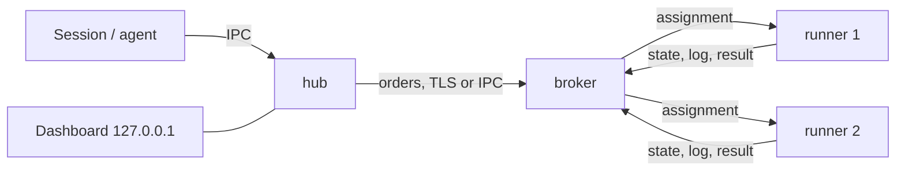

# Al.LocalRunner

**English** | [Русский](README.ru.md)

A resource-aware job queue for a developer and their AI agents. Heavy tasks (tests, builds, lint, deploys, migrations) go into one queue and run one at a time on a suitable machine, within its memory and cores, instead of agents fighting over CPU, memory, emulators and caches. One machine or many, on one network or several. Works on Windows, Linux and macOS. One binary, `localrunner`, plays every role.

The core knows no language and no toolchain. What to run and what it needs is described by a profile in the project's own `.localrunner/profiles.toml`. The full design, formats and requirements: [`docs/architecture.en.html`](docs/architecture.en.html) ([Russian](docs/architecture.html)).

## Contents

- [How it works](#how-it-works)
- [Quick start with an AI agent](#quick-start-with-an-ai-agent)
- [Quick start by hand (one machine)](#quick-start-by-hand-one-machine)
- [Installation](#installation)
- [Hub](#hub)
- [Broker](#broker)
- [Runner](#runner)
- [Several machines](#several-machines)
- [Docker Compose](#docker-compose)
- [Project profiles](#project-profiles)
- [Logging](#logging)
- [Autostart, stop, update, uninstall](#autostart-stop-update-uninstall)
- [Troubleshooting](#troubleshooting)
- [Security](#security)
- [Plugin details](#plugin-details)
- [Usage](#usage)
- [Releasing](#releasing)
- [License](#license)

## How it works

A session or an agent submits a task through the CLI. The task becomes an order and goes to the broker, which holds the queue and hands orders to runners that fit by memory, cores, programs and tags. The runner executes it and returns the result and the log. One binary plays three roles:

| Node | What it does | Where it runs | Configuration |
|---|---|---|---|
| hub | takes CLI commands, turns a profile into an order, sends it to a broker, keeps a copy of the logs, shows the dashboard | on the machine you submit from; one per OS user | `hub-policy.toml`, `logging.toml` |
| broker | holds the queue, picks a runner, keeps history and member keys | on one machine of the pool | `policy.toml`, `logging.toml` |
| runner | executes jobs, one at a time | on the machine that has the tools | `runner.toml`, `logging.toml` |



For several machines, install the broker first, then join the hub and the runners to it (see [Several machines](#several-machines)).

## Quick start with an AI agent

The simplest way: connect the plugin and ask the agent. The plugin gives the agent skills to install, start and use the queue.

Claude Code:

```
claude plugin marketplace add alexpantiukhin/Al.LocalRunner
claude plugin install localrunner@al-localrunner
```

Codex:

```
codex plugin marketplace add alexpantiukhin/Al.LocalRunner
codex plugin add localrunner@al-localrunner
```

Restart the agent session, then ask in plain words:

| Say | Skill | What it does |
|---|---|---|
| "install the runner" | `install-runner` | gets the binary from a release, runs `init` and `doctor` |
| "update localrunner" | `upgrade-runner` | takes the new version from a signed release and replaces the binary with `upgrade`, restarting the roles |
| "start the runners" | `up-runner` | starts the hub, the broker and the runners |
| "run the tests through the runner" | `run` | puts the task into the queue and reads the result |
| "show the queue" | `status-runner` | queue, jobs, runners, history, dashboard |
| "stop the runners", "turn autostart on" | `down-runner`, `autostart-runner` | stop the roles, switch autostart |

The skills never raise rights on their own and never print join codes or tokens. Until the first regular release exists, use a pre-release or a source build (see below). Scopes, removal and Codex limits: [Plugin details](#plugin-details).

## Quick start by hand (one machine)

1. Install the binary. Take the script from a release, not from a branch (the repository copy holds the placeholder `@RELEASE_PUBKEY@` and refuses to install). Linux and macOS:

   ```
   curl -fsSL https://github.com/alexpantiukhin/Al.LocalRunner/releases/latest/download/install.sh | sh -s -- --role all
   ```

   Windows (PowerShell, as an ordinary user; the script takes parameters only as a file):

   ```
   Invoke-WebRequest https://github.com/alexpantiukhin/Al.LocalRunner/releases/latest/download/install.ps1 -OutFile install.ps1
   powershell -ExecutionPolicy Bypass -File .\install.ps1 --role all
   ```

   Or from source: `cargo build --release`, then `target/release/localrunner install`. The installer itself creates the configuration templates (`init`) and runs `doctor`. Details and options: [Installation](#installation).

2. Start and check:

   ```
   localrunner up        # broker, hub and runner as background processes
   localrunner status    # the queue and the pool: memory and cores
   localrunner runners   # your runner is `online`
   ```

   If `localrunner runners` prints `broker <name> unreachable since <time>`, the broker is not running or not reachable: the hub and the runners reconnect by themselves with a growing pause (1 to 30 s, no limit on attempts). `localrunner up` and `localrunner doctor` name a hub or runner that is alive but not connected to the broker.

3. Describe a task. A profile lives in `.localrunner/profiles.toml` of a project; in any empty folder create it with:

   ```toml
   [profile.hello]
   command   = "echo hello from localrunner"   # on Windows: "cmd /c echo hello from localrunner"
   timeout_s = 60
   ```

4. Run it, look at the result, stop everything:

   ```
   localrunner run hello --as me:test   # submit, show the output, return the exit code
   localrunner history                  # the record of the run
   localrunner dashboard                # live page on 127.0.0.1, Ctrl+C stops it
   localrunner down                     # the runner finishes the current job, then everything stops
   ```

## Installation

### Release scripts

Copies with the release public key built in are attached to every release (https://github.com/alexpantiukhin/Al.LocalRunner/releases); take the script from there, not from a branch. The role is set by `--role hub|broker|runner|all` (default `all`). Other parameters: `--version X.Y.Z`, `--dir DIR`, `--offline ARCHIVE`, `--allow-elevated`, `--upgrade` (update an installed copy, see "Update"); `--help` lists them. `latest` does not point to a pre-release: use the tag and the version, for example `.../releases/download/v0.1.0-rc1/install.sh` and `--version 0.1.0-rc1`. The script checks the signature of `SHA256SUMS` and the SHA-256 of the archive and installs nothing on any mismatch. While there is no regular release, build from source or use the pre-release link.

### From source

You need Rust; the version is set in `rust-toolchain.toml`. `cargo build --release` gives `target/release/localrunner` (`localrunner.exe` on Windows). Put it into the user's directory and prepare the node:

```
target/release/localrunner install --dry-run   # show the actions
target/release/localrunner install             # copy the binary, extend PATH, run init
```

Check the node with `localrunner doctor`. `install` starts no roles and enables no autostart. It refuses to run as root or administrator without `--allow-elevated`. Repeat the installation on every machine.

### Files of a node

| What | Windows | Linux, macOS |
|---|---|---|
| binary | `%LOCALAPPDATA%\Programs\Al.LocalRunner` | `~/.local/bin` |
| state and configuration of hub and runner | `%LOCALAPPDATA%\Al.LocalRunner` | `~/.local/share/al-localrunner` |
| state of the broker service | `%ProgramData%\Al.LocalRunner` | `/var/lib/al-localrunner` (Linux), `/Library/Application Support/Al.LocalRunner` (macOS) |

The directories can be replaced: `--state-dir` and `--config-dir`, or the variables `LOCALRUNNER_STATE_DIR` and `LOCALRUNNER_CONFIG_DIR`. `localrunner init [--role hub|broker|runner|all]` creates the state directory and the configuration templates. It never overwrites existing files.

## Hub

Needed on every machine you submit runs from. One hub per OS user.

Install and start:

```
localrunner install --role hub   # the binary and the hub templates (init)
localrunner up hub               # or: localrunner hub run (in the foreground)
```

If the broker is on another machine, the hub joins the pool (the broker issues the code, see [Broker](#broker)):

```
localrunner hub join <host:port> --code-file code.txt --name office
localrunner brokers         # check: the broker is listed, its zone, availability
```

The code can be passed as `--code-file file`, `--code-file -` (standard input), the variable `LOCALRUNNER_JOIN_CODE`, or a command-line argument. The last way shows the code to other users of the machine.

Configuration: `hub-policy.toml` in the configuration directory. It decides which broker gets an order:

```toml
[brokers]
order             = ["win-host", "linux-box"]   # names from hub join, in order
strategy          = "first"                     # first | least_loaded
broker_zone_order = ["local", "lan", "remote"]
query_timeout_s   = 3
query_attempts    = 3
zone_query        = "sequential"                # sequential | all
query_retry_s     = 5

[outbox]
ttl_hours = 24                                  # how long an order waits for a broker
on_expire = "fail"                              # fail | keep
```

Without the file the defaults apply. "Same machine" orders (a working tree) go only to a broker on that machine. On the broker's machine the hub does not join by code: the broker lets local users in by the `[[local_user]]` list in `policy.toml` (`install` adds you). Commands for working with jobs: see [Usage](#usage).

## Broker

One per pool. Holds the queue, member keys and history. Executes nothing itself.

Start on a user's machine:

```
localrunner install --role broker
localrunner up broker       # or: localrunner broker run
```

Start as an OS service (a dedicated machine, several users). Administrator rights are needed. The service runs under its own account, never root or SYSTEM:

```
localrunner broker install-service --dry-run
localrunner broker install-service
```

Remove the service with `localrunner autostart off broker` or `uninstall`. `down` does not stop the service: use the OS service manager. `up` does not start it. Configuration: `policy.toml` in the broker's state directory. Without the file the defaults apply. Main tables:

| Table | Purpose |
|---|---|
| `[listen]` | the address the broker listens on. Without it the network is not listened to. Wildcard addresses (`0.0.0.0`, `::`) are rejected. In a container: `address = "container"` |
| `[networks]` | named networks; the hub's zone (`lan` or `remote`) depends on them |
| `[[local_user]]` | who may use local IPC: `name`, `label` |
| `[queue]` | `strategy` = `priority-fifo`, `fair-share`, `weighted`; `age_after_min` |
| `[[rule]]` | priority, reserve, quota, weight by the `when` condition (the first matching rule for each field) |
| `[pool]` | `mem_mb`, `cpu`, `exclusive_tags`; by default all memory and cores of the broker machine |
| `[limits]` | `max_job_timeout_s`, `timeout_above_max` (`reject` or `trim`), `job_log_max_mb`, `max_active_per_client`, `api_requests_per_min` (1200) |
| `[resources]` | limits of a job by its declared `mem_mb` and `disk_mb`: `mode` = `off`, `warn` (default), `kill`; `mem_headroom`, `disk_headroom` (factor, default 1.25). See [Resource limits](#resource-limits-cleanup-and-foreign-load) |
| `[admission]` | `foreign_load` = `off` (default) or `wait`: wait while foreign processes load the runner machine; `mem_headroom_mb` (256) |
| `[commands]` | `default = "any"` or `"named"`; `[[commands.client]]` for single keys or labels |
| `[visibility]` | `others_orders` = `none`, `summary`, `full`: what other clients see |
| `[cancel]` | `others = "none"` or `"owner"`: who cancels other clients' orders |
| `[join]` | `code_ttl_min`: lifetime of a join code (60) |
| `[orphans]`, `[grace]`, `[results]` | what to do with orders of a vanished hub, the grace period for a lost runner (`lost_min`), result retention |
| `[history]`, `[saturation]`, `[cache]`, `[services]` | history retention, saturation thresholds, shared cache, runner services |
| `[[secrets.allow]]` | which label may ask for which secrets |

Example:

```toml
[listen]
address = "192.168.1.10:7443"

[[local_user]]
name  = "alex"
label = ""

[[rule]]
name     = "ci-first"
when     = { client_label = "ci" }
priority = 100
```

Rules with a condition on declared attributes (`source`, `project`, `tag`, `submitter_label`, `min_mem_mb`) are allowed only together with a `client_label` condition. Unknown tables and keys are rejected with a line number.

Commands:

```
localrunner policy check [file]   # check without applying
localrunner policy reload         # apply; only on the broker machine. [listen] and [networks] need a restart
localrunner logging reload        # reread logging.toml in every running role
```

Joining members:

```
localrunner broker add --name office --label dev              # for a hub: prints the address, the code and the certificate fingerprint
localrunner broker add --runners 2 --address 192.168.1.10:7443  # for runners: a code for 2 joins
localrunner broker add --runners 1 --code-file code.txt         # write the code to a new file instead of printing it
localrunner runner list
localrunner runner remove <name> [--yes]   # remove a runner and revoke its key
localrunner client list
localrunner client remove <name> [--yes]   # revoke a hub's key
```

`broker add` uses the broker's admin channel: on a broker installed as a Windows service it needs an administrator, on Unix the OS user of the broker. `runner join` and `hub join` refuse to run as an administrator, so the code has to cross between two users: run `broker add --code-file <file>` as the administrator (the file must not exist yet), then `runner join <address> --code-file <file>` as the regular user, and delete the file. The code never appears on the screen; the address, the fingerprint and the expiry are printed as usual.

A code is valid for 1 hour and for the given number of joins. The address with the port must be reachable by the member. The certificate fingerprint is part of the code, so there is nothing to compare by hand. `runner remove` and `client remove` ask for confirmation; without a terminal (scripts, agents) they need `--yes`.

## Runner

Executes jobs, one at a time, with the resources declared in `runner.toml`.

Install and start on the broker's machine:

```
localrunner install --role runner
# edit runner.toml (see below)
localrunner up runner
```

A runner on another machine:

```
localrunner install --role runner
# edit runner.toml
localrunner runner join <host:port> --code-file code.txt --name box --count 2
localrunner up runner
```

`--count N` (1 to 64) creates runners `box-1` … `box-N` from one `runner.toml` template; each has its own directory, key and record on the broker. `--name` wins over `name` in the file; with neither, the machine name is used.

`runner join` copies the template into `runner/<name>/runner.toml`, and that copy wins: later edits of the template do not reach a joined runner, while a runner that never joined reads the template. `localrunner runner config <name>` shows the file a runner reads and its path; `--diff` shows the lines in which the own copy differs from the template.

Configuration: `runner.toml`. `[env] path` is mandatory: it is the job's `PATH` and the place where programs are looked up. A runner without it does not start, and the runner process's `PATH` is not passed to jobs. Autostart and services give a poor environment, so set the paths explicitly.

A job gets only these variables: `PATH` (from `[env] path`), `HOME` (from the runner process), `TEMP`, `TMP` and `TMPDIR` (a private directory of the job), `LOCALRUNNER_JOB_ID`, `LOCALRUNNER_CACHE_<NAME>`, the secrets it asked for and everything in `[job_env]`; on Windows also `SystemRoot`, `windir`, `ComSpec`, `PATHEXT`. Nothing else of the runner's environment is inherited. Any other variable the jobs need (`JAVA_HOME`, `CARGO_HOME`, `ANDROID_NDK_HOME`) is written in `[job_env]` as `NAME = "value"`; `HOME` written there replaces the detected one. A native build on Windows may need more than the list above: Rust with the MSVC toolchain finds the linker through `vswhere`, which reads `ProgramFiles(x86)`; if a job fails with `linker link.exe not found` although the tools are installed, write `"ProgramFiles(x86)"`, `ProgramFiles` and `ProgramData` in `[job_env]`. `init` and `runner join` write the `HOME` of the shell they run in into `[job_env]`, so you see it in the file; a runner whose file has no `HOME` takes the home directory of the OS user that runs it, so jobs on different runners may see different settings in it (`.npmrc`, `.gitconfig`); to make them the same, set `HOME` in `[job_env]` to a directory of your own. `PATH` (use `[env] path`), `TEMP`, `TMP`, `TMPDIR` and names starting with `LOCALRUNNER_` are refused. A key that is not a setting of `runner.toml` (a variable written under `[env]`, for example) is a warning at start and in `doctor`. The `[programs]` checks run in exactly the same environment, and each check may take `check_timeout_s` seconds (default 10): a program that starts slowly, such as `pnpm` through `corepack` on a cold cache, needs a larger value or a `HOME` where its cache lives.

```toml
name      = "linux-heavy"
platforms = ["linux", "android"]
tags      = ["gradle", "emulator"]
mem_mb    = 16384              # optional: all host memory
cpu       = 8                  # optional: all host cores
allow_elevated = false         # run as root or administrator
allow_same_user_as_broker = false

[env]
path = "/usr/local/bin:/usr/bin:/bin"

[programs]                     # what to look for on the runner and how to check it
git    = {}
gradle = { check = "gradle --version" }
[accept]
min_mem_mb = 8192              # a reserve for heavy orders

[limits]
max_job_timeout_s = 3600       # ceiling of a job's timeout on this runner
enforce       = "kill"        # optional: off | warn | kill; replaces the broker's mode
mem_headroom  = 1.25          # optional: factor of the declared mem_mb (1.0 to 100.0)
disk_headroom = 1.5           # optional: factor of the declared disk_mb (1.0 to 100.0)

[cache]
max_size_gb    = 40
retention_days = 14
evict          = "lru"

[workspace]
max_size_gb    = 20
retention_days = 7

[commands]                     # names for clients with mode = "named"
build = "make all"

[job_env]                     # extra variables for every job, service and cleanup hook
JAVA_HOME = "/opt/jdk"
GRADLE_OPTS = "-Dorg.gradle.daemon=false"

[[cleanup]]                    # a command run after every job
name      = "labelled-containers"
command   = "sh -c 'docker rm -f $(docker ps -aq --filter label=$LOCALRUNNER_JOB_LABEL)'"
timeout_s = 60                 # 1 to 3600, default 60
on        = ["passed", "failed", "killed", "cancelled", "timeout"]   # default: all
```

Runner services (a build daemon, an emulator) are described in `[service.<name>]`: `start`, `ready_check`, `stop`, `ready_timeout_s`, `memory_mb`, `lifetime` (`per_job`, `idle`, `keep`), `idle_timeout_s`, `max_lifetime_s` (mandatory), `reuse`. The format is in section 3.11 of the architecture document.

### Resource limits, cleanup and foreign load

The `cpu`, `mem_mb` and `disk_mb` of a profile limit the job itself by default in the `warn` mode: the runner records the peaks of every job, writes a warning to the job log when the `mem_mb` or `disk_mb` ceiling is exceeded, caps the CPU share to the declared `cpu` and limits the process count; nothing is killed unless `kill` is chosen. Turn it off with `[resources] mode = "off"` or `[limits] enforce = "off"`. This default changes the behaviour of existing installations. Peaks are recorded in any mode (`peak_mem_mb`, `peak_disk_mb`): see the `PEAK_MEM_MB` and `PEAK_DISK_MB` columns of `history`, and `history show`, `jobs`, `explain`, `status --json` and the dashboard. A dash in a peak column means "not measured" (a job without a declared `disk_mb` and without directories to measure has no disk peak), while `0` means measured and empty. A job that starts a container (`docker run ...`) is measured by its own process tree only: the memory used inside the Docker VM or the container is not part of the peak, so the peak of such a job is small and its declared `mem_mb` cannot be compared with it.

An order the broker refuses at intake (more than the pool can ever give, a name no runner list has, a secret not allowed for the label) is recorded: `history` shows it with the state `rejected` and `history show` gives the reason; `history --result rejected` lists only these. The dashboard shows the same state.

- **Modes.** Broker `policy.toml` `[resources] mode` or the runner's `[limits] enforce` (the runner owner's value wins): `off` (explicit) limits nothing and records peaks only, `warn` (the default) writes a warning line to the job log, `kill` ends the whole process tree and the job fails with the reason `resource_exceeded` and the text `превышен заявленный mem_mb: заявлено X МБ, пик Y МБ`. Turn `kill` on after a history of peaks has accumulated.
- **Ceilings** (only when the mode is not `off`): memory is the declared `mem_mb` times `mem_headroom`, disk is `disk_mb` times `disk_headroom` (a factor from 1.0 to 100.0, default 1.25). CPU is the declared `cpu` cores of CPU time: a share, not pinning to cores, a hard cap, never a reason to kill. The process count is limited to `max(512, cpu * 256)`. A job that exits with code 0 while its peak was above the ceiling stays passed.
- **Mechanisms.** Windows: a Job Object (memory, CPU rate cap, process limit). Linux: a cgroup v2 scope through `systemd-run` (`MemoryMax`, `CPUQuota`, `TasksMax`) when the controllers are delegated to the user. Otherwise, and always on macOS, a user-space watcher samples the process tree about every 250 ms and kills it above the ceiling; CPU is lowered with the process priority (`nice`), and the process count limit does not apply. The watcher measures RSS on Unix, so the figures are approximate there (on Windows it is the commit). The runner reports `enforcement = os` or `watcher` (see `runners` and the dashboard).
- **Disk.** A watcher sums the files in the job's working directory and in its private temporary directory `<runner state dir>/tmp/lr-<job-id>` about every 2 seconds (symbolic links are not followed; the shared system temp is not measured). `TEMP`, `TMP` and `TMPDIR` of every job point to that directory, which is always used, created before the first step and removed after the job (also after kill or cancel; up to 8 attempts 250 ms apart, since on Windows files of a just-killed process are briefly locked); after a runner crash everything under `<state dir>/tmp` is removed when the runner starts. This changes where jobs write temporary files. Before a job starts the runner checks the free space of the working volume against `disk_mb` times the factor.
- **Cleanup.** `[[cleanup]]` commands run after every job outcome (`on` defaults to all of `passed`, `failed`, `killed`, `cancelled`, `timeout`) with the environment `LOCALRUNNER_JOB_ID` and `LOCALRUNNER_JOB_LABEL` (`lr-<job id>`). A hook failure never changes the job result: a warning goes to the job log and the diagnostics. A job cut short by a runner crash or restart gets its hooks once, at the next start, as `killed` (before its result `runner_restarted` is sent), so a hook must be idempotent. Hooks do not run for orders rejected at intake. What to clean (labelled containers, build daemons) is up to the owner's command; the core knows no tools.
- **`[job_env]`** adds variables to every job and hook; `PATH`, `TEMP`, `TMP`, `TMPDIR` and `LOCALRUNNER_*` are forbidden; `HOME` is allowed. `LOCALRUNNER_JOB_LABEL` reaches the job environment only if at least one `[[cleanup]]` exists.
- **Foreign load.** Runners send the free memory and CPU load of their machine with the heartbeat. With `[admission] foreign_load = "wait"` an order waits while foreign processes leave too little (`занято чужими процессами: CPU 95%, нужно 4 ядер`, visible in `status` and `explain`); running jobs are never paused. The CPU of the broker's own jobs on the same machine is not counted as foreign. macOS reads `vm_stat` and `ps`. Runners that send no load (older ones) are admitted as before.
- **Not in this version:** disk I/O limits, core pinning, pausing running jobs, a Docker socket proxy, OS disk quotas.

The database `broker.db` moves to schema 2 on the first start (a copy `broker.db.bak-1` is kept). The two new `history` columns stand before `BROKER`: shift column numbers in scripts. The details are in section 3.14 of the architecture document.

`localrunner doctor` warns when a runner registered with a broker runs another version than this binary (`runners` marks the same mismatch); upgrade such a machine with `localrunner upgrade`.

Permissions:

- A runner executes commands from orders and runs as the user who started it. For other people's clients, create a separate restricted OS user.
- A runner refuses to start as root, administrator or SYSTEM without `allow_elevated = true`.
- If the broker is not a service, admits other clients (`[listen]` or a foreign `[[local_user]]`) and lets them run any command, a runner under the same OS user will not start. Options: run the runner under another user, run the broker as an OS service, set `[commands] default = "named"` in `policy.toml`, or set `allow_same_user_as_broker = true` in `runner.toml` (you accept the risk).

## Several machines

Order: the broker first, then the rest.

1. Broker machine. `install --role broker`, set `[listen]` and `[networks]` in `policy.toml`, start it (`broker install-service` for permanent operation).
2. For each client machine: on the broker `broker add --name <name> --label <label>`; on the client `install --role hub`, `hub join <host:port> --code-file code.txt --name <broker name>`, `up hub`.
3. For each machine with runners: on the broker `broker add --runners N --address <host:port>`; on the machine `install --role runner`, edit `runner.toml`, `runner join ...`, `up runner`.
4. Check: `localrunner doctor`, `localrunner runners`, `localrunner brokers`.

Only the broker needs an incoming port. There is no automatic broker discovery on the network; enter the address by hand.

## Docker Compose

Files: `install/Dockerfile`, `install/compose.yaml`, `install/policy.toml`, `install/runner.toml`. The image holds only the binary and does not run as root. Every release publishes the image `ghcr.io/alexpantiukhin/al-localrunner:<version>` and attaches a `compose.yaml` that uses it. Add the project's tools to your own image `FROM al-localrunner:<version>`. Always give the image tag explicitly.

Updating Linux runners in Docker: take the new release image as the base of your own image (`FROM ghcr.io/alexpantiukhin/al-localrunner:<new version>` followed by your toolchain), change the tag in your `compose.yaml`, then `docker compose build` and `docker compose up -d`. The state volume keeps the runner key and the join record, so nothing is joined again. Check the result with `localrunner runners`: every runner shows the version it registered with (`version 0.2.0`, with the version of this binary beside it when they differ; also in `--json` and on the dashboard), a runner that has not registered since the update shows `version unknown`.

A custom image must create these directories and give them to the user the process runs as (the official image uses `65532:65532`): `/var/lib/al-localrunner` (state, `LOCALRUNNER_STATE_DIR`), `/etc/al-localrunner` (configuration, `LOCALRUNNER_CONFIG_DIR`), `/run/al-localrunner` (Unix sockets). Without them the process stops with `cannot create /run/al-localrunner: Permission denied`.

```
docker compose -f install/compose.yaml up -d broker
docker compose -f install/compose.yaml exec broker localrunner broker add --runners 1 --address broker:7443
docker compose -f install/compose.yaml run --rm runner localrunner runner join broker:7443 <code>
docker compose -f install/compose.yaml up -d runner
```

Policy: edit `install/policy.toml`, then `docker compose exec broker localrunner policy reload`. The broker port is published on `127.0.0.1:7443`; for other machines replace the address with the host interface. A runner in a container does not see host files and takes only orders with a commit.

## Project profiles

`.localrunner/profiles.toml` in the project's repository:

```toml
[profile.rust-unit]
command   = "cargo test --workspace"
timeout_s = 900                     # mandatory
mem_mb    = 4096
cpu       = 4
tags      = ["cargo"]

[profile.rust-gate]
timeout_s = 1800
steps = [
  { name = "fmt",  command = "cargo fmt --all --check", timeout_s = 120 },
  { name = "test", command = "cargo test --workspace",  timeout_s = 900, mem_mb = 8192 },
]
```

A profile has either `command` or `steps`. A failed step stops the job; `continue_on_failure = true` lets it go on. `exclusive` lists tags held by one job at a time. `cache` names runner caches. The other fields are described in sections 4 and 5 of the architecture document.

**Working tree or commit.** An order without `--platform` runs in the live working directory of the client, not on a snapshot: any edit of the files while the job runs reaches it (a `bash` script edited under a running job fails with a `syntax error` that the file does not contain). Only an order for a commit (`--platform`) is isolated from such edits. Do not touch the files of a long run in progress; the dashboard card says where the code comes from (`Directory` for the working tree, `Commit` for a commit).

## Logging

`logging.toml` in the state directory of each role. Without the file a rotated JSON file is written. Apply without a restart: `localrunner logging reload`.

```toml
[logging]
level = "info"

[[sink]]
kind       = "file"
path       = "logs/daemon.log"
rotate_mb  = 50
keep_days  = 14
keep_files = 10

[[sink]]
kind = "console"       # foreground only
```

The `otlp` sink (`endpoint`, `ca_file`, `enabled`) is off by default: it is the only thing that can send data away from the machine. Secret values, join codes and tokens are masked in logs and output.

## Autostart, stop, update, uninstall

```
localrunner autostart on [hub|broker|runner|all] [--dry-run]
localrunner autostart on runner <name>
localrunner autostart off [...]
localrunner down [names] [--drain | --cancel [--yes]]
localrunner uninstall [--purge] [--yes] [--dry-run]
```

- Autostart is off by default. It runs as the user who enabled it: a scheduler task on Windows, a systemd user unit on Linux, a LaunchAgent on macOS. `autostart on broker` is the same as `broker install-service` and needs administrator rights (sudo). `autostart on` for several roles (`all`, or none named) does the user part without them and prints what is left for an administrator; `--dry-run` marks the steps that need those rights.
- `down` by default (`--drain`) waits for current jobs; `--cancel` cancels them and waits for the runners no longer than 30 seconds. The broker stops after the runners. `--cancel` (like `cancel --mine`) asks for confirmation; without a terminal (scripts, agents) it needs `--yes`.
- Update: `install.sh --upgrade` (or `install.ps1 --upgrade`; add `--version X.Y.Z` for a version other than the latest). The script checks the signature as for the installation, then runs `localrunner upgrade` of the downloaded binary: it prints the installed and the new version and the running jobs and waiting orders, asks (with running jobs: wait for them to finish, cancel them, or abort), stops the runners first (they finish their jobs, or with `--cancel` cancel them and exit within 30 s), then the hub and a broker started by hand, copies itself over the installed binary and starts the same roles again from it. `upgrade --dry-run` shows the plan (`install.sh|ps1 --upgrade` passes `--yes`, `--cancel` and `--dry-run` through, so an agent or a CI job can finish the update without a terminal); `--yes` skips the question and, with running jobs, waits for them (`--yes --cancel` cancels them); Ctrl+C while waiting replaces nothing and leaves the hub and the broker running; an older binary is refused. The same by hand: `down`, replace the binary, `up`. Database schemas are upgraded at start with a backup; rolling back to an older version is not supported. When the major protocol version changes, upgrade the broker, the hubs and the runners of other machines in the same window; every machine is upgraded the same way, one by one. The broker as an OS service keeps its own copy of the binary (Windows: `%ProgramFiles%\Al.LocalRunner\localrunner.exe`; Linux and macOS: `/usr/local/libexec/al-localrunner/localrunner`), and `upgrade` does not touch it. With administrator rights run `localrunner broker update-service` from the new binary (`--dry-run` shows the plan): it stops the service, copies the binary over that file and starts the service; the registration, the state and the keys stay. By hand the same is: stop the service (`AlLocalRunnerBroker` on Windows, `al-localrunner-broker` on Linux), copy the new binary over that file, start the service.
- `uninstall` stops the roles and removes autostart, the service, the binary and the PATH entry. Keys and history stay; `--purge` removes the state too, after confirmation.

## Troubleshooting

| Problem | What to do |
|---|---|
| unclear what is wrong with a node | `localrunner doctor` (`--json`; code 1 if there is a `fail`) |
| an order does not start | `localrunner explain <job>`: the reason and the rule that fired |
| no suitable runner | the answer names the difference between the order and the runners; `localrunner runners` |
| a setting in `runner.toml` has no effect | a misspelled key or section is not an error: it is printed as a warning at start and by `localrunner doctor` |
| a runner does not start | the message names the reason: no `[env] path`, run as root, runner under the broker's user |
| the hub does not see the broker | `localrunner brokers`; check `[listen]`, `[networks]` and the port |
| `broker add`: "admin channel is not reachable ... access denied" | run it as an administrator (Windows service) or as the broker's OS user; hand the code over with `--code-file` |
| the join code is rejected | it lives 1 hour and has a limited number of joins; issue a new one with `broker add` |

## Security

- The dashboard listens only on `127.0.0.1` and `::1`.
- A member joins by a one-time code; the broker's certificate is pinned by the fingerprint from the code. After that a revocable member key works: `client remove`, `runner remove`.
- The broker never runs under a privileged account.
- Only whoever sits at the broker machine edits the policy; `policy reload` is accepted only over the local channel.
- `status --html` does not include logs without `--with-logs`.

## Plugin details

The plugin in `plugin/` wraps the commands into skills. The same `al-localrunner` plugin is described for both agents: `.claude-plugin/marketplace.json` for Claude Code, `.agents/plugins/marketplace.json` for Codex. The plugin only calls the `localrunner` binary.

### Claude Code

The installation scope is set by `--scope`:

| Scope | Where it is written | Who gets it |
|---|---|---|
| `project` | `.claude/settings.json` of the repository | everyone who works with this repository (the file is committed) |
| `local` | local repository settings, not committed | only you and only in this repository |
| `user` (default) | user settings | you, in every project |

From a local copy of the repository, give the path to the directory that holds `.claude-plugin/` instead of `alexpantiukhin/Al.LocalRunner`. Removal:

```
claude plugin uninstall localrunner@al-localrunner --scope <scope>
claude plugin marketplace remove al-localrunner --scope <scope>
```

### Codex

Codex has no installation scopes: plugins and marketplaces are written to the user's `~/.codex/config.toml` and apply in every project. Project-level installation is not possible. The marketplace takes the plugin from the `main` branch. Check with `codex plugin list`. Removal:

```
codex plugin remove localrunner@al-localrunner
codex plugin marketplace remove al-localrunner
```

## Usage

Order of a typical session:

1. Put the task in the queue: `localrunner run [profile] --as label` (waits and returns the exit code) or `submit` (returns the job id at once). Profiles come from [`.localrunner/profiles.toml`](#project-profiles).
2. Follow it: `wait <job>` or `log <job> -f`.
3. If it waits: `explain <job>` says why; `status` shows the whole queue.
4. If the result no longer matters: `cancel <job> --as label` or `cancel --mine --as label [--yes]`.
5. Afterwards: `history`, `stats`, `dashboard`.

All commands:

| Command | Action |
|---|---|
| `submit [profile] --as label` | submit an order, print the id, return at once |
| `run [profile] --as label` | the same, but show the output and return the exit code |
| `wait <job>` | follow a job; interrupting cancels nothing |
| `log <job> [--step name] [--tail N] [-f]` | the job log |
| `cancel <job> --as label`, `cancel --mine --as label [--yes]` | cancel |
| `jobs --mine [--active] [--as label]` | your jobs |
| `status`, `explain <job>` | the queue; why an order waits |
| `profile check [profile] [--label L]` | before a run: for every secret of the profiles, the job variable it becomes, whether the policy lets the label request it (the label of your `[[local_user]]` entry, not `--as`), whether a runner of this machine has a source for it; exit 1 if something would stop a run |
| `history [--all]`, `history show <job>` | history |
| `stats`, `runners`, `brokers` | statistics, runners, brokers |
| `dashboard` | a page on 127.0.0.1 |

Flags of `submit` and `run`: `--note`, `--platform`, `--timeout <s>` (only lowers the profile timeout), `--mem 6144|512m|6g`, `--cpu <cores>` (replace the profile values for one run), `--arg name=value` (fills an argument the profile declares; repeatable), `--detach` (the order outlives the sending process). `--as` is required; inside GitHub Actions it defaults to `github:<workflow>/<job>`. Read commands accept `--json`.

## Releasing

1. Put one version `X.Y.Z` everywhere: `version` of every `crates/*/Cargo.toml`, `image: al-localrunner:X.Y.Z` in `install/compose.yaml`, `version` of `plugin/.claude-plugin/plugin.json` and `plugin/.codex-plugin/plugin.json`. Run `cargo build` so `Cargo.lock` follows (CI and the release build use `--locked`). A pre-release carries the suffix in all of them, for example `0.2.0-rc1`.
2. Open a pull request and wait for `ci-ok`: it is required for `main`, nothing is merged before it passes.
3. Tag the merge commit `vX.Y.Z` and push the tag. The `release` workflow builds the archives for five platforms and fails when `localrunner --version` differs from the tag, then (environment `release`, which may wait for approval) signs `SHA256SUMS` with the release key and publishes the archives with `install.sh` and `install.ps1`. `latest` does not point to a pre-release.
4. Check the release on one machine with `install.sh --upgrade --version X.Y.Z` (or `install.ps1`), then `localrunner doctor`. The broker OS service keeps its own copy of the binary and is updated by hand (see "Autostart, stop, update, uninstall"); other machines follow one by one, the broker first unless the major protocol version changes.
5. A plugin update reaches users only with a new plugin `version`: change the plugin files only together with a version bump.

## License

GPL-3.0-or-later: see [LICENSE](LICENSE). Additional terms (keep the author attribution in copies and documentation): [NOTICE](NOTICE).
