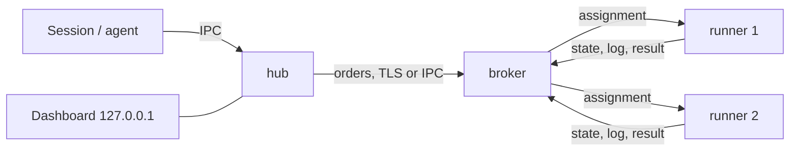

# Al.LocalRunner

**English** | [Русский](README.ru.md)

A resource-aware job queue for a developer and their AI agents. Heavy tasks (tests, builds, lint, deploys, migrations) go into one queue and run one at a time on a suitable machine, within its memory and cores, instead of agents fighting over CPU, memory, emulators and caches. One machine or many, on one network or several. Works on Windows, Linux and macOS. One binary, `localrunner`, plays every role.

The core knows no language and no toolchain. What to run and what it needs is described by a profile in the project's own `.localrunner/profiles.toml`. The full design, formats and requirements: [`docs/architecture.en.html`](docs/architecture.en.html) ([Russian](docs/architecture.html)).

## Contents

- [How it works](#how-it-works)
- [Quick start with an AI agent](#quick-start-with-an-ai-agent)
- [Quick start by hand (one machine)](#quick-start-by-hand-one-machine)
- [Installation](#installation)
- [Hub](#hub)
- [Broker](#broker)
- [Runner](#runner)
- [Several machines](#several-machines)
- [Docker Compose](#docker-compose)
- [Project profiles](#project-profiles)
- [Logging](#logging)
- [Autostart, stop, update, uninstall](#autostart-stop-update-uninstall)
- [Troubleshooting](#troubleshooting)
- [Security](#security)
- [Plugin details](#plugin-details)
- [Usage](#usage)
- [License](#license)

## How it works

A session or an agent submits a task through the CLI. The task becomes an order and goes to the broker, which holds the queue and hands orders to runners that fit by memory, cores, programs and tags. The runner executes it and returns the result and the log. One binary plays three roles:

| Node | What it does | Where it runs | Configuration |
|---|---|---|---|
| hub | takes CLI commands, turns a profile into an order, sends it to a broker, keeps a copy of the logs, shows the dashboard | on the machine you submit from; one per OS user | `hub-policy.toml`, `logging.toml` |
| broker | holds the queue, picks a runner, keeps history and member keys | on one machine of the pool | `policy.toml`, `logging.toml` |
| runner | executes jobs, one at a time | on the machine that has the tools | `runner.toml`, `logging.toml` |



For several machines, install the broker first, then join the hub and the runners to it (see [Several machines](#several-machines)).

## Quick start with an AI agent

The simplest way: connect the plugin and ask the agent. The plugin gives the agent skills to install, start and use the queue.

Claude Code:

```
claude plugin marketplace add alexpantiukhin/Al.LocalRunner
claude plugin install al-localrunner@al-localrunner
```

Codex:

```
codex plugin marketplace add alexpantiukhin/Al.LocalRunner
codex plugin add al-localrunner@al-localrunner
```

Restart the agent session, then ask in plain words:

| Say | Skill | What it does |
|---|---|---|
| "install the runner" | `install-runner` | gets the binary from a release, runs `init` and `doctor` |
| "start the runners" | `up-runner` | starts the hub, the broker and the runners |
| "run the tests through the runner" | `run` | puts the task into the queue and reads the result |
| "show the queue" | `status-runner` | queue, jobs, runners, history, dashboard |
| "stop the runners", "turn autostart on" | `down-runner`, `autostart-runner` | stop the roles, switch autostart |

The skills never raise rights on their own and never print join codes or tokens. Until the first regular release exists, use a pre-release or a source build (see below). Scopes, removal and Codex limits: [Plugin details](#plugin-details).

## Quick start by hand (one machine)

1. Install the binary. Take the script from a release, not from a branch (the repository copy holds the placeholder `@RELEASE_PUBKEY@` and refuses to install). Linux and macOS:

   ```
   curl -fsSL https://github.com/alexpantiukhin/Al.LocalRunner/releases/latest/download/install.sh | sh -s -- --role all
   ```

   Windows (PowerShell, as an ordinary user; the script takes parameters only as a file):

   ```
   Invoke-WebRequest https://github.com/alexpantiukhin/Al.LocalRunner/releases/latest/download/install.ps1 -OutFile install.ps1
   powershell -ExecutionPolicy Bypass -File .\install.ps1 --role all
   ```

   Or from source: `cargo build --release`, then `target/release/localrunner install`. Details and options: [Installation](#installation).

2. Start everything and run a task:

   ```
   localrunner init
   localrunner doctor
   localrunner up                               # broker, hub and runners as background processes
   localrunner run rust-unit --as claude:fix-1  # submit a run, show its output, return the job's exit code
   localrunner status                           # queue, running jobs, reasons for waiting
   localrunner down                             # runners finish the current job, then everything stops
   ```

The hub on the broker's machine does not join by code: the broker lets local users in by the `[[local_user]]` list in `policy.toml` (`init` adds you).

## Installation

### Release scripts

You do not need to clone the repository. In the repository the scripts hold the placeholder `@RELEASE_PUBKEY@` and refuse to install anything with it. Working copies with the release public key built in are attached to every release: https://github.com/alexpantiukhin/Al.LocalRunner/releases. Take the script from there, not from a branch.

The role is set by `--role hub|broker|runner|all` (default `all`). Other parameters: `--version X.Y.Z`, `--dir DIR`, `--offline ARCHIVE`, `--allow-elevated`; `--help` lists them. `latest` does not point to a pre-release: use the tag and the version, for example `.../releases/download/v0.1.0-rc1/install.sh` and `--version 0.1.0-rc1`. The script checks the signature of `SHA256SUMS` and the SHA-256 of the archive and installs nothing on any mismatch. While there is no regular release, build from source or use the pre-release link.

### From source

You need Rust; the version is set in `rust-toolchain.toml`.

```
cargo build --release
```

The binary is `target/release/localrunner` (`localrunner.exe` on Windows). Put it into the user's directory and prepare the node:

```
target/release/localrunner install --dry-run   # show the actions
target/release/localrunner install             # copy the binary, extend PATH, run init
localrunner doctor                             # check the node
```

`install` starts no roles and enables no autostart. It refuses to run as root or administrator without `--allow-elevated`. Repeat the installation on every machine.

### Files of a node

| What | Windows | Linux, macOS |
|---|---|---|
| binary | `%LOCALAPPDATA%\Programs\Al.LocalRunner` | `~/.local/bin` |
| state and configuration of hub and runner | `%LOCALAPPDATA%\Al.LocalRunner` | `~/.local/share/al-localrunner` |
| state of the broker service | `%ProgramData%\Al.LocalRunner` | `/var/lib/al-localrunner` (Linux), `/Library/Application Support/Al.LocalRunner` (macOS) |

The directories can be replaced: `--state-dir` and `--config-dir`, or the variables `LOCALRUNNER_STATE_DIR` and `LOCALRUNNER_CONFIG_DIR`.

`localrunner init [--role hub|broker|runner|all]` creates the state directory and the configuration templates. It never overwrites existing files.

## Hub

Needed on every machine you submit runs from. One hub per OS user.

Install and start:

```
localrunner install
localrunner init --role hub
localrunner up hub          # or: localrunner hub run (in the foreground)
```

If the broker is on another machine, the hub joins the pool (the broker issues the code, see [Broker](#broker)):

```
localrunner hub join <host:port> --code-file code.txt --name office
localrunner brokers         # check: the broker is listed, its zone, availability
```

The code can be passed as `--code-file file`, `--code-file -` (standard input), the variable `LOCALRUNNER_JOIN_CODE`, or a command-line argument. The last way shows the code to other users of the machine.

Configuration: `hub-policy.toml` in the configuration directory. It decides which broker gets an order:

```toml
[brokers]
order             = ["win-host", "linux-box"]   # names from hub join, in order
strategy          = "first"                     # first | least_loaded
broker_zone_order = ["local", "lan", "remote"]
query_timeout_s   = 3
query_attempts    = 3
zone_query        = "sequential"                # sequential | all
query_retry_s     = 5

[outbox]
ttl_hours = 24                                  # how long an order waits for a broker
on_expire = "fail"                              # fail | keep
```

Without the file the defaults apply. "Same machine" orders (a working tree) go only to a broker on that machine.

Commands for working with jobs: see [Usage](#usage).

## Broker

One per pool. Holds the queue, member keys and history. Executes nothing itself.

Start on a user's machine:

```
localrunner init --role broker
localrunner up broker       # or: localrunner broker run
```

Start as an OS service (a dedicated machine, several users). Administrator rights are needed. The service runs under its own account, never root or SYSTEM:

```
localrunner broker install-service --dry-run
localrunner broker install-service
```

Remove the service with `localrunner autostart off broker` or `uninstall`. `down` does not stop the service: use the OS service manager. `up` does not start it.

Configuration: `policy.toml` in the broker's state directory. Without the file the defaults apply. Main tables:

| Table | Purpose |
|---|---|
| `[listen]` | the address the broker listens on. Without it the network is not listened to. Wildcard addresses (`0.0.0.0`, `::`) are rejected. In a container: `address = "container"` |
| `[networks]` | named networks; the hub's zone (`lan` or `remote`) depends on them |
| `[[local_user]]` | who may use local IPC: `name`, `label` |
| `[queue]` | `strategy` = `priority-fifo`, `fair-share`, `weighted`; `age_after_min` |
| `[[rule]]` | priority, reserve, quota, weight by the `when` condition (the first matching rule for each field) |
| `[pool]` | `mem_mb`, `cpu`, `exclusive_tags`; by default all memory and cores of the broker machine |
| `[limits]` | `max_job_timeout_s`, `timeout_above_max` (`reject` or `trim`), `job_log_max_mb`, `max_active_per_client`, `api_requests_per_min` (1200) |
| `[commands]` | `default = "any"` or `"named"`; `[[commands.client]]` for single keys or labels |
| `[visibility]` | `others_orders` = `none`, `summary`, `full`: what other clients see |
| `[cancel]` | `others = "none"` or `"owner"`: who cancels other clients' orders |
| `[join]` | `code_ttl_min`: lifetime of a join code (60) |
| `[orphans]`, `[grace]`, `[results]` | what to do with orders of a vanished hub, the grace period for a lost runner (`lost_min`), result retention |
| `[history]`, `[saturation]`, `[cache]`, `[services]` | history retention, saturation thresholds, shared cache, runner services |
| `[[secrets.allow]]` | which label may ask for which secrets |

Example:

```toml
[listen]
address = "192.168.1.10:7443"

[[local_user]]
name  = "alex"
label = ""

[[rule]]
name     = "ci-first"
when     = { client_label = "ci" }
priority = 100
```

Rules with a condition on declared attributes (`source`, `project`, `tag`, `submitter_label`, `min_mem_mb`) are allowed only together with a `client_label` condition. Unknown tables and keys are rejected with a line number.

Commands:

```
localrunner policy check [file]   # check without applying
localrunner policy reload         # apply; only on the broker machine. [listen] and [networks] need a restart
localrunner logging reload        # reread logging.toml in every running role
```

Joining members:

```
localrunner broker add --name office --label dev              # for a hub: prints the address, the code and the certificate fingerprint
localrunner broker add --runners 2 --address 192.168.1.10:7443  # for runners: a code for 2 joins
localrunner runner list
localrunner runner remove <name> [--yes]   # remove a runner and revoke its key
localrunner client list
localrunner client remove <name> [--yes]   # revoke a hub's key
```

A code is valid for 1 hour and for the given number of joins. The address with the port must be reachable by the member. The certificate fingerprint is part of the code, so there is nothing to compare by hand. `runner remove` and `client remove` ask for confirmation; without a terminal (scripts, agents) they need `--yes`.

## Runner

Executes jobs, one at a time, with the resources declared in `runner.toml`.

Install and start on the broker's machine:

```
localrunner init --role runner
# edit runner.toml (see below)
localrunner up runner
```

A runner on another machine:

```
localrunner install
localrunner init --role runner
# edit runner.toml
localrunner runner join <host:port> --code-file code.txt --name box --count 2
localrunner up runner
```

`--count N` (1 to 64) creates runners `box-1` … `box-N` from one `runner.toml` template; each has its own directory, key and record on the broker. `--name` wins over `name` in the file; with neither, the machine name is used.

Configuration: `runner.toml`. `[env] path` is mandatory: it is the job's `PATH` and the place where programs are looked up. A runner without it does not start, and the runner process's `PATH` is not passed to jobs. Autostart and services give a poor environment, so set the paths explicitly.

```toml
name      = "linux-heavy"
platforms = ["linux", "android"]
tags      = ["gradle", "emulator"]
mem_mb    = 16384              # optional: all host memory
cpu       = 8                  # optional: all host cores
allow_elevated = false         # run as root or administrator
allow_same_user_as_broker = false

[env]
path = "/usr/local/bin:/usr/bin:/bin"

[programs]                     # what to look for on the runner and how to check it
git    = {}
gradle = { check = "gradle --version" }

[accept]
min_mem_mb = 8192              # a reserve for heavy orders

[limits]
max_job_timeout_s = 3600       # ceiling of a job's timeout on this runner

[cache]
max_size_gb    = 40
retention_days = 14
evict          = "lru"

[workspace]
max_size_gb    = 20
retention_days = 7

[commands]                     # names for clients with mode = "named"
build = "make all"
```

Runner services (a build daemon, an emulator) are described in `[service.<name>]`: `start`, `ready_check`, `stop`, `ready_timeout_s`, `memory_mb`, `lifetime` (`per_job`, `idle`, `keep`), `idle_timeout_s`, `max_lifetime_s` (mandatory), `reuse`. The format is in section 3.11 of the architecture document.

Permissions:

- A runner executes commands from orders and runs as the user who started it. For other people's clients, create a separate restricted OS user.
- A runner refuses to start as root, administrator or SYSTEM without `allow_elevated = true`.
- If the broker is not a service, admits other clients (`[listen]` or a foreign `[[local_user]]`) and lets them run any command, a runner under the same OS user will not start. Options: run the runner under another user, run the broker as an OS service, set `[commands] default = "named"` in `policy.toml`, or set `allow_same_user_as_broker = true` in `runner.toml` (you accept the risk).

## Several machines

Order: the broker first, then the rest.

1. Broker machine. Install the binary, `init --role broker`, set `[listen]` and `[networks]` in `policy.toml`, start it (`broker install-service` for permanent operation).
2. For each client machine: on the broker `broker add --name <name> --label <label>`; on the client `install`, `init --role hub`, `hub join <host:port> --code-file code.txt --name <broker name>`, `up hub`.
3. For each machine with runners: on the broker `broker add --runners N --address <host:port>`; on the machine `install`, `init --role runner`, edit `runner.toml`, `runner join ...`, `up runner`.
4. Check: `localrunner doctor`, `localrunner runners`, `localrunner brokers`.

Only the broker needs an incoming port. There is no automatic broker discovery on the network; enter the address by hand.

## Docker Compose

Files: `install/Dockerfile`, `install/compose.yaml`, `install/policy.toml`, `install/runner.toml`. The image holds only the binary and does not run as root. Add the project's tools to your own image `FROM al-localrunner:<version>`. Always give the image tag explicitly.

```
docker compose -f install/compose.yaml up -d broker
docker compose -f install/compose.yaml exec broker localrunner broker add --runners 1 --address broker:7443
docker compose -f install/compose.yaml run --rm runner localrunner runner join broker:7443 <code>
docker compose -f install/compose.yaml up -d runner
```

Policy: edit `install/policy.toml`, then `docker compose exec broker localrunner policy reload`. The broker port is published on `127.0.0.1:7443`; for other machines replace the address with the host interface. A runner in a container does not see host files and takes only orders with a commit.

## Project profiles

`.localrunner/profiles.toml` in the project's repository:

```toml
[profile.rust-unit]
command   = "cargo test --workspace"
timeout_s = 900                     # mandatory
mem_mb    = 4096
cpu       = 4
tags      = ["cargo"]

[profile.rust-gate]
timeout_s = 1800
steps = [
  { name = "fmt",  command = "cargo fmt --all --check", timeout_s = 120 },
  { name = "test", command = "cargo test --workspace",  timeout_s = 900, mem_mb = 8192 },
]
```

A profile has either `command` or `steps`. A failed step stops the job; `continue_on_failure = true` lets it go on. `exclusive` lists tags held by one job at a time. `cache` names runner caches. The other fields are described in sections 4 and 5 of the architecture document.

## Logging

`logging.toml` in the state directory of each role. Without the file a rotated JSON file is written. Apply without a restart: `localrunner logging reload`.

```toml
[logging]
level = "info"

[[sink]]
kind       = "file"
path       = "logs/daemon.log"
rotate_mb  = 50
keep_days  = 14
keep_files = 10

[[sink]]
kind = "console"       # foreground only
```

The `otlp` sink (`endpoint`, `ca_file`, `enabled`) is off by default: it is the only thing that can send data away from the machine. Secret values, join codes and tokens are masked in logs and output.

## Autostart, stop, update, uninstall

```
localrunner autostart on [hub|broker|runner|all] [--dry-run]
localrunner autostart on runner <name>
localrunner autostart off [...]
localrunner down [names] [--drain | --cancel [--yes]]
localrunner uninstall [--purge] [--yes] [--dry-run]
```

- Autostart is off by default. It runs as the user who enabled it: a scheduler task on Windows, a systemd user unit on Linux, a LaunchAgent on macOS. `autostart on broker` is the same as `broker install-service`.
- `down` by default (`--drain`) waits for current jobs; `--cancel` cancels them and waits for the runners no longer than 30 seconds. The broker stops after the runners. `--cancel` (like `cancel --mine`) asks for confirmation; without a terminal (scripts, agents) it needs `--yes`.
- Update: stop the runners (`down`), replace the binary, `up` again. Database schemas are upgraded at start with a backup; rolling back to an older version is not supported.
- `uninstall` stops the roles and removes autostart, the service, the binary and the PATH entry. Keys and history stay; `--purge` removes the state too, after confirmation.

## Troubleshooting

| Problem | What to do |
|---|---|
| unclear what is wrong with a node | `localrunner doctor` (`--json`; code 1 if there is a `fail`) |
| an order does not start | `localrunner explain <job>`: the reason and the rule that fired |
| no suitable runner | the answer names the difference between the order and the runners; `localrunner runners` |
| a runner does not start | the message names the reason: no `[env] path`, run as root, runner under the broker's user |
| the hub does not see the broker | `localrunner brokers`; check `[listen]`, `[networks]` and the port |
| the join code is rejected | it lives 1 hour and has a limited number of joins; issue a new one with `broker add` |

## Security

- The dashboard listens only on `127.0.0.1` and `::1`.
- A member joins by a one-time code; the broker's certificate is pinned by the fingerprint from the code. After that a revocable member key works: `client remove`, `runner remove`.
- The broker never runs under a privileged account.
- Only whoever sits at the broker machine edits the policy; `policy reload` is accepted only over the local channel.
- `status --html` does not include logs without `--with-logs`.

## Plugin details

The plugin in `plugin/` wraps the commands into skills. The same `al-localrunner` plugin is described for both agents: `.claude-plugin/marketplace.json` for Claude Code, `.agents/plugins/marketplace.json` for Codex. The plugin only calls the `localrunner` binary.

### Claude Code

The installation scope is set by `--scope`:

| Scope | Where it is written | Who gets it |
|---|---|---|
| `project` | `.claude/settings.json` of the repository | everyone who works with this repository (the file is committed) |
| `local` | local repository settings, not committed | only you and only in this repository |
| `user` (default) | user settings | you, in every project |

From a local copy of the repository, give the path to the directory that holds `.claude-plugin/` instead of `alexpantiukhin/Al.LocalRunner`. Removal:

```
claude plugin uninstall al-localrunner@al-localrunner --scope <scope>
claude plugin marketplace remove al-localrunner --scope <scope>
```

### Codex

Codex has no installation scopes: plugins and marketplaces are written to the user's `~/.codex/config.toml` and apply in every project. Project-level installation is not possible. The marketplace takes the plugin from the `main` branch. Check with `codex plugin list`. Removal:

```
codex plugin remove al-localrunner@al-localrunner
codex plugin marketplace remove al-localrunner
```

## Usage

Order of a typical session:

1. Put the task in the queue: `localrunner run [profile] --as label` (waits and returns the exit code) or `submit` (returns the job id at once). Profiles come from [`.localrunner/profiles.toml`](#project-profiles).
2. Follow it: `wait <job>` or `log <job> -f`.
3. If it waits: `explain <job>` says why; `status` shows the whole queue.
4. If the result no longer matters: `cancel <job> --as label` or `cancel --mine --as label [--yes]`.
5. Afterwards: `history`, `stats`, `dashboard`.

All commands:

| Command | Action |
|---|---|
| `submit [profile] --as label` | submit an order, print the id, return at once |
| `run [profile] --as label` | the same, but show the output and return the exit code |
| `wait <job>` | follow a job; interrupting cancels nothing |
| `log <job> [--step name] [--tail N] [-f]` | the job log |
| `cancel <job> --as label`, `cancel --mine --as label [--yes]` | cancel |
| `jobs --mine [--active] [--as label]` | your jobs |
| `status`, `explain <job>` | the queue; why an order waits |
| `history [--all]`, `history show <job>` | history |
| `stats`, `runners`, `brokers` | statistics, runners, brokers |
| `dashboard` | a page on 127.0.0.1 |

Flags of `submit` and `run`: `--note`, `--platform`, `--timeout <s>` (only lowers the profile timeout), `--mem 6144|512m|6g`, `--cpu <cores>` (replace the profile values for one run), `--detach` (the order outlives the sending process). `--as` is required; inside GitHub Actions it defaults to `github:<workflow>/<job>`. Read commands accept `--json`.

## License

GPL-3.0-or-later: see [LICENSE](LICENSE). Additional terms (keep the author attribution in copies and documentation): [NOTICE](NOTICE).
