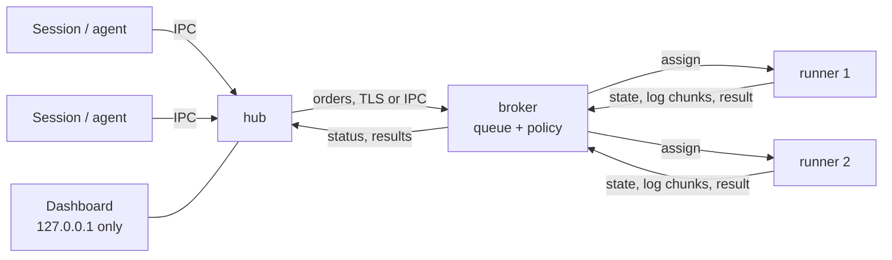

# Al.LocalRunner

Local queued runners for tests and builds on one developer machine. Parallel agent sessions submit runs to a shared queue instead of competing for CPU, memory, the emulator and Gradle/cargo caches.

The core is project-agnostic: it knows nothing about Rust, Kotlin or any consumer. Each consumer project declares its own profiles in `.localrunner/profiles.toml`. The single design document is [`docs/architecture.html`](docs/architecture.html): architecture, requirements, config formats, security.

## Roles

There are no levels. A job lists what it needs (platform, memory, CPU, disk, programs, tags, timeout); a runner reports what it has; the broker picks a runner that satisfies all of it and answers with the exact difference when none does. Priority and ordering come from the owner policy (`policy.toml` on the broker), not from the code.



A single machine runs a hub, a broker and a runner by default, so no configuration is needed. All runners of a pool share one resource budget, so a `ci` job never overlaps with a conflicting local run.

## Supported systems

Windows, Linux and macOS. One binary, `localrunner`, serves every role. Local IPC is a named pipe on Windows and a Unix socket elsewhere. OS-specific details of the `ci` runner and autostart are in `plugin/shared/os/`.

## Build

The toolchain is pinned by `rust-toolchain.toml` (stable, with rustfmt and clippy):

```
cargo build --release
```

The binary is `target/release/localrunner` (`localrunner.exe` on Windows).

## Install

```
target/release/localrunner install --dry-run   # show what will be done
target/release/localrunner install             # copy the binary to the user directory, extend the user PATH, run init
localrunner init                # state directory and config templates (--role hub|broker|runner|all)
localrunner doctor              # check this node
localrunner autostart on        # start the roles with the OS (off to disable)
```

`install` refuses to run as root or administrator without `--allow-elevated`, starts no roles and enables no autostart. `autostart on|off [hub|broker|runner|all]` works per role; `autostart on|off runner <name>` for one runner; `--dry-run` shows the actions. `uninstall [--purge] [--yes] [--dry-run]` reverses the installation.

## Quick start

One machine, everything local:

```
localrunner up                              # hub, broker and runners as background processes
localrunner run rust-unit --as claude:fix-1 # submit, stream the output, exit with the job's code
localrunner status                          # queue, running jobs, wait reasons
localrunner history                         # own runs, newest first
localrunner down                            # runners finish the current job, then everything stops
```

`submit` returns the job id at once; `--wait` streams the output (that is `run`), `--detach` lets the order outlive the sender, `--timeout <s>` only lowers the profile timeout, `--mem <6144|512m|6g>` and `--cpu <cores>` replace the profile values for one run. Follow up with `wait <job>`, `log <job> [--step N] [--tail N] [-f]`, `explain <job>`, `jobs --mine --active --as <label>`, `cancel <job>|--mine --as <label>`.

Reading the state: `status [--json] [--html [path] [--history] [--with-logs]]`, `history [--all]` and `history show <job>`, `stats`, `runners`, `brokers`, `dashboard`. `down --cancel` cancels running jobs (it waits for the runners at most 30 seconds); `down --drain` is the default; `down hub|broker|<runner>` stops named roles.

### Several machines

On the broker machine:

```
localrunner broker add --name laptop --runners 2   # prints address, one-time code, certificate fingerprint
```

On a machine that submits jobs:

```
localrunner hub join <host:port> --code-file code.txt --name office
```

On a machine that executes jobs:

```
localrunner runner join <host:port> --code-file code.txt --name box --count 2
```

The code can also come from standard input (`--code-file -`) or `LOCALRUNNER_JOIN_CODE`; passing it on the command line works but other users of the machine can see it. Administration on the broker: `runner list`, `runner remove <name>`, `client list`, `client remove <name>`, `policy check`, `policy reload`, `logging reload`. A multi-user machine runs the broker as an OS service: `broker install-service` (administrator), `autostart off broker` removes it.

## Policy and profiles

A consumer project describes what a run needs in `.localrunner/profiles.toml`:

```toml
[profile.rust-unit]
command   = "cargo test --workspace"
timeout_s = 900
mem_mb    = 4096
cpu       = 4
programs  = ["git", "cargo"]
tags      = []
```

Priority, visibility and which clients may use which runners are set by the owner in `policy.toml` on the broker, not by profiles. `policy check` validates the file without applying it. Formats are described in `docs/architecture.html`.

## Security

- The dashboard listens on loopback only (127.0.0.1, ::1); nothing leaves the machine except the optional OTLP sink the owner enables.
- A machine joins a broker with a one-time code that expires (1 hour by default) and is limited to N joins; the broker certificate fingerprint is shown by `broker add`. Each hub and runner then has its own revocable key (`client remove`, `runner remove`).
- Secret values in job output, secrets and join codes are masked in logs and CLI output; `status --html` leaves logs out unless `--with-logs` is given.
- The broker never runs as a privileged account.

## Claude Code plugin

The plugin in `plugin/` wraps the commands above in skills:

| Skill | Purpose |
|---|---|
| `install-runner` | one-time setup of the binary and, if absent, the `ci` runner |
| `up-runner` | start the hub, the broker and runners (default: one general runner) |
| `autostart-runner` | enable or disable starting roles with the OS |
| `down-runner` | stop runners, drain or cancel the jobs |
| `status-runner` | queue, running jobs, wait reasons, runners, history, dashboard |
| `run` | submit a run: profile, label, timeout, reading the result |

Install into a consumer project at project scope only:
`claude plugin marketplace add <url> --scope project`, then `claude plugin install al-localrunner@al-localrunner --scope project`.
