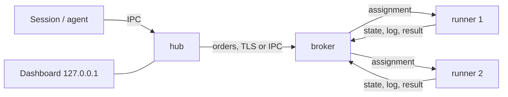

# Al.LocalRunner

**English** | [Русский](README.ru.md)

A resource-aware job queue for a developer and their AI agents. Heavy tasks (tests, builds, lint, deploys, migrations) go into one queue and run one at a time on a suitable machine, within its memory and cores, instead of agents fighting over CPU, memory, emulators and caches. One machine or many, on one network or several. Works on Windows, Linux and macOS. One binary, `localrunner`, plays every role.

The core knows no language and no toolchain. What to run and what it needs is described by a profile in the project's own `.localrunner/profiles.toml`. The full design, formats and requirements: [`docs/architecture.en.html`](docs/architecture.en.html) ([Russian](docs/architecture.html)).

## Contents

- [How it works](#how-it-works)
- [Quick start with an AI agent](#quick-start-with-an-ai-agent)
- [Quick start by hand (one machine)](#quick-start-by-hand-one-machine)
- [Installation](#installation)
- [Updating](#updating)
- [Hub](#hub)
- [Broker](#broker)
- [Runner](#runner)
- [Several machines](#several-machines)
- [Docker Compose](#docker-compose)
- [Project profiles](#project-profiles)
- [Logging](#logging)
- [Changing settings](#changing-settings)
- [Autostart, stop, update, uninstall](#autostart-stop-update-uninstall)
- [Troubleshooting](#troubleshooting)
- [Security](#security)
- [Plugin details](#plugin-details)
- [Usage](#usage)
- [Releasing](#releasing)
- [License](#license)

## How it works

A session or an agent submits a task through the CLI. The task becomes an order and goes to the broker, which holds the queue and hands orders to runners that fit by memory, cores, programs and tags. The runner executes it and returns the result and the log. One binary plays three roles:

| Node | What it does | Where it runs | Configuration |
|---|---|---|---|
| hub | takes CLI commands, turns a profile into an order, sends it to a broker, keeps a copy of the logs, shows the dashboard | on the machine you submit from; one per OS user | `hub-policy.toml`, `logging.toml` |
| broker | holds the queue, picks a runner, keeps history and member keys | on one machine of the pool | `policy.toml`, `logging.toml` |
| runner | executes jobs, one at a time | on the machine that has the tools | `runner.toml`, `logging.toml` |



For several machines, install the broker first, then join the hub and the runners to it (see [Several machines](#several-machines)).

## Quick start with an AI agent

The simplest way: connect the plugin and ask the agent. The plugin gives the agent skills to install, start and use the queue.

Claude Code:

```
claude plugin marketplace add alexpantiukhin/Al.LocalRunner
claude plugin install localrunner@al-localrunner
```

Codex:

```
codex plugin marketplace add alexpantiukhin/Al.LocalRunner
codex plugin add localrunner@al-localrunner
```

Restart the agent session, then ask in plain words:

| Say | Skill | What it does |
|---|---|---|
| "install the runner" | `install-runner` | gets the binary from a release, runs `init` and `doctor` |
| "update localrunner" | `upgrade-runner` | takes the new version from a signed release and replaces the binary with `upgrade`, restarting the roles |
| "start the runners" | `up-runner` | starts the hub, the broker and the runners |
| "run the tests through the runner" | `run` | puts the task into the queue and reads the result |
| "set up localrunner in this repository" | `repo-setup` | interviews, writes the profiles file and `temp/` in `.gitignore` after you confirm each diff, checks it with `profile check` |
| "show the queue" | `status-runner` | queue, jobs, runners, history, dashboard |
| "stop the runners", "turn autostart on" | `down-runner`, `autostart-runner` | stop the roles, switch autostart |

The skills never raise rights on their own and never print join codes or tokens. Until the first regular release exists, use a pre-release or a source build (see below). Scopes, removal and Codex limits: [Plugin details](#plugin-details).

## Quick start by hand (one machine)

1. Install the binary. Take the script from a release, not from a branch (the repository copy holds the placeholder `@RELEASE_PUBKEY@` and refuses to install). Linux and macOS:

   ```
   curl -fsSL https://github.com/alexpantiukhin/Al.LocalRunner/releases/latest/download/install.sh | sh -s -- --role all
   ```

   Windows (PowerShell, as an ordinary user; the script takes parameters only as a file):

   ```
   Invoke-WebRequest https://github.com/alexpantiukhin/Al.LocalRunner/releases/latest/download/install.ps1 -OutFile install.ps1
   powershell -ExecutionPolicy Bypass -File .\install.ps1 --role all
   ```

   Or from source: `cargo build --release`, then `target/release/localrunner install`. The installer itself creates the configuration templates (`init`) and runs `doctor`. Details and options: [Installation](#installation).

2. Start and check:

   ```
   localrunner up        # broker, hub and runner as background processes
   localrunner status    # the queue and the pool: memory and cores
   localrunner runners   # your runner is `online`
   ```

   If `localrunner runners` prints `broker <name> unreachable since <time>`, the broker is not running or not reachable: the hub and the runners reconnect by themselves with a growing pause (1 to 30 s, no limit on attempts). `localrunner up` and `localrunner doctor` name a hub or runner that is alive but not connected to the broker.

   Runners of one pool share one budget (memory, CPU, exclusive tags), so `localrunner runners` groups them by pool: `pool default: memory 12/32 GB free, cpu 6/16 free, tags held: gradle`, and each runner shows `idle` or `busy` and `can start a job now: yes/no` (an idle runner cannot start a job when the pool is full). `yes` only means the runner is free and the pool has at least 1 CPU and 1 MB left: reserve and quota rules, foreign load, queued orders and the size of your order are not counted, so compare your profile's `mem_mb` and `cpu` with the pool header, and use `localrunner explain` after submitting. `--json` has `pools` per broker. Read it before submitting several jobs at once. A runner whose declared `[programs]` were not found stays online (the runner reports their names; an older runner reports none): `runners` prints `programs not found: ...` under it, `status` lists it (`runner_notes` in `--json`), and `doctor` warns for it, also for runners of other machines. A runner whose version lags behind this binary (or reports none: an earlier version) is marked the same way, `version 0.5.0 is behind 0.8.0: ...` (`version_behind` in `runner_notes`); at its end `upgrade` already lists the runners of other machines and containers that are still on another version, by name and version.

3. Describe a task. A profile lives in `.localrunner/profiles.toml` of a project; in any empty folder create it with:

   ```toml
   [profile.hello]
   command   = "echo hello from localrunner"   # on Windows: "cmd /c echo hello from localrunner"
   timeout_s = 60
   ```

4. Run it, look at the result, stop everything:

   ```
   localrunner run hello --as me:test   # submit, show the output, return the exit code
   localrunner history                  # the runs, most recently finished first
   localrunner dashboard                # starts the live page in the background, prints its link; down stops it
   localrunner down                     # the runner finishes the current job, then everything stops
   ```

## Installation

### Release scripts

Copies with the release public key built in are attached to every release (https://github.com/alexpantiukhin/Al.LocalRunner/releases); take the script from there, not from a branch. The role is set by `--role hub|broker|runner|all` (default `all`). Other parameters: `--version X.Y.Z`, `--dir DIR`, `--offline ARCHIVE`, `--allow-elevated`, `--upgrade` (update an installed copy, see "Updating"); `--help` lists them. `latest` does not point to a pre-release: use the tag and the version, for example `.../releases/download/v0.1.0-rc1/install.sh` and `--version 0.1.0-rc1`. The script checks the signature of `SHA256SUMS` and the SHA-256 of the archive and installs nothing on any mismatch. While there is no regular release, build from source or use the pre-release link.

### From source

You need Rust; the version is set in `rust-toolchain.toml`. `cargo build --release` gives `target/release/localrunner` (`localrunner.exe` on Windows). Put it into the user's directory and prepare the node:

```
target/release/localrunner install --dry-run   # show the actions
target/release/localrunner install             # copy the binary, extend PATH, run init
```

Check the node with `localrunner doctor`. `install` starts no roles and enables no autostart. It refuses to run as root or administrator without `--allow-elevated`. Repeat the installation on every machine.

### Files of a node

| What | Windows | Linux, macOS |
|---|---|---|
| binary | `%LOCALAPPDATA%\Programs\Al.LocalRunner` | `~/.local/bin` |
| state and configuration of hub and runner | `%LOCALAPPDATA%\Al.LocalRunner` | `~/.local/share/al-localrunner` |
| state of the broker service | `%ProgramData%\Al.LocalRunner` | `/var/lib/al-localrunner` (Linux), `/Library/Application Support/Al.LocalRunner` (macOS) |

The directories can be replaced: `--state-dir` and `--config-dir`, or the variables `LOCALRUNNER_STATE_DIR` and `LOCALRUNNER_CONFIG_DIR`. `localrunner init [--role hub|broker|runner|all]` creates the state directory and the configuration templates. It never overwrites existing files. When the state directory comes from `--state-dir` or `LOCALRUNNER_STATE_DIR`, `status`, `doctor`, `up` and `down` print `state directory: <path> (from LOCALRUNNER_STATE_DIR)` (or `from --state-dir`) to stderr, so what they print to stdout does not change and a variable left set in the shell does not pass unnoticed.

To try a build of a branch against its own state, set `LOCALRUNNER_STATE_DIR` and `LOCALRUNNER_CONFIG_DIR` to new directories in that shell, run `localrunner init`, `localrunner up all`, the commands to try, and `localrunner down`, then remove the directories and unset the variables. It does not touch the usual installation, which keeps its own hub and runners.

## Updating

From the simplest to the most detailed way.

### 1. With the agent

Say to the agent: "update localrunner" (the `upgrade-runner` skill of the plugin). It shows the installed and the latest version, asks what to do with running jobs, takes the new binary only from the signed release, restarts the roles and checks the result with `localrunner doctor`. It asks before anything needs administrator rights (the broker service).

### 2. By hand: `localrunner upgrade`

Run `localrunner upgrade` from the installed binary; add `--version X.Y.Z` for a version other than the latest release. It downloads the release for this platform, checks the signature and the SHA-256 itself against the keys built into the binary, and installs nothing on any mismatch. It shows the installed and the new version, the running jobs and the waiting orders, and asks what to do: wait for the jobs, cancel them, or abort. Then it stops the roles, replaces the installed binary and starts the same roles again from it. Finish with `localrunner --version` and `localrunner doctor`.

On a machine without a working binary, take the release script instead (`install.sh --upgrade` or `install.ps1 --upgrade`, see "Release scripts"): it fetches the binary and runs the same `upgrade`.

### 3. Details and parameters

- **Without a terminal** (a script, an agent, CI): `--yes` skips the question and waits for running jobs; `--yes --cancel` cancels them; `--dry-run` only shows the plan; `--wait-timeout 15m` ends the wait with nothing replaced; `--offline ARCHIVE` takes the files from a folder instead of the network. Ctrl+C while waiting replaces nothing.
- **Broker as an OS service** keeps its own copy of the binary and `upgrade` does not touch it. With administrator rights run `localrunner broker update-service` from the new binary (`--dry-run` shows the plan). When the major protocol version changed, a command that meets the service still on the old one (`status`, `submit`, `reload`) says `refused: protocol 2.0 is not supported; the role answers on protocol 1.0, ...` and names this command, `down` says the role runs on the old protocol instead of `not running`, `upgrade` prints that it does not update the service, and the release notes carry an automatic **Breaking** line.
- **Several machines:** one by one, the broker first; all in the same window when the major protocol version changes. `localrunner runners` marks a runner whose version differs from the binary.
- **Docker runners:** change the image tag, `docker compose pull`, `docker compose up -d` (see "Docker Compose").
- **Plugin** (skills for the agent) is updated separately: `claude plugin marketplace update al-localrunner`, then `claude plugin update localrunner@al-localrunner --scope <scope>`, then restart Claude Code.
- Database schemas are upgraded at start with a backup; rolling back to an older version is not supported.
- All details: "Autostart, stop, update, uninstall".

## Hub

Needed on every machine you submit runs from. One hub per OS user.

Install and start:

```
localrunner install --role hub   # the binary and the hub templates (init)
localrunner up hub               # or: localrunner hub run (in the foreground)
```

If the broker is on another machine, the hub joins the pool (the broker issues the code, see [Broker](#broker)):

```
localrunner hub join <host:port> --code-file code.txt --name office
localrunner brokers         # check: the broker is listed, its zone, availability
```

The code can be passed as `--code-file file`, `--code-file -` (standard input), the variable `LOCALRUNNER_JOIN_CODE`, or a command-line argument. The last way shows the code to other users of the machine.

Configuration: `hub-policy.toml` in the configuration directory. It decides which broker gets an order:

```toml
[brokers]
order             = ["win-host", "linux-box"]   # names from hub join, in order
strategy          = "first"                     # first | least_loaded
broker_zone_order = ["local", "lan", "remote"]
query_timeout_s   = 3
query_attempts    = 3
zone_query        = "sequential"                # sequential | all
query_retry_s     = 5

[outbox]
ttl_hours = 24                                  # how long an order waits for a broker
on_expire = "fail"                              # fail | keep
```

Without the file the defaults apply. An order limited to the zone `local` (`zones = ["local"]` in the profile or `--zones local`) goes only to a broker on that machine. On the broker's machine the hub does not join by code: the broker lets local users in by the `[[local_user]]` list in `policy.toml` (`install` adds you). Commands for working with jobs: see [Usage](#usage).

## Broker

One per pool. Holds the queue, member keys and history. Executes nothing itself.

Start on a user's machine:

```
localrunner install --role broker
localrunner up broker       # or: localrunner broker run
```

Start as an OS service (a dedicated machine, several users). Administrator rights are needed. The service runs under its own account, never root or SYSTEM:

```
localrunner broker install-service --dry-run
localrunner broker install-service
```

Remove the service with `localrunner autostart off broker` or `uninstall`. `down` does not stop the service: use the OS service manager. Without administrator rights `down broker` names the running service and prints the command that restarts it from an elevated shell (exit code 1). `up` does not start it. Configuration: `policy.toml` in the broker's state directory. Without the file the defaults apply. Main tables:

| Table | Purpose |
|---|---|
| `[listen]` | the address the broker listens on. Without it the network is not listened to. Wildcard addresses (`0.0.0.0`, `::`) are rejected. In a container: `address = "container"` |
| `[networks]` | named networks; the hub's zone (`lan` or `remote`) depends on them |
| `[[shared]]` | `members = ["main-laptop", "docker-1"]`: client labels and runner names that reach one shared disk; the zone between them is `shared`. The label of a client is unique: `broker add --label` refuses a taken one. Applied on reload |
| `[[local_user]]` | who may use local IPC: `name`, `label` |
| `[queue]` | `strategy` = `priority-fifo`, `fair-share`, `weighted` |
| `[[rule]]` | priority, reserve, quota, weight by the `when` condition (the first matching rule for each field) |
| `[pool]` | `name` (shown by `localrunner runners`, default `default`), `mem_mb`, `cpu`, `exclusive_tags`; by default all memory and cores of the broker machine |
| `[limits]` | `max_job_timeout_s`, `timeout_above_max` (`reject` or `trim`), `job_log_max_mb`, `max_active_per_client`, `api_requests_per_min` (1200) |
| `[resources]` | limits of a job by its declared `mem_mb` and `disk_mb`: `mode` = `off`, `warn` (default), `limit`, `kill`; `mem_headroom`, `disk_headroom` (factor, default 1.25). See [Resource limits](#resource-limits-cleanup-and-foreign-load) |
| `[admission]` | `foreign_load` = `off` (default) or `wait`: wait while foreign processes load the runner machine; `mem_headroom_mb` (256) |
| `[commands]` | `default = "any"` or `"named"`; `[[commands.client]]` for single keys or labels |
| `[visibility]` | `others_orders` = `none`, `summary`, `full`: what other clients see |
| `[cancel]` | `others = "none"` or `"owner"`: who cancels other clients' orders |
| `[join]` | `code_ttl_min`: lifetime of a join code (60) |
| `[orphans]`, `[grace]`, `[results]` | what to do with orders of a vanished hub, the grace period for a lost runner (`lost_min`), result retention |
| `[history]`, `[saturation]`, `[cache]`, `[services]` | history retention, saturation thresholds, shared cache, runner services |
| `[[secrets.allow]]` | which label may ask for which secrets |

Example:

```toml
[listen]
address = "192.168.1.10:7443"

[[local_user]]
name  = "alex"
label = ""

[[rule]]
name     = "ci-first"
when     = { client_label = "ci" }
priority = 100

[[rule]]
name     = "nightly"
when     = { client_label = { in = ["ci", "night"] }, project = { glob = "lr-*" }, mem_mb = { ge = 8192 }, not = { tag = "flaky" } }
priority = 50
```

A condition value is a plain value (equality) or a table of tests: `in`, `prefix`, `glob`, `ne` for strings and `lt`, `le`, `gt`, `ge` for numbers, plus `any = [...]` and `not = {...}`. Rules with a condition on declared attributes (`source`, `project`, `tag`, `label`, `submitter_label`, `platform`, `mem_mb`, `cpu`, `disk_mb`, `timeout_s`, `min_mem_mb`) are allowed only together with a positive `client_label` condition. A negative `priority` is allowed. There is no aging: under a constant stream of higher-priority orders a low-priority order can wait indefinitely; `[queue] age_after_min` from older files is ignored with a warning. Unknown tables and keys are rejected with a line number.

Commands:

```
localrunner policy check [file]   # check without applying
localrunner policy reload         # apply every table, [listen], [networks] and [[shared]] included; only on the broker machine
localrunner logging reload        # reread logging.toml in every running role
```

Joining members:

```
localrunner broker add --name office --label dev              # for a hub: prints the address, the code and the certificate fingerprint
localrunner broker add --runners 2 --address 192.168.1.10:7443  # for runners: a code for 2 joins
localrunner broker add --runners 1 --code-file code.txt         # write the code to a new file instead of printing it
localrunner runner list
localrunner runner remove <name> [--yes]   # remove a runner and revoke its key
localrunner client list
localrunner client remove <name> [--yes]   # revoke a hub's key
```

`broker add` uses the broker's admin channel: on a broker installed as a Windows service it needs an administrator, on Unix the OS user of the broker. `runner join` and `hub join` refuse to run as an administrator, so the code has to cross between two users: run `broker add --code-file <file>` as the administrator (the file must not exist yet), then `runner join <address> --code-file <file>` as the regular user, and delete the file. The code never appears on the screen; the address, the fingerprint and the expiry are printed as usual.

A code is valid for 1 hour and for the given number of joins. The address with the port must be reachable by the member. The certificate fingerprint is part of the code, so there is nothing to compare by hand. `runner remove` and `client remove` ask for confirmation; without a terminal (scripts, agents) they need `--yes`.

## Runner

Executes jobs, one at a time, with the resources declared in `runner.toml`.

Install and start on the broker's machine:

```
localrunner install --role runner
# set keys: localrunner config set runner:<name> <key> <value> (see below and "Changing settings")
localrunner up runner
```

A runner on another machine:

```
localrunner install --role runner
# set keys: localrunner config set runner:<name> <key> <value>
localrunner runner join <host:port> --code-file code.txt --name box --count 2
localrunner up runner
```

`--count N` (1 to 64) creates runners `box-1` … `box-N` from one `runner.toml` template; each has its own directory, key and record on the broker. `--name` wins over `name` in the file; with neither, the machine name is used.

`runner join` copies the template into `runner/<name>/runner.toml`, and that copy wins: later edits of the template do not reach a joined runner, while a runner that never joined reads the template. `localrunner runner config <name>` shows the file a runner reads and its path; `--diff` shows the lines in which the own copy differs from the template. A joined runner on the same machine as the broker needs its own state directory (`--state-dir`), different from the broker's. In a container, a file mounted at `/etc/al-localrunner/runner.toml` is read directly instead: `runner join` writes no copy, an edit of the mounted file is picked up by `localrunner reload` or a restart at once, and `runner config <name>` shows the mounted file; the copy is only a template for a start without a mounted file. `--platforms` and `--tags` of `runner join` need a copy, so a container with a mounted file refuses them: set them in the file. Edit the mounted file in place: a tool that replaces it with a new file (`config set`) leaves a running container on the old one, recreate the container then.

A runner keeps what it still has to deliver to the broker in an outbox. If the broker has already cancelled or lost a job, its entries can stay pending; `localrunner runner outbox drop [--runner NAME] <job-id>` closes them while the runner runs and prints `closed N entries of <job-id>`. It is refused while the runner still runs that job; without `--runner` it takes the only runner of the installation. A runner that is not running prints `not running` and the exit code is 1.

Configuration: `runner.toml`. `[env] path` is mandatory: it is the job's `PATH` and the place where programs are looked up. A runner without it does not start, and the runner process's `PATH` is not passed to jobs. Autostart and services give a poor environment, so set the paths explicitly.

A job gets only these variables: `PATH` (from `[env] path`), `HOME` (from the runner process), `TEMP`, `TMP` and `TMPDIR` (a private directory of the job), `LOCALRUNNER_JOB_ID`, `LOCALRUNNER_CACHE_<NAME>`, the secrets it asked for and everything in `[job_env]`; on Windows also `SystemRoot`, `windir`, `ComSpec`, `PATHEXT`. Nothing else of the runner's environment is inherited. Any other variable the jobs need (`JAVA_HOME`, `CARGO_HOME`, `ANDROID_NDK_HOME`) is written in `[job_env]` as `NAME = "value"`; `HOME` written there replaces the detected one. A native build on Windows may need more than the list above: Rust with the MSVC toolchain finds the linker through `vswhere`, which reads `ProgramFiles(x86)`; if a job fails with `linker link.exe not found` although the tools are installed, list the names in `[job_env] inherit` (below). `init` and `runner join` write that list on Windows. `init` and `runner join` write the `HOME` of the shell they run in into `[job_env]`, so you see it in the file; a runner whose file has no `HOME` takes the home directory of the OS user that runs it, so jobs on different runners may see different settings in it (`.npmrc`, `.gitconfig`); to make them the same, set `HOME` in `[job_env]` to a directory of your own. `PATH` (use `[env] path`), `TEMP`, `TMP`, `TMPDIR` and names starting with `LOCALRUNNER_` are refused. A key that is not a setting of `runner.toml` (a variable written under `[env]`, for example) is a warning at start and in `doctor`. The `[programs]` checks run in exactly the same environment, and each check may take `check_timeout_s` seconds (default 10): a program that starts slowly, such as `pnpm` through `corepack` on a cold cache, needs a larger value or a `HOME` where its cache lives.

```toml
name      = "linux-heavy"
platforms = ["linux", "android"]
tags      = ["gradle", "emulator"]
mem_mb    = 16384              # optional: all host memory
cpu       = 8                  # optional: all host cores
allow_elevated = false         # run as root or administrator
allow_same_user_as_broker = false

[env]
path = "/usr/local/bin:/usr/bin:/bin"

[programs]                     # what to look for on the runner and how to check it
git    = {}
gradle = { check = "gradle --version" }
android-emulator = { check = "emulator -list-avds" }   # a capability name: the check decides
[accept]
min_mem_mb = 8192              # a reserve for heavy orders

[limits]
max_job_timeout_s = 3600       # ceiling of a job's timeout on this runner
enforce       = "kill"        # optional: off | warn | limit | kill; replaces the broker's mode
mem_headroom  = 1.25          # optional: factor of the declared mem_mb (1.0 to 100.0)
disk_headroom = 1.5           # optional: factor of the declared disk_mb (1.0 to 100.0)

[cache]
max_size_gb    = 40
retention_days = 14
evict          = "lru"

[commands]                     # names for clients with mode = "named"
build = "make all"

[job_env]                     # extra variables for every job, service and cleanup hook
JAVA_HOME = "/opt/jdk"
GRADLE_OPTS = "-Dorg.gradle.daemon=false"
inherit = ["ProgramFiles(x86)", "USERPROFILE"]   # exact names copied from the runner process at the start of each job

[[cleanup]]                    # a command run after every job
name      = "labelled-containers"
command   = "sh -c 'docker rm -f $(docker ps -aq --filter label=$LOCALRUNNER_JOB_LABEL)'"
timeout_s = 60                 # 1 to 3600, default 60
on        = ["passed", "failed", "killed", "cancelled", "timeout"]   # default: all
```

`[programs]`: `check` is any command, run in the same environment as a job, and its exit code 0 is all that `doctor` and the registration of the runner trust. `cargo --version` proves that the program starts, not that it does what the projects need (a native build can still fail at link time because the clean job environment lacks a variable). An owner whose projects compile native code makes `check` do a step the project needs, for example a link of a tiny crate or `cargo build --offline` of a fixture. The runner and `doctor` know nothing about any toolchain.

The key of a `[programs]` entry is the name of a capability and by default the name of the program. With a `check` and no `path`, the name is not looked up in `[env] path`: the exit code of the check decides, so a key such as `android-emulator` is offered when `emulator -list-avds` succeeds. Without a `check` the name is looked up in `[env] path`; with a `path` the file must exist. A check that fails or takes longer than `check_timeout_s` (default 10) only means that the program is not offered: the runner keeps running, and `doctor`, `runners` and `status` show the program as not found. A capability that has no command to check goes to `tags`.

Runner services (a build daemon, an emulator) are described in `[service.<name>]`: `start`, `ready_check`, `stop`, `ready_timeout_s`, `memory_mb`, `lifetime` (`per_job`, `idle`, `keep`), `idle_timeout_s`, `max_lifetime_s` (mandatory), `reuse`. The format is in section 3.11 of the architecture document.

### Local and joined runners

`localrunner runners` shows the kind of each runner: `local` or `joined`.

| | Local runner | Joined runner |
| --- | --- | --- |
| How it connects | Over the local channel of the broker on this computer (any OS user the broker lets in connects this way); it needs no `broker.toml` and no key | By key (`join`), over the network or from a container, even if it is on the same computer |
| Its name | `local:<name>` | The name it was given when it joined |
| Zone toward the client | `local`, when it runs as the same OS user as the client | `shared`, `lan` or `remote`, never `local` |
| Steps it runs | The steps of its zone, in the client's directory | The steps of its zone: in the client's directory in `shared`, in a work folder of the job in `lan` and `remote` |

Consequences:

- A joined runner on the same computer as the client is never in the zone `local`, because the broker cannot prove that it sees the client's directory; the owner may put it in `shared` with a `[[shared]]` block of `policy.toml`.
- To make a runner work in the client's directory, run it as a local runner: start it with no `broker.toml` and no key on the client's computer.
- An order that no runner can take is rejected at once, not queued. Find it with `localrunner jobs` (`--json` shows the state `rejected_no_matching_runner`); `status <job>` and `history show <job>` do not know a rejected order.
- A runner in a container cannot be local: it has no local channel to the broker, so it is always joined.
- An older broker does not report the kind; the column is then empty.

### Resource limits, cleanup and foreign load

The `cpu`, `mem_mb` and `disk_mb` of a profile limit the job itself by default in the `warn` mode: the runner records the peaks of every job, writes a warning to the job log when the `mem_mb` or `disk_mb` ceiling is exceeded, caps the CPU share to the declared `cpu` and limits the process count; nothing is killed unless `kill` is chosen. Turn it off with `[resources] mode = "off"` or `[limits] enforce = "off"`. This default changes the behaviour of existing installations. Peaks are recorded in any mode (`peak_mem_mb`, `peak_disk_mb`): see the `PEAK_MEM_MB` and `PEAK_DISK_MB` columns of `history`, and `history show`, `jobs`, `explain`, `status --json` and the dashboard. A dash in a peak column means "not measured" (a job without a declared `disk_mb` and without directories to measure has no disk peak), while `0` means measured and empty. A job that starts a container (`docker run ...`) is measured by its own process tree only: the memory used inside the Docker VM or the container is not part of the peak, so the peak of such a job is small and its declared `mem_mb` cannot be compared with it.

An order the broker refuses at intake (more than the pool can ever give, a name no runner list has, a secret not allowed for the label) is recorded: `history` shows it with the state `rejected` and `history show` gives the reason; `history --result rejected` lists only these. The dashboard shows the same state. `explain <job>` answers for such an order too and names the unmet requirement (`r1: bash не найден`: the runner has no `bash` on its PATH).

Every order that left the queue keeps its end reason and who ended it: the `--as` label of `cancel`, the sender label for an order withdrawn because its sender is gone (`sender_gone`), `upgrade` or `down` for a job of a runner stopped by `upgrade --cancel` or `down --cancel`, `lock` for a job of a runner that stopped while an upgrade lock held it in drain, `broker` for a refusal; an unknown actor is left out. `status --recent [N|DURATION]` lists them after the queue (the last 10 without a value, or e.g. `--recent 2h`), `history` has them in its last column `REASON` (`cancelled by upgrade: runner_stopped`), and `--json` in `reason` and `cancelled_by`. `upgrade --cancel` prints the jobs it cancels (those of the runners it stops), the jobs of other machines that keep running, if any, and every order that stays queued. Its question counts only the jobs it cancels. A runner the broker reports by its bare name is matched to this installation by name only, so a same-named runner of another machine is not told apart; the list says so for such jobs.

- **Modes.** Broker `policy.toml` `[resources] mode` or the runner's `[limits] enforce` (the runner owner's value wins): `off` (explicit) limits nothing and records peaks only, `warn` (the default) writes a warning line to the job log, `limit` holds the job's memory at the ceiling through the OS without killing it (allocations beyond it fail on Windows, the job is throttled on Linux; disk behaves as in `warn`), `kill` ends the whole process tree and the job fails with the reason `resource_exceeded` and the text `превышен заявленный mem_mb: заявлено X МБ, пик Y МБ`. In `limit` a job that fails after the OS limit was actually reached (Windows: the Job Object's peak commit reached the ceiling; Linux: the scope's `memory.events` counted `high`, `max` or an OOM kill) also gets `resource_exceeded` with the peak and keeps its exit code, and its log ends with `localrunner: failed at the memory ceiling: ...`; any other failure keeps its own reason. A runner of an earlier version gets `warn` instead of `limit` from the broker; `runners` marks it `(limit mode not supported: runs as warn; ...)` and gives the reason: an earlier version, or no systemd (`enforcement watcher`). A container has no systemd, so no limit per job is applied there and `limit` runs as `warn`; the limit of the whole runner is set by Docker (`mem_limit` and `cpus` of the service in `install/compose.yaml`). Turn `kill` on after a history of peaks has accumulated.
- **Ceilings** (only when the mode is not `off`): memory is the declared `mem_mb` times `mem_headroom`, disk is `disk_mb` times `disk_headroom` (a factor from 1.0 to 100.0, default 1.25). CPU is the declared `cpu` cores of CPU time: a share, not pinning to cores, a hard cap, never a reason to kill. The process count is limited to `max(512, cpu * 256)`. A job that exits with code 0 while its peak was above the ceiling stays passed.
- **Mechanisms.** Windows: a Job Object (memory, CPU rate cap, process limit); its memory limit is 10% above the ceiling in `kill` and at the ceiling in `limit`. Linux: a cgroup v2 scope through `systemd-run` (`MemoryMax`, `CPUQuota`, `TasksMax`) when the controllers are delegated to the user; `limit` adds `MemoryHigh` at the ceiling (throttling and reclaim, swap allowed) and keeps `MemoryMax` 10% above it. A runner that is a Linux system service has no user manager, so it makes the job cgroups itself in the cgroup subtree its unit delegates to it (`Delegate=yes`, written by `autostart on runner <name> --service`): it moves itself into a `runner` leaf, enables the memory controller for the children and writes the same values to `memory.high`, `memory.max`, `cpu.max` and `pids.max` of a cgroup per job. This needs the memory controller in the unit's cgroup and Linux 5.14+ (`cgroup.kill`, so a forking tree is killed whole); otherwise the runner reports `watcher`. A unit installed by an earlier version has no `Delegate=yes`: reinstall it (`autostart off runner <name> --service`, then `autostart on runner <name> --service`); until then `limit` runs as `warn` there, and `doctor` says so. Otherwise, and always on macOS, a user-space watcher samples the process tree about every 250 ms and kills it above the ceiling; there `limit` behaves as `warn`; CPU is lowered with the process priority (`nice`), and the process count limit does not apply. The watcher measures RSS on Unix, so the figures are approximate there (on Windows it is the commit). The runner reports `enforcement = os` or `watcher` (see `runners` and the dashboard); a `watcher` runner does not announce `limit`, so the broker sends it `warn`.
- **Disk.** A watcher sums the files in the job's working directory and in its private temporary directory `<runner state dir>/tmp/lr-<job-id>` about every 2 seconds (symbolic links are not followed; the shared system temp is not measured). `TEMP`, `TMP` and `TMPDIR` of every job point to that directory, which is always used, created before the first step and removed after the job (also after kill or cancel; up to 8 attempts 250 ms apart, since on Windows files of a just-killed process are briefly locked); after a runner crash everything under `<state dir>/tmp` is removed when the runner starts. This changes where jobs write temporary files. Before a job starts the runner checks the free space of the working volume against `disk_mb` times the factor.
- **Cleanup.** `[[cleanup]]` commands run after every job outcome (`on` defaults to all of `passed`, `failed`, `killed`, `cancelled`, `timeout`) with the environment `LOCALRUNNER_JOB_ID` and `LOCALRUNNER_JOB_LABEL` (`lr-<job id>`). A hook failure never changes the job result: a warning goes to the job log and the diagnostics. A job cut short by a runner crash or restart gets its hooks once, at the next start, as `killed` (before its result `runner_restarted` is sent), so a hook must be idempotent. Hooks do not run for orders rejected at intake. What to clean (labelled containers, build daemons) is up to the owner's command; the core knows no tools.
- **`[job_env]`** adds variables to every job and hook; `PATH`, `TEMP`, `TMP`, `TMPDIR` and `LOCALRUNNER_*` are forbidden; `HOME` is allowed. `inherit` is a list of exact variable names (no patterns) that the runner copies from its own process at the start of each job, so a change of the machine leaves no stale copy in the file; a name that is not set there is skipped and `doctor` lists it, an explicit `NAME = "value"` wins over an inherited one, the same forbidden names apply, and a name that is also a `[secret.<name>]` of this runner is refused when the file is loaded (secrets are never inherited). Only the owner of the runner writes the list: a profile cannot ask for more. `doctor` also warns when `cargo` is in `[programs]` on Windows and neither `inherit` nor `[job_env]` has `ProgramFiles(x86)`. A variable literally named `inherit` cannot be set. `LOCALRUNNER_JOB_LABEL` reaches the job environment only if at least one `[[cleanup]]` exists.
- **Foreign load.** Runners send the free memory and CPU load of their machine with the heartbeat. With `[admission] foreign_load = "wait"` an order waits while foreign processes leave too little (`занято чужими процессами: CPU 95%, нужно 4 ядер`, visible in `status` and `explain`); running jobs are never paused. The CPU of the broker's own jobs on the same machine is not counted as foreign. macOS reads `vm_stat` and `ps`. Runners that send no load (older ones) are admitted as before.
- **Not in this version:** disk I/O limits, core pinning, pausing running jobs, a Docker socket proxy, OS disk quotas.

The database `broker.db` moves to schema 2 on the first start (a copy `broker.db.bak-1` is kept). The two new `history` columns stand before `BROKER`: shift column numbers in scripts. The details are in section 3.14 of the architecture document.

`localrunner doctor` warns when a runner registered with a broker runs another version than this binary (`runners` marks the same mismatch); upgrade such a machine with `localrunner upgrade`.

Permissions:

- A runner executes commands from orders and runs as the user who started it. For other people's clients, create a separate restricted OS user.
- A runner refuses to start as root, administrator or SYSTEM without `allow_elevated = true`.
- If the broker is not a service, admits other clients (`[listen]` or a foreign `[[local_user]]`) and lets them run any command, a runner under the same OS user will not start. Options: run the runner under another user, run the broker as an OS service, set `[commands] default = "named"` in `policy.toml`, or set `allow_same_user_as_broker = true` in `runner.toml` (you accept the risk).

## Several machines

Order: the broker first, then the rest.

1. Broker machine. `install --role broker`, set `[listen]` and `[networks]` in `policy.toml`, start it (`broker install-service` for permanent operation).
2. For each client machine: on the broker `broker add --name <name> --label <label>`; on the client `install --role hub`, `hub join <host:port> --code-file code.txt --name <broker name>`, `up hub`.
3. For each machine with runners: on the broker `broker add --runners N --address <host:port>`; on the machine `install --role runner`, edit `runner.toml`, `runner join ...`, `up runner`.
4. Check: `localrunner doctor`, `localrunner runners`, `localrunner brokers`.

Only the broker needs an incoming port. There is no automatic broker discovery on the network; enter the address by hand.

## Docker Compose

Files: `install/Dockerfile`, `install/compose.yaml`, `install/policy.toml`, `install/runner.toml`. The published image holds only the binary on top of `debian:bookworm-slim` (a shell, glibc, CA certificates) and does not run as root; it stays minimal. Every release publishes it as `ghcr.io/alexpantiukhin/al.localrunner:<version>` and attaches a `compose.yaml` that uses it.

The standard way to run a runner is an image of your own that `compose.yaml` builds itself, with no repository and no separate Dockerfile: the runner service has `build: dockerfile_inline`, where you pick the base OS and the packages in one visible list, and the binary is copied from the published image of the same version:

```yaml
runner:
  build:
    dockerfile_inline: |
      FROM debian:bookworm-slim
      RUN apt-get update \
          && apt-get install -y --no-install-recommends ca-certificates git python3 \
          && rm -rf /var/lib/apt/lists/*
      COPY --from=ghcr.io/alexpantiukhin/al.localrunner:<version> /usr/local/bin/localrunner /usr/local/bin/localrunner
      # ... directories, ENV and USER as in install/compose.yaml
```

The binary is static, so any base works: for alpine write `FROM alpine:3.21` and `RUN apk add --no-cache ca-certificates git python3`. The build runs once and is cached (`docker compose build runner` after a change of the list); starting the container needs no network, the runner does not run as root and `cap_drop: [ALL]` stays. Which way to use: packages of the OS (git, python, a C compiler, anything with shared libraries or `libexec`, which a mounted directory cannot carry) go to `dockerfile_inline`, so that `[programs]` finds them; large toolchains (node, java, rust) that you do not want to rebuild into the image go to a directory of the host or a volume as `<tool>/bin`, mounted into the runner container and named in `runner.toml`: `[env] tools_dir = "/opt/tools"`. The `bin` directories found there are appended to `path`; `localrunner reload` picks up a directory filled later. If the directory for sockets, `/run/al-localrunner`, is not writable by the user the container runs as, the runner uses `ipc/` of the state directory. The runner reads the mounted `./runner.toml` directly: an edit in place and `localrunner reload` (or a restart) is enough. In a container the memory and the cores are limited by Docker, not by `[limits] enforce = "limit"` (it needs systemd and runs as `warn`; `runners` says so): set `mem_limit` and `cpus` of the service. Always give the image tag explicitly, also in `COPY --from`. A checkout of an unreleased version has no published tag yet: copy the binary from the image the `broker` service builds (`COPY --from=al-localrunner:<version>`).

Updating Linux runners in Docker: change the tag in your `compose.yaml` to the new release image, then `docker compose pull` and `docker compose up -d`; the tools directory stays as it is. The state volume keeps the runner key and the join record, so nothing is joined again. Check the result with `localrunner runners`: every runner shows the version it registered with (`version 0.2.0`, with the version of this binary beside it when they differ; also in `--json` and on the dashboard), a runner that has not registered since the update shows `version unknown`.

A custom image (the `dockerfile_inline` of `compose.yaml` does this) must create these directories and give them to the user the process runs as (the official image and the example use `65532:65532`): `/var/lib/al-localrunner` (state, `LOCALRUNNER_STATE_DIR`), `/etc/al-localrunner` (configuration, `LOCALRUNNER_CONFIG_DIR`), `/run/al-localrunner` (Unix sockets). Without them the process stops with `cannot create /run/al-localrunner: Permission denied`.

```
docker compose -f install/compose.yaml up -d broker
docker compose -f install/compose.yaml exec broker localrunner broker add --runners 1 --address broker:7443
docker compose -f install/compose.yaml run --rm -e LOCALRUNNER_JOIN_CODE runner localrunner runner join broker:7443 --config /etc/al-localrunner/runner.toml --name runner
docker compose -f install/compose.yaml up -d runner
```

The code that `broker add` prints is a secret and must not go on a command line, where other users of the machine see it: put it in the environment of your shell first (`read -rs LOCALRUNNER_JOIN_CODE; export LOCALRUNNER_JOIN_CODE` in bash, `$env:LOCALRUNNER_JOIN_CODE = Read-Host` in PowerShell) and pass the variable by name, as `-e LOCALRUNNER_JOIN_CODE` above (without `=value`), or use `--code-file -` with the code on standard input (`run --rm -T`) or `--code-file <file>` with a file mounted into the container. In a container `runner join` needs `--config /etc/al-localrunner/runner.toml` (the mounted file, which the runner then reads directly) and `--name`: the name the runner has in the pool (otherwise the container's host name).

Policy: edit `install/policy.toml`, then `docker compose exec broker localrunner policy reload`. The broker port is published on `127.0.0.1:7443`; for other machines replace the address with the host interface. A runner in a container does not see host files and takes only orders with a commit.

Docker Desktop (Windows, macOS). The runner runs inside the Docker virtual machine, so:

- **Memory.** `runner.toml` is checked against the memory of the machine the runner sees, and in a container that is the virtual machine, by default much smaller than the memory of Windows: `mem_mb = 12288` on a VM of 7944 MB stops the runner with `mem_mb = 12288 is more than this host has (7944); declare at most 7944`. Raise the VM limit in `%UserProfile%\.wslconfig` (`[wsl2]`, `memory=16GB`; on the Hyper-V backend in the Docker Desktop settings) and apply it with `wsl --shutdown`: a change restarts WSL and **every** container of Docker Desktop, also the ones that have nothing to do with the runner. `cpus` and `mem_limit` of the service limit the runner inside the VM.
- **A broker on the host.** A broker that runs on the host (`[listen] address = "127.0.0.1:7443"`) is reached from the container as `host.docker.internal:7443` (Docker Desktop resolves the name; on Linux Docker add `extra_hosts: ["host.docker.internal:host-gateway"]` to the service and let the broker listen on an address the bridge reaches). Create the code with `localrunner broker add --runners 1 --address host.docker.internal:7443` and join with `runner join host.docker.internal:7443 ...` as above; `install/compose.yaml` has the broker in a container, then the address is `broker:7443`.
- **The directory of sockets.** `/run/al-localrunner` must exist and belong to the user the container runs as: the `dockerfile_inline` of `install/compose.yaml` creates it; in an image of your own add `mkdir -p /run/al-localrunner && chown <uid>:<gid> /run/al-localrunner`, otherwise the runner stops with `cannot create /run/al-localrunner: Permission denied`.


## Project profiles

`.localrunner/profiles.toml` in the project's repository:

```toml
[profile.rust-unit]
command   = "cargo test --workspace"
timeout_s = 900                     # mandatory
mem_mb    = 4096
cpu       = 4
tags      = ["cargo"]

[profile.rust-gate]
timeout_s = 1800
steps = [
  { name = "fmt",  command = "cargo fmt --all --check", timeout_s = 120 },
  { name = "test", command = "cargo test --workspace",  timeout_s = 900, mem_mb = 8192 },
]
```

A profile has either `command` or `steps`. A failed step stops the job; `continue_on_failure = true` lets it go on. The fields in one place (section 5 of the architecture document has the reasoning, `localrunner profile check` has the last word):

| Field | Required | Default | Meaning |
|---|---|---|---|
| `command` or `steps` | one of the two, never both | none | one command, or an ordered list of steps; a zone variant `[profile.X.zone.<zone>]` may replace them |
| `timeout_s` | yes | none, no unlimited run | job timeout in seconds, above zero; the policy ceiling rejects an order that exceeds it, the runner ceiling makes a runner unsuitable |
| `mem_mb`, `cpu`, `disk_mb` | no | `0`: nothing is reserved | memory, cores and disk the job holds while it runs |
| `programs` | no | empty | names, or `{ name = "...", check = "..." }`; the runner must have each (a `check` command must also exit with 0) |
| `platforms` | no | empty: any platform | platform names the profile runs on; `[profile.X.platform.<P>]` overrides `command`, `steps`, `timeout_s`, `mem_mb`, `cpu`, `disk_mb` for one platform |
| `tags` | no | empty | resources the job holds for the run |
| `exclusive` | no | empty | tags that no other running job may hold meanwhile |
| `labels` | no | empty | free-form names for the broker policy (`label` in a rule); not requirements |
| `cache` | no | empty | named runner caches kept between runs of the project |
| `services` | no | empty | runner services the job needs |
| `secrets` | no | empty | secret names (never values); the policy decides who may request them |
| `zone` / `zones` | no | every zone | the farthest allowed zone, or the list of allowed zones; never both |
| `needs` | no | none | name of a `[needs.<name>]` set to inherit from; the profile's own fields win |
| `args.<name>` | no | none | a named argument filled with `--arg name=value` |

Keys of a step: `name` and `command` and `timeout_s` (required), `continue_on_failure` (default `false`), `mem_mb`, `cpu`, `tags` and `secrets` (optional). Step names are unique, and the step timeout runs inside the job timeout. Resources are taken once for the whole job: the maximum over the steps of `mem_mb` and `cpu` (a step without its own value takes the profile's), and the union of `tags` and `secrets`. `[needs.<name>]` takes the shared requirement keys: `timeout_s`, `mem_mb`, `cpu`, `disk_mb`, `programs`, `tags`, `exclusive`, `cache`, `services`, `secrets`, `zone`, `zones`, `platforms`. An unknown key is rejected with its name. There is no `env`, no working directory and no retry: several commands in one environment are `steps` or one script called from `command`.

**The client's directory.** In the zone `local` a job runs in the live working directory of the client, not on a snapshot: any edit of the files while the job runs reaches it (a `bash` script edited under a running job fails with a `syntax error` that the file does not contain). Do not touch the files of a long run in progress. In `shared` the runner sees the same directory through the shared disk. In `lan` and `remote` the runner works in a folder of the job, which it removes at the end, and the steps of the zone bring the code.

## Logging

`logging.toml` in the state directory of each role. Without the file a rotated JSON file is written. Apply without a restart: `localrunner logging reload`.

```toml
[logging]
level = "info"

[[sink]]
kind       = "file"
path       = "logs/daemon.log"
rotate_mb  = 50
keep_days  = 14
keep_files = 10

[[sink]]
kind = "console"       # foreground only
```

The `otlp` sink (`endpoint`, `ca_file`, `enabled`) is off by default: it is the only thing that can send data away from the machine. Secret values, join codes and tokens are masked in logs and output. Masking is exact and job-wide: the exact value of every secret of a job is replaced with `***` in the output of all its steps, with no minimum length, so a short or common value (`true`, `1`, `K`) would also damage ordinary output; use long random values for secrets.

## Changing settings

Every setting of `policy.toml`, `hub-policy.toml`, `runner.toml` and `logging.toml` can be changed with a command on the machine whose file it is. The command finds the file the role really reads (the broker service copy when the broker is an OS service, a runner's own copy when it has one), keeps comments and order, checks the result with the role's own parser, prints the diff, writes a backup `<name>.bak-<UTC time>` and the new file atomically, and reloads the running role.

```
localrunner config show runner:box                      # the path and the text of the file runner box reads
localrunner config get broker queue.strategy
localrunner config set broker queue.strategy fair-share --dry-run   # show the diff, write nothing
localrunner config set runner:box cpu 4
localrunner config set hub outbox.ttl_hours 48
localrunner config set logging logging.level debug      # every role of the installation rereads logging.toml
localrunner config unset runner:box limits.enforce      # back to the default
localrunner policy allow-secret signing_key --label ci  # also remove-secret, allow-service, remove-service
localrunner policy add-local-user ci-agent --label ci   # also remove-local-user
localrunner policy add-shared main-laptop docker-1      # also remove-shared
```

- Targets: `broker` (`policy.toml`), `hub` (`hub-policy.toml`), `runner:<name>` (`runner.toml`), `logging` (`logging.toml`). The type of an existing key wins; a new value is read as TOML (`5`, `true`, `["a", "b"]`), otherwise as a string; `--string` forces a string. A value the role refuses, or a new unknown key in `runner.toml`, leaves the file untouched.
- A file that needs administrator rights (the broker service file) is written by the same command run once again elevated: one UAC prompt on Windows, `sudo` on Unix. The diff is shown before the prompt; a refused prompt writes nothing, and so does the elevated copy when the file changed while the prompt was open (exit code 76).
- A role that is not running is reported as `not running`: the file is written and the command exits 0. A role whose channel refuses your rights is a failure (exit 1) that says to run the command elevated. A runner template edit reloads every runner without an own copy; a `logging` edit does not reload a broker that runs as the OS service (it reads its own `logging.toml`). A repeated `policy allow-*` or `add-*` prints `already present` and exits 0.
- Policy, hub policy and logging apply on reload, `[listen]`, `[networks]` and `[[shared]]` included: a moved `[listen]` keeps established connections, but a joined machine that reconnects later dials the address it saved at the join, so join it again. In `runner.toml`, `allow_elevated` applies at the next start of the runner (a runner checks it only when it starts); `name`, the state directory, `allow_same_user_as_broker`, `[service.*]`, `[secret.*]` and the broker address are named by the runner as `needs a restart`. The command prints the restart command and never restarts by itself; `--restart` runs it (the role's connections drop).
- `allow_elevated = true` and `allow_same_user_as_broker = true` print a `widens privileges` line instead of asking for a confirmation.
- An order refused for a secret or a service names the file, the label and the fix: `secret signing_key is not allowed for label agent in <path>; to allow it: localrunner policy allow-secret signing_key --label agent`. An allow entry with `label = ""` matches only clients whose label is empty (local owners without a `[[local_user]]` entry, members joined with an empty label), never a labelled client.

## Autostart, stop, update, uninstall

```
localrunner autostart on [hub|broker|runner|all] [--dry-run]
localrunner autostart on runner <name>
localrunner autostart on|off runner <name> --service [--dry-run]
localrunner autostart off [...]
localrunner down [names] [--drain | --cancel [--yes]] [--wait [--wait-timeout 90s]]
localrunner uninstall [--purge] [--yes] [--dry-run]
```

- Autostart is off by default. It runs as the user who enabled it: a scheduler task on Windows, a systemd user unit on Linux, a LaunchAgent on macOS. `autostart on broker` is the same as `broker install-service` and needs administrator rights (sudo). `autostart on` for several roles (`all`, or none named) does the user part without them and prints what is left for an administrator; `--dry-run` marks the steps that need those rights.
- The hub and runners start at user login (`autostart on` says "starts at user login"): they stop at logout and do not start after a reboot until someone logs in, and `doctor` warns about it. A runner that must keep running becomes an OS service with `autostart on runner <name> --service` (administrator rights; without them the command prints the exact line to run, `--dry-run` needs none): a Windows service `AlLocalRunner-<name>` under the virtual account `NT SERVICE\AlLocalRunner-<name>`, a systemd system unit `al-localrunner-runner-<name>.service` under your user (with `Delegate=yes`, so that `limit` holds job memory without a user manager; a unit written by an earlier version lacks it: run `autostart off runner <name> --service`, then `on` again), or a LaunchDaemon `com.al-localrunner.runner-<name>` under your user. Never root or `SYSTEM`. The `ci` runner and runners that need a desktop session (an emulator, a simulator, graphics) are refused. The runner must exist in your installation and must not also start at login (remove that first with `autostart off runner <name>`). On Windows only a runner joined to a broker with its own key (`runner join`) can be a service, and only for the user that key belongs to (another administrator is refused): the service account becomes the only user of that key (the Administrators group owns it, which both the service and your own login accept, so no step needs the restore privilege) until `autostart off`, which gives it back to the user the service was installed for and checks it; if that fails, the command prints the `takeown`/`icacls` commands to run as administrator. A runner that reaches the broker over your local channel is refused; the refusal and `doctor` name the steps (`localrunner broker add --runners 1`, `localrunner runner join <address> --name <name>`, then `autostart on runner <name> --service`), and `doctor` does not recommend the service for such a runner until it is joined. The service account does not have your PATH or the tools installed for your user only, so jobs see only tools installed for all users. On Windows `down`, `reload` and `upgrade` do not reach the service; on every OS `up` does not start a second copy and `upgrade` does not start it again: they print the command to stop or restart it as administrator (`Stop-Service`/`Restart-Service AlLocalRunner-<name>`, `sudo systemctl stop|restart al-localrunner-runner-<name>`). A stop through the service manager ends running jobs at once, without the drain of `down`. After changing the binary or the state directory, run `autostart on ... --service` again and restart the service. On Windows `on` and `off` touch only a service this installation registered (same program path, runner, state directory and account), `on` checks that the service keeps running for a few seconds (otherwise it names `runner/<name>/logs/service.log` and fails), and `off` waits for the service to stop before it gives the key back. A failed re-run never removes an existing service. The Windows service account gets modify rights only on its own `runner/<name>` directory, on its job root `%ProgramData%\Al.LocalRunner.Jobs\<name>` (the jobs' workspace, caches and temporary files, started with `runner run --job-root`; closed to everyone but the service account, the Administrators group, `SYSTEM` and the installing user, inside the parent `%ProgramData%\Al.LocalRunner.Jobs`, which the Administrators group owns and ordinary users may only read and traverse (the install refuses a parent or job root that is a link or junction; a path swapped after that check is outside what the installer guards); `autostart off` takes the right back and leaves the directory) and on `disk-reservations/`, and read rights on `machine-id`, the configuration and the binary directory: not on the broker database, the hub, `policy.toml`, the keys or other runners. It reaches the network as the computer account (`DOMAIN\HOST$` on a domain-joined machine), so its jobs can use what network shares grant to this computer; keep the login autostart where that is not acceptable. Before the rights are asked for, and in `--dry-run`, `autostart on ... --service` prints these notes (no user `PATH`, the computer account on the network, stopping without a drain) together with the checks of `runner.toml`: an `[secret.*] from = "env:NAME"` secret (the service does not see the variables of your shell or user) and a `docker` tag (the service account may not reach the Docker engine). A service does not see your environment, so a secret of such a runner is `from = "file:/absolute/path"` (`config set runner:<name> secret.<NAME>.from file:/path`): the file holds the value (one trailing line break is dropped) and should be readable only by the service account; `autostart on ... --service` gives the Windows service account read access to it (as for the key; `off` takes it back) and warns about an `env:` secret, a missing file and, on Linux and macOS, a file other users can read. `autostart off runner <name> --service` removes the service and keeps the runner's state.
- `up [NAMES]` takes the same names as `down`: a runner of this installation (`localrunner up <name>`, also as `local:<name>` as `runners` prints it), `runner` (every runner), `hub` or `broker`; `up runner` starts every stopped runner of the installation, including ones stopped on purpose, so name the one you mean. With no name `up` starts the roles that `init` created. An unknown name is an error that lists the names of this installation.
- `down` by default (`--drain`) waits for current jobs; `--cancel` cancels them and waits for the runners no longer than 30 seconds. A runner with no job leaves within 10 seconds of the stop even when its broker does not answer; a running job (with `--drain`) or services that are still stopping can take longer. What it could not deliver stays in its outbox for its next start. The broker stops after the runners.
- A runner is `online` while its broker heard a heartbeat within 22.5 seconds (one and a half 15-second intervals), `stale` while it is connected but a heartbeat is overdue (it gets no new orders; `runners` shows `stale (silent N s)`, `--json` has `liveness` and `silent_for_s`), and `offline` after 45 seconds of silence or without a connection. The `runner_online` metric is 1 only while the runner is online. `--cancel` (like `cancel --mine`) asks for confirmation; without a terminal (scripts, agents) it needs `--yes`.
- Update: `localrunner upgrade [--version X.Y.Z]` from the installed binary. It downloads the release archive, `SHA256SUMS` and `SHA256SUMS.sig` for this platform and checks the signature and the SHA-256 itself, against public keys built into the binary; on any mismatch nothing is installed. `--offline ARCHIVE` takes the files from a folder instead of the network; `install.sh --upgrade` (or `install.ps1 --upgrade`) stays for the first installation and for a machine without a working binary. `upgrade` prints the installed and the new version, the running jobs, the waiting orders and the runners of other machines with their versions, and asks (with running jobs: wait for them to finish, cancel them with `--cancel`, or abort). It writes `upgrade.lock`, stops the runners first (they finish their jobs, or with `--cancel` cancel them and exit within 30 s), then the hub and a broker started by hand, replaces the installed binary (the old one is renamed aside) and starts the same roles again from it. While it runs, `localrunner up` refuses to start the runners of this installation and names the upgrade (`status` shows the same line): if `up` says an upgrade runs, do not repeat it, wait. Orders waiting on the machine stay queued and run after the upgrade. `upgrade --dry-run` shows the plan; `--yes` skips the question and, with running jobs, waits for them (`--yes --cancel` cancels them); the first waiting line says that new jobs are not taken while `upgrade` waits, then it prints one line (`waiting for 1 job, running 12 min`) when the running jobs change and once a minute; `--wait-timeout DURATION` (`90s`, `15m`, `2h`; no limit by default) ends the wait as Ctrl+C does: nothing is replaced, and the message says what to do next (run `upgrade` again later); Ctrl+C while waiting replaces nothing; an older binary is refused. The same by hand: `down`, replace the binary, `up`. Database schemas are upgraded at start with a backup; rolling back to an older version is not supported. When the major protocol version changes, upgrade the broker, the hubs and the runners of other machines in the same window; every machine is upgraded the same way, one by one.
- Reload without a restart: `localrunner reload [--role runner|hub|broker] [name]` makes running roles reread their files: a runner `runner.toml` (tags, platforms, programs, limits, job environment; the next job and the capabilities the broker sees follow the new file, a running job keeps what it started with), the hub `hub-policy.toml`, the broker `policy.toml`. A bad file is refused and the role keeps what it had. Settings that need a restart (`name`, the state directory, `allow_elevated`, `allow_same_user_as_broker`, `[service.*]`, `[secret.*]`, the broker address) are named as `needs a restart: <setting>`. `status` and `doctor` warn when a runner runs with an older `runner.toml` than the file on disk.

### Updating the broker service

The broker as an OS service keeps its own copy of the binary (Windows: `%ProgramFiles%\Al.LocalRunner\localrunner.exe`; Linux and macOS: `/usr/local/libexec/al-localrunner/localrunner`), and `upgrade` does not touch it. Replacing it needs administrator rights, and `localrunner` never elevates itself: run `localrunner broker update-service --dry-run` from the new binary to see the plan, then the real command from an administrator shell:

- Windows (PowerShell as administrator): `localrunner broker update-service`
- Linux and macOS: `sudo localrunner broker update-service`

Without the rights the command prints the exact line to run (on Windows a PowerShell `Start-Process -Verb RunAs` line, elsewhere `sudo <path> broker update-service`) and exits with 1. It stops the service, copies the binary over the service file, starts the service and prints `service: old -> new`; it returns 0 only when the service runs the new version. The registration, the state and the keys stay. By hand the same is: stop the service (`AlLocalRunnerBroker` on Windows, `al-localrunner-broker` on Linux), copy the new binary over that file, start the service.
- `uninstall` stops the roles and removes autostart, the service, the binary and the PATH entry. Keys and history stay; `--purge` removes the state too, after confirmation.

## Troubleshooting

| Problem | What to do |
|---|---|
| unclear what is wrong with a node | `localrunner doctor` (`--json`; code 1 if there is a `fail`) |
| an order does not start | `localrunner explain <job>`: the reason and the rule that fired |
| no suitable runner | the answer names the difference between the order and the runners; `localrunner runners` |
| a setting in `runner.toml` has no effect | a misspelled key or section is not an error: it is printed as a warning at start and by `localrunner doctor`; the section `[workspace]`, which 0.7.0 dropped, is read without an error and reported as `deprecated since 0.7.0, remove it` |
| a runner does not start | the message names the reason: no `[env] path`, run as root, runner under the broker's user |
| the hub does not see the broker | `localrunner brokers`; check `[listen]`, `[networks]` and the port |
| `broker add`: "admin channel is not reachable ... access denied" | run it as an administrator (Windows service) or as the broker's OS user; hand the code over with `--code-file` |
| the join code is rejected | it lives 1 hour and has a limited number of joins; issue a new one with `broker add` |

## Security

- The dashboard listens only on `127.0.0.1` and `::1`. `localrunner dashboard` starts it in the background and prints the link (with a one-time token) on one line; a repeated call asks the running one for a fresh link through a per-user local channel (a named pipe or a Unix socket, never TCP). The token is printed to the terminal only and never logged.
- A member joins by a one-time code; the broker's certificate is pinned by the fingerprint from the code. After that a revocable member key works: `client remove`, `runner remove`.
- The broker never runs under a privileged account.
- Only whoever sits at the broker machine edits the policy; `policy reload` is accepted only over the local channel.
- `status --html` does not include logs without `--with-logs`.

## Plugin details

The plugin in `plugin/` wraps the commands into skills. The same `al-localrunner` plugin is described for both agents: `.claude-plugin/marketplace.json` for Claude Code, `.agents/plugins/marketplace.json` for Codex. The plugin only calls the `localrunner` binary.

### Claude Code

The installation scope is set by `--scope`:

| Scope | Where it is written | Who gets it |
|---|---|---|
| `project` | `.claude/settings.json` of the repository | everyone who works with this repository (the file is committed) |
| `local` | local repository settings, not committed | only you and only in this repository |
| `user` (default) | user settings | you, in every project |

From a local copy of the repository, give the path to the directory that holds `.claude-plugin/` instead of `alexpantiukhin/Al.LocalRunner`. Removal:

```
claude plugin uninstall localrunner@al-localrunner --scope <scope>
claude plugin marketplace remove al-localrunner --scope <scope>
```

### Codex

Codex has no installation scopes: plugins and marketplaces are written to the user's `~/.codex/config.toml` and apply in every project. Project-level installation is not possible. The marketplace takes the plugin from the `main` branch. Check with `codex plugin list`. Removal:

```
codex plugin remove localrunner@al-localrunner
codex plugin marketplace remove al-localrunner
```

## Usage

Order of a typical session:

1. Put the task in the queue: `localrunner run [profile] --as label` (waits and returns the exit code) or `submit` (returns the job id at once). Profiles come from [`.localrunner/profiles.toml`](#project-profiles).
2. Follow it: `wait <job>` or `log <job> -f`.
3. If it waits: `explain <job>` says why; `status` shows the whole queue.
4. If the result no longer matters: `cancel <job> --as label` or `cancel --mine --as label [--yes]`.
5. Afterwards: `history`, `stats`, `dashboard`.

All commands:

| Command | Action |
|---|---|
| `submit [profile] --as label` | submit an order, print the id, return at once |
| `run [profile] --as label` | the same, but show the output and return the exit code |
| `wait <job>... [--as L] [--json]` | follow a job and end with its exit code; interrupting cancels nothing. Several jobs, or `--as L` alone (the active jobs of that label, else its last job), print one line per job when it ends (`<job-id> <profile> <state>`, the profile is `-` without `--as`), no log; the code is the first non-zero one. With ids, `--as` checks that they are jobs of that label |
| `log <job> [--as L] [--step name] [--tail N] [-f]` | the job log; `--as` is accepted so a session can pass its label to every command, the label is not used; a value masked by a sensitive name is shown as `***(name: command)`, so the mask is told from the program's output (the stored log is intact, the structured logs of the roles keep `***`) |
| `cancel <job> --as label`, `cancel --mine --as label [--yes]` | cancel; without `--as` the error names the label of the job (`the label of <job> is <label>`) when `status` would show it to you, else says the label is not shown or the job is unknown |
| `jobs --mine [--active] [--as label]` | your jobs, with the `started` and `finished` times (`-` while not yet reached) |
| `status`, `status <job>`, `explain <job>` | the queue with the `stale` and `offline` runners (`--json`: a `runners` array per broker); a running job shows `last output 7.0s ago`, how long ago its log last received output (`last_output_ago_ms` in `--json`; absent before the first output, for a job whose fields you may not see, and from an older broker), so stalled output is seen without opening the log; one job with its record; why an order waits, how long it has waited for a runner to start it, and which job holds the slot |
| `profile check [profile] [--label L] [--file path] [--json]` | validates the profiles file: a per-profile summary (steps or command, timeout, resources, platform mode "with platforms" or "no platforms", arguments, and for a command with an optional segment `{? ...}` the command expanded with every argument given (a sample value) and with none given), a warning for ignored top-level sections such as `[profiles.x]`, exit 1 for zero profiles or a parse error; before a run: for every secret of the profiles, the job variable it becomes, whether the policy lets the label request it (the label of your `[[local_user]]` entry, not `--as`), whether a runner of this machine has a source for it; exit 1 if something would stop a run |
| `status --recent [N\|DURATION]` | the orders that left the queue, with the end reason and who ended it |
| `history [--all]`, `history show <job>` | history with `QUEUED`, `STARTED` and `FINISHED` columns; `--since` keeps the runs queued since a time, `--ran-since` and `--ran-until` keep the runs that were running in a window (started before its end, not finished before its start; a run still going counts); the `REASON` column says who cancelled a run and why |
| `stats`, `runners`, `brokers` | statistics, runners, brokers |
| `dashboard` | a page on 127.0.0.1, started in the background (the link is one line on stdout, closing the terminal does not stop it; a repeated call prints a fresh link; `--foreground` keeps it in the terminal until Ctrl+C; `down` stops it, and it ends with the hub); the queue grid has `Priority` (the effective priority, sortable, in CSV and JSON), `Client label` (the `--as` label) and `Labels` (the profile labels) columns; the History tab is paged (previous, next, page size) and the queue says `shown N of M` when a broker's list limit cut orders |

Flags of `submit` and `run`: `--note`, `--platform`, `--timeout <s>` (only lowers the profile timeout), `--mem 6144|512m|6g`, `--cpu <cores>` (replace the profile values for one run), `--arg name=value` (fills an argument the profile declares; repeatable), `--detach` (explicit; `submit` already detaches by default), `--no-detach` (`submit` only: the order is cancelled when the sending process exits, as `submit --wait` and `run` always do), `--quiet` (`submit` only: no hint block). A detached `submit` prints only the job id to stdout and a hint block to stderr with ready-to-copy commands (`queued <job-id> (profile ..., label ...)`, `follow: localrunner wait <job-id>`, `result: localrunner log <job-id> --tail 50`, `cancel: localrunner cancel <job-id> --as <label>`); `--quiet`, `--json` and `run` print no block. `--as` is required; inside GitHub Actions it defaults to `github:<workflow>/<job>`. Read commands accept `--json`.

## Releasing

1. Put one version `X.Y.Z` everywhere: `version` of every `crates/*/Cargo.toml`, `image: al-localrunner:X.Y.Z` in `install/compose.yaml`, `version` of `plugin/.claude-plugin/plugin.json` and `plugin/.codex-plugin/plugin.json`. Run `cargo build` so `Cargo.lock` follows (CI and the release build use `--locked`). A pre-release carries the suffix in all of them, for example `0.2.0-rc1`.
2. Open a pull request and wait for `ci-ok`: it is required for `main`, nothing is merged before it passes. A pull request that changes only these version lines (and the matching `version` entries of `Cargo.lock`) skips the `rust` matrix, because the same code was tested before the bump; the cheap `lockfile` job runs `cargo metadata --locked` instead, so a `Cargo.toml` and a `Cargo.lock` that disagree fail before the tag. Any other changed line or file, or a diff that cannot be read, runs the full matrix (`.github/scripts/version_only.py`).
3. Tag the merge commit `vX.Y.Z` and push the tag. The `release` workflow builds the archives for five platforms and fails when `localrunner --version` differs from the tag, then (environment `release`, which may wait for approval) signs `SHA256SUMS` with the release key and publishes the archives with `install.sh` and `install.ps1`. `latest` does not point to a pre-release.
4. Check the release on one machine with `install.sh --upgrade --version X.Y.Z` (or `install.ps1`), then `localrunner doctor`. The broker OS service keeps its own copy of the binary and is updated by hand (see "Autostart, stop, update, uninstall"); other machines follow one by one, the broker first unless the major protocol version changes.
5. A plugin update reaches users only with a new plugin `version`: change the plugin files only together with a version bump.

## License

GPL-3.0-or-later: see [LICENSE](LICENSE). Additional terms (keep the author attribution in copies and documentation): [NOTICE](NOTICE).
