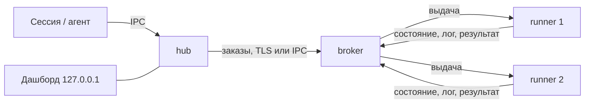

# Al.LocalRunner

[English](README.md) | **Русский**

Очередь задач с учётом ресурсов для разработчика и его AI-агентов. Тяжёлые задачи (тесты, сборки, lint, деплой, миграции) встают в одну очередь и идут по одной на подходящей машине в пределах её памяти и ядер, а агенты не спорят за процессор, память, эмулятор и кэши. Машина может быть одна или их может быть много, в одной сети или в разных. Работает на Windows, Linux и macOS. Один бинарник `localrunner` выполняет все роли.

Ядро не знает ни языка, ни инструментов проекта. Что запускать и что для этого нужно, описывает профиль в `.localrunner/profiles.toml` самого проекта. Полное описание, форматы и требования: [`docs/architecture.html`](docs/architecture.html) ([на английском](docs/architecture.en.html)).

## Содержание

- [Как это работает](#как-это-работает)
- [Быстрый старт с AI-агентом](#быстрый-старт-с-ai-агентом)
- [Быстрый старт вручную (одна машина)](#быстрый-старт-вручную-одна-машина)
- [Установка](#установка)
- [Hub](#hub)
- [Брокер](#брокер)
- [Раннер](#раннер)
- [Несколько машин](#несколько-машин)
- [Docker Compose](#docker-compose)
- [Профили проекта](#профили-проекта)
- [Журналы](#журналы)
- [Автозапуск, остановка, обновление, удаление](#автозапуск-остановка-обновление-удаление)
- [Диагностика](#диагностика)
- [Безопасность](#безопасность)
- [Подробности о плагине](#подробности-о-плагине)
- [Использование](#использование)
- [Лицензия](#лицензия)

## Как это работает

Сессия или агент ставит задачу через CLI. Задача становится заказом и уходит брокеру: он держит очередь и выдаёт заказы раннерам, которые подходят по памяти, ядрам, программам и тегам. Раннер выполняет её и возвращает результат и лог. Один бинарник играет три роли:

| Узел | Что делает | Где работает | Конфигурация |
|---|---|---|---|
| hub | принимает команды CLI, превращает профиль в заказ, отправляет его брокеру, хранит копию логов, показывает дашборд | на машине, откуда запускают; один на пользователя ОС | `hub-policy.toml`, `logging.toml` |
| broker | держит очередь, выбирает раннер, хранит историю и ключи участников | на одной машине пула | `policy.toml`, `logging.toml` |
| runner | исполняет джобы, по одной за раз | на машине, где нужны инструменты | `runner.toml`, `logging.toml` |



Для нескольких машин сначала ставят брокер, потом к нему присоединяют hub и раннеры (раздел [«Несколько машин»](#несколько-машин)).

## Быстрый старт с AI-агентом

Самый простой путь: подключить плагин и попросить агента. Плагин даёт агенту скилы для установки, запуска и работы с очередью.

Claude Code:

```
claude plugin marketplace add alexpantiukhin/Al.LocalRunner
claude plugin install al-localrunner@al-localrunner
```

Codex:

```
codex plugin marketplace add alexpantiukhin/Al.LocalRunner
codex plugin add al-localrunner@al-localrunner
```

Перезапустите сессию агента и просите простыми словами:

| Скажите | Скил | Что делает |
|---|---|---|
| «установи раннер» | `install-runner` | берёт бинарник из релиза, выполняет `init` и `doctor` |
| «подними раннеры» | `up-runner` | запускает hub, брокер и раннеры |
| «прогони тесты через раннер» | `run` | ставит задачу в очередь и читает результат |
| «покажи очередь» | `status-runner` | очередь, джобы, раннеры, история, дашборд |
| «останови раннеры», «включи автозапуск» | `down-runner`, `autostart-runner` | остановить роли, переключить автозапуск |

Скилы сами не повышают права и не печатают коды вступления и токены. Пока нет первого обычного релиза, используйте предварительный релиз или сборку из исходников (см. ниже). Области установки, удаление и ограничения Codex: [«Подробности о плагине»](#подробности-о-плагине).

## Быстрый старт вручную (одна машина)

1. Установите бинарник. Берите скрипт из релиза, а не из ветки (копия в репозитории содержит метку `@RELEASE_PUBKEY@` и отказывается что-либо ставить). Linux и macOS:

   ```
   curl -fsSL https://github.com/alexpantiukhin/Al.LocalRunner/releases/latest/download/install.sh | sh -s -- --role all
   ```

   Windows (PowerShell, от обычного пользователя; скрипт принимает параметры только как файл):

   ```
   Invoke-WebRequest https://github.com/alexpantiukhin/Al.LocalRunner/releases/latest/download/install.ps1 -OutFile install.ps1
   powershell -ExecutionPolicy Bypass -File .\install.ps1 --role all
   ```

   Или из исходников: `cargo build --release`, затем `target/release/localrunner install`. Подробности и параметры: [«Установка»](#установка).

2. Запустите всё и поставьте задачу:

   ```
   localrunner init
   localrunner doctor
   localrunner up                               # брокер, hub и раннеры фоновыми процессами
   localrunner run rust-unit --as claude:fix-1  # поставить запуск, показывать вывод, вернуть код джобы
   localrunner status                           # очередь, выполняющиеся джобы, причины ожидания
   localrunner down                             # раннеры доделывают текущую джобу, затем всё останавливается
   ```

Hub на машине брокера по коду не вступает: брокер разрешает локальным пользователям доступ по списку `[[local_user]]` в `policy.toml` (`init` вносит туда вас).

## Установка

### Скрипты релиза

В репозитории в скриптах стоит метка `@RELEASE_PUBKEY@`, и с ней они отказываются что-либо ставить. Рабочие копии с вшитым открытым ключом выпуска лежат среди файлов каждого релиза: https://github.com/alexpantiukhin/Al.LocalRunner/releases. Берите скрипт оттуда, а не из ветки.

Роль задаёт `--role hub|broker|runner|all` (по умолчанию `all`). Остальные параметры: `--version X.Y.Z`, `--dir DIR`, `--offline ARCHIVE`, `--allow-elevated`; список даёт `--help`. Для предварительного релиза `latest` в ссылке не подходит: подставьте тег и версию, например `.../releases/download/v0.1.0-rc1/install.sh` и `--version 0.1.0-rc1`. Скрипт проверяет подпись `SHA256SUMS` и SHA-256 архива и при любом несовпадении ничего не ставит. Пока нет ни одного обычного релиза, используйте сборку из исходников или ссылку на предварительный.

### Из исходников

Нужен Rust (версия в `rust-toolchain.toml`). `cargo build --release` даёт `target/release/localrunner` (`localrunner.exe` на Windows). Положите его в каталог пользователя и подготовьте узел:

```
target/release/localrunner install --dry-run   # показать действия
target/release/localrunner install             # скопировать бинарник, дополнить PATH, выполнить init
```

`install` не запускает роли и не включает автозапуск. От root или администратора он отказывается без `--allow-elevated`. Установку нужно повторять на каждой машине.

### Файлы узла

| Что | Windows | Linux, macOS |
|---|---|---|
| бинарник | `%LOCALAPPDATA%\Programs\Al.LocalRunner` | `~/.local/bin` |
| состояние и конфигурации hub и раннера | `%LOCALAPPDATA%\Al.LocalRunner` | `~/.local/share/al-localrunner` |
| состояние брокера-службы | `%ProgramData%\Al.LocalRunner` | `/var/lib/al-localrunner` (Linux), `/Library/Application Support/Al.LocalRunner` (macOS) |

Каталоги можно заменить: `--state-dir` и `--config-dir`, либо переменные `LOCALRUNNER_STATE_DIR` и `LOCALRUNNER_CONFIG_DIR`.

`localrunner init [--role hub|broker|runner|all]` создаёт каталог состояния и шаблоны конфигураций. Существующие файлы он не перезаписывает.

## Hub

Нужен на каждой машине, откуда ставят запуски. Один hub на пользователя ОС.

Установка и запуск:

```
localrunner install
localrunner init --role hub
localrunner up hub          # или: localrunner hub run (на переднем плане)
```

Если брокер на другой машине, hub вступает в пул (код выдаёт брокер, см. [«Брокер»](#брокер)):

```
localrunner hub join <адрес:порт> --code-file code.txt --name office
localrunner brokers         # проверить: брокер в списке, зона, доступность
```

Код можно передать так: `--code-file файл`, `--code-file -` (стандартный ввод), переменная `LOCALRUNNER_JOIN_CODE`, аргумент командной строки. Последний способ показывает код другим пользователям машины.

Настройка: `hub-policy.toml` в каталоге конфигурации. Определяет, какому брокеру отправить заказ:

```toml
[brokers]
order             = ["win-host", "linux-box"]   # имена из hub join, по порядку
strategy          = "first"                     # first | least_loaded
broker_zone_order = ["local", "lan", "remote"]
query_timeout_s   = 3
query_attempts    = 3
zone_query        = "sequential"                # sequential | all
query_retry_s     = 5

[outbox]
ttl_hours = 24                                  # сколько заказ ждёт брокера
on_expire = "fail"                              # fail | keep
```

Без файла действуют значения по умолчанию. Заказы «та же машина» (рабочее дерево) уходят только на брокер с этой же машины.

Команды для работы с джобами: см. [«Использование»](#использование).

## Брокер

Один на пул. Держит очередь, ключи участников и историю. Сам ничего не исполняет.

Запуск на машине пользователя:

```
localrunner init --role broker
localrunner up broker       # или: localrunner broker run
```

Запуск службой ОС (выделенная машина, несколько пользователей). Нужны права администратора. Служба работает под отдельной учётной записью, не под root и не под SYSTEM:

```
localrunner broker install-service --dry-run
localrunner broker install-service
```

Служба снимается командой `localrunner autostart off broker` или `uninstall`. Команда `down` службу не останавливает: останавливайте менеджером служб ОС. `up` службу не запускает.

Настройка: `policy.toml` в каталоге состояния брокера. Без файла действуют значения по умолчанию. Основные таблицы:

| Таблица | Назначение |
|---|---|
| `[listen]` | адрес, на котором брокер слушает сеть. Без него сеть не слушается. Подстановочные адреса (`0.0.0.0`, `::`) отвергаются. В контейнере: `address = "container"` |
| `[networks]` | именованные сети; от них зависит зона hub (`lan` или `remote`) |
| `[[local_user]]` | кому разрешён локальный IPC: `name`, `label` |
| `[queue]` | `strategy` = `priority-fifo`, `fair-share`, `weighted`; `age_after_min` |
| `[[rule]]` | приоритет, резерв, квота, вес по условию `when` (первое подошедшее правило по каждому полю) |
| `[pool]` | `mem_mb`, `cpu`, `exclusive_tags`; по умолчанию вся память и все ядра машины брокера |
| `[limits]` | `max_job_timeout_s`, `timeout_above_max` (`reject` или `trim`), `job_log_max_mb`, `max_active_per_client`, `api_requests_per_min` (1200) |
| `[commands]` | `default = "any"` или `"named"`; `[[commands.client]]` для отдельных ключей или ярлыков |
| `[visibility]` | `others_orders` = `none`, `summary`, `full`: что видят чужие клиенты |
| `[cancel]` | `others = "none"` или `"owner"`: кто отменяет чужие заказы |
| `[join]` | `code_ttl_min` — срок жизни кода вступления (60) |
| `[orphans]`, `[grace]`, `[results]` | что делать с заказами пропавшего hub, льготный срок потери раннера (`lost_min`), хранение результатов |
| `[history]`, `[saturation]`, `[cache]`, `[services]` | хранение истории, пороги насыщения, общий кэш, сервисы раннеров |
| `[[secrets.allow]]` | какой ярлык какие секреты может просить |

Пример:

```toml
[listen]
address = "192.168.1.10:7443"

[[local_user]]
name  = "alex"
label = ""

[[rule]]
name     = "ci-first"
when     = { client_label = "ci" }
priority = 100
```

Правила с условием по заявленным атрибутам (`source`, `project`, `tag`, `submitter_label`, `min_mem_mb`) допускаются только вместе с условием `client_label`. Неизвестные таблицы и ключи отвергаются с номером строки.

Команды:

```
localrunner policy check [файл]   # проверить, не применяя
localrunner policy reload         # применить; только на машине брокера. [listen] и [networks] требуют перезапуска
localrunner logging reload        # перечитать logging.toml во всех работающих ролях
```

Присоединение участников:

```
localrunner broker add --name office --label dev              # для hub: печатает адрес, код и отпечаток сертификата
localrunner broker add --runners 2 --address 192.168.1.10:7443  # для раннеров: код на 2 вступления
localrunner runner list
localrunner runner remove <имя>     # удалить раннер и отозвать его ключ
localrunner client list
localrunner client remove <имя>     # отозвать ключ hub
```

Код действует 1 час и на указанное число вступлений. Адрес с портом должен быть доступен участнику. Отпечаток сертификата входит в код, поэтому вручную его сверять не нужно.

## Раннер

Исполняет джобы. Одну за раз, с теми ресурсами, которые объявлены в `runner.toml`.

Установка и запуск на машине брокера:

```
localrunner init --role runner
# отредактировать runner.toml (раздел ниже)
localrunner up runner
```

Раннер на другой машине:

```
localrunner install
localrunner init --role runner
# отредактировать runner.toml
localrunner runner join <адрес:порт> --code-file code.txt --name box --count 2
localrunner up runner
```

`--count N` (от 1 до 64) создаёт раннеры `box-1` … `box-N` с одним шаблоном `runner.toml`; у каждого свой каталог, ключ и запись на брокере. `--name` побеждает `name` из файла; без обоих берётся имя машины.

Настройка: `runner.toml`. Обязателен `[env] path`: это `PATH` джобы и место поиска программ. Раннер без него не запускается, `PATH` процесса раннера джобам не передаётся. Автозапуск и службы дают бедное окружение, поэтому пути задают явно.

```toml
name      = "linux-heavy"
platforms = ["linux", "android"]
tags      = ["gradle", "emulator"]
mem_mb    = 16384              # необязательно: вся память хоста
cpu       = 8                  # необязательно: все ядра хоста
allow_elevated = false         # запуск от root или администратора
allow_same_user_as_broker = false

[env]
path = "/usr/local/bin:/usr/bin:/bin"

[programs]                     # что искать на раннере и чем проверять
git    = {}
gradle = { check = "gradle --version" }

[accept]
min_mem_mb = 8192              # резерв под тяжёлые заказы

[limits]
max_job_timeout_s = 3600       # потолок таймаута джобы на этом раннере

[cache]
max_size_gb    = 40
retention_days = 14
evict          = "lru"

[workspace]
max_size_gb    = 20
retention_days = 7

[commands]                     # названия для клиентов с mode = "named"
build = "make all"
```

Сервисы раннера (демон сборки, эмулятор) описываются в `[service.<имя>]`: `start`, `ready_check`, `stop`, `ready_timeout_s`, `memory_mb`, `lifetime` (`per_job`, `idle`, `keep`), `idle_timeout_s`, `max_lifetime_s` (обязателен), `reuse`. Формат — в разделе 3.11 архитектуры.

Права:

- Раннер выполняет команды из заказов и работает под пользователем, который его запустил. Для чужих клиентов заведите отдельного ограниченного пользователя ОС.
- От root, администратора и SYSTEM раннер отказывается запускаться без `allow_elevated = true`.
- Если брокер запущен не службой, принимает других клиентов (`[listen]` или чужой `[[local_user]]`) и разрешает им любые команды, раннер под тем же пользователем ОС не запустится. Варианты: раннер под другим пользователем, брокер службой ОС, `[commands] default = "named"` в `policy.toml` или `allow_same_user_as_broker = true` в `runner.toml` (вы принимаете риск).

## Несколько машин

Порядок: брокер, затем остальные.

1. Брокер-машина. Установить бинарник, `init --role broker`, в `policy.toml` задать `[listen]` и `[networks]`, запустить (`broker install-service` для постоянной работы).
2. Для каждой клиентской машины: на брокере `broker add --name <имя> --label <ярлык>`; на клиенте `install`, `init --role hub`, `hub join <адрес:порт> --code-file code.txt --name <имя брокера>`, `up hub`.
3. Для каждой машины с раннерами: на брокере `broker add --runners N --address <адрес:порт>`; на машине `install`, `init --role runner`, правка `runner.toml`, `runner join ...`, `up runner`.
4. Проверка: `localrunner doctor`, `localrunner runners`, `localrunner brokers`.

Входящий порт нужен только брокеру. Автоматического поиска брокера в сети нет, адрес вводят вручную.

## Docker Compose

Файлы: `install/Dockerfile`, `install/compose.yaml`, `install/policy.toml`, `install/runner.toml`. В образе только бинарник, он работает не от root. Инструменты проекта добавляйте в свой образ `FROM al-localrunner:<версия>`. Тег образа всегда указывается явно.

```
docker compose -f install/compose.yaml up -d broker
docker compose -f install/compose.yaml exec broker localrunner broker add --runners 1 --address broker:7443
docker compose -f install/compose.yaml run --rm runner localrunner runner join broker:7443 <код>
docker compose -f install/compose.yaml up -d runner
```

Политика: правьте `install/policy.toml`, затем `docker compose exec broker localrunner policy reload`. Порт брокера опубликован на `127.0.0.1:7443`; для других машин замените адрес на интерфейс хоста. Раннер в контейнере не видит файлы хоста и берёт только заказы с коммитом.

## Профили проекта

`.localrunner/profiles.toml` в репозитории проекта:

```toml
[profile.rust-unit]
command   = "cargo test --workspace"
timeout_s = 900                     # обязателен
mem_mb    = 4096
cpu       = 4
tags      = ["cargo"]

[profile.rust-gate]
timeout_s = 1800
steps = [
  { name = "fmt",  command = "cargo fmt --all --check", timeout_s = 120 },
  { name = "test", command = "cargo test --workspace",  timeout_s = 900, mem_mb = 8192 },
]
```

В профиле либо `command`, либо `steps`. Упавший шаг останавливает джобу; `continue_on_failure = true` разрешает продолжить. `exclusive` — теги, которые одновременно держит одна джоба. `cache` — именованные кэши раннера. Остальные поля описаны в разделах 4 и 5 архитектуры.

## Журналы

`logging.toml` в каталоге состояния каждой роли. Без файла пишется JSON-файл с ротацией. Применение без перезапуска: `localrunner logging reload`.

```toml
[logging]
level = "info"

[[sink]]
kind       = "file"
path       = "logs/daemon.log"
rotate_mb  = 50
keep_days  = 14
keep_files = 10

[[sink]]
kind = "console"       # только на переднем плане
```

Получатель `otlp` (`endpoint`, `ca_file`, `enabled`) по умолчанию выключен: это единственное, что может отправлять данные с машины. Значения секретов, коды вступления и токены маскируются в логах и выводе.

## Автозапуск, остановка, обновление, удаление

```
localrunner autostart on [hub|broker|runner|all] [--dry-run]
localrunner autostart on runner <имя>
localrunner autostart off [...]
localrunner down [имена] [--drain | --cancel]
localrunner uninstall [--purge] [--yes] [--dry-run]
```

- Автозапуск по умолчанию выключен. Он работает под пользователем, который его включил: задача планировщика на Windows, пользовательский юнит systemd на Linux, LaunchAgent на macOS. `autostart on broker` то же, что `broker install-service`.
- `down` по умолчанию (`--drain`) дожидается текущих джоб; `--cancel` отменяет их и ждёт раннеры не дольше 30 секунд. Брокер останавливается после раннеров.
- Обновление: остановить раннеры (`down`), заменить бинарник, снова `up`. Схемы баз обновляются при старте с резервной копией; откат на более старую версию не поддерживается.
- `uninstall` останавливает роли, снимает автозапуск, службу, бинарник и запись в PATH. Ключи и история остаются; `--purge` удаляет и состояние после подтверждения.

## Диагностика

| Проблема | Что сделать |
|---|---|
| не ясно, что с узлом | `localrunner doctor` (`--json`; код 1, если есть `fail`) |
| заказ не стартует | `localrunner explain <job>`: причина и сработавшее правило |
| нет подходящего раннера | в ответе указана разница между заказом и раннерами; `localrunner runners` |
| раннер не запускается | сообщение называет причину: нет `[env] path`, запуск от root, раннер под пользователем брокера |
| hub не видит брокера | `localrunner brokers`; проверить `[listen]`, `[networks]` и порт |
| код вступления не подходит | срок 1 час и число вступлений ограничены; выдать новый `broker add` |

## Безопасность

- Дашборд слушает только `127.0.0.1` и `::1`.
- Участник вступает по одноразовому коду; сертификат брокера закреплён отпечатком из кода. Дальше работает отзываемый ключ участника: `client remove`, `runner remove`.
- Брокер никогда не работает под привилегированной учётной записью.
- Политику правит только тот, кто сидит за машиной брокера; `policy reload` принимается только по локальному каналу.
- `status --html` не включает логи без `--with-logs`.

## Подробности о плагине

Плагин в `plugin/` оборачивает команды в скилы. Один и тот же плагин `al-localrunner` описан для обоих агентов: `.claude-plugin/marketplace.json` для Claude Code, `.agents/plugins/marketplace.json` для Codex. Плагин только вызывает бинарник `localrunner`.

### Claude Code

Область установки задаёт `--scope`:

| Область | Где записывается | Кому доступен |
|---|---|---|
| `project` | `.claude/settings.json` репозитория | всем, кто работает с этим репозиторием (файл коммитится) |
| `local` | локальные настройки репозитория, не коммитятся | только вам и только в этом репозитории |
| `user` (по умолчанию) | настройки пользователя | вам во всех проектах |

Из локальной копии репозитория вместо `alexpantiukhin/Al.LocalRunner` укажите путь к каталогу, в котором лежит `.claude-plugin/`. Удаление:

```
claude plugin uninstall al-localrunner@al-localrunner --scope <область>
claude plugin marketplace remove al-localrunner --scope <область>
```

### Codex

У Codex нет областей установки: плагины и маркетплейсы записываются в `~/.codex/config.toml` пользователя и действуют во всех проектах. Установка на уровень проекта невозможна. Маркетплейс берёт плагин из ветки `main`. Проверка: `codex plugin list`. Удаление:

```
codex plugin remove al-localrunner@al-localrunner
codex plugin marketplace remove al-localrunner
```

## Использование

Порядок обычной сессии:

1. Поставьте задачу в очередь: `localrunner run [профиль] --as метка` (ждёт и возвращает код выхода) или `submit` (сразу печатает id джобы). Профили берутся из [`.localrunner/profiles.toml`](#профили-проекта).
2. Следите за ней: `wait <job>` или `log <job> -f`.
3. Если она ждёт: `explain <job>` скажет почему; `status` покажет всю очередь.
4. Если результат уже не нужен: `cancel <job> --as метка` или `cancel --mine --as метка`.
5. Потом: `history`, `stats`, `dashboard`.

Все команды:

| Команда | Действие |
|---|---|
| `submit [профиль] --as метка` | поставить заказ, напечатать id, вернуться сразу |
| `run [профиль] --as метка` | то же, но показывать вывод и вернуть код выхода |
| `wait <job>` | следить за джобой; прерывание ничего не отменяет |
| `log <job> [--step имя] [--tail N] [-f]` | лог джобы |
| `cancel <job> --as метка`, `cancel --mine --as метка` | отменить |
| `jobs --mine [--active] [--as метка]` | свои джобы |
| `status`, `explain <job>` | очередь; почему заказ ждёт |
| `history [--all]`, `history show <job>` | история |
| `stats`, `runners`, `brokers` | статистика, раннеры, брокеры |
| `dashboard` | страница на 127.0.0.1 |

Флаги `submit` и `run`: `--note`, `--platform`, `--timeout <с>` (только уменьшает таймаут профиля), `--mem 6144|512m|6g`, `--cpu <ядра>` (заменяют значения профиля на один запуск), `--detach` (заказ переживает процесс-отправитель). `--as` обязателен; внутри GitHub Actions по умолчанию `github:<workflow>/<job>`. У команд чтения есть `--json`.

## Лицензия

GPL-3.0-or-later: см. [LICENSE](LICENSE). Дополнительные условия (сохранять указание автора в копиях и документации): [NOTICE](NOTICE).
