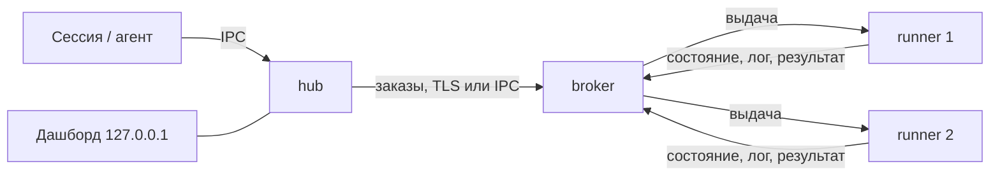

# Al.LocalRunner

[English](README.md) | **Русский**

Очередь задач с учётом ресурсов для разработчика и его AI-агентов. Тяжёлые задачи (тесты, сборки, lint, деплой, миграции) встают в одну очередь и идут по одной на подходящей машине в пределах её памяти и ядер, а агенты не спорят за процессор, память, эмулятор и кэши. Машина может быть одна или их может быть много, в одной сети или в разных. Работает на Windows, Linux и macOS. Один бинарник `localrunner` выполняет все роли.

Ядро не знает ни языка, ни инструментов проекта. Что запускать и что для этого нужно, описывает профиль в `.localrunner/profiles.toml` самого проекта. Полное описание, форматы и требования: [`docs/architecture.html`](docs/architecture.html) ([на английском](docs/architecture.en.html)).

## Содержание

- [Как это работает](#как-это-работает)
- [Быстрый старт с AI-агентом](#быстрый-старт-с-ai-агентом)
- [Быстрый старт вручную (одна машина)](#быстрый-старт-вручную-одна-машина)
- [Установка](#установка)
- [Обновление](#обновление)
- [Hub](#hub)
- [Брокер](#брокер)
- [Раннер](#раннер)
- [Несколько машин](#несколько-машин)
- [Docker Compose](#docker-compose)
- [Профили проекта](#профили-проекта)
- [Журналы](#журналы)
- [Изменение настроек](#изменение-настроек)
- [Автозапуск, остановка, обновление, удаление](#автозапуск-остановка-обновление-удаление)
- [Диагностика](#диагностика)
- [Безопасность](#безопасность)
- [Подробности о плагине](#подробности-о-плагине)
- [Использование](#использование)
- [Выпуск версии](#выпуск-версии)
- [Лицензия](#лицензия)

## Как это работает

Сессия или агент ставит задачу через CLI. Задача становится заказом и уходит брокеру: он держит очередь и выдаёт заказы раннерам, которые подходят по памяти, ядрам, программам и тегам. Раннер выполняет её и возвращает результат и лог. Один бинарник играет три роли:

| Узел | Что делает | Где работает | Конфигурация |
|---|---|---|---|
| hub | принимает команды CLI, превращает профиль в заказ, отправляет его брокеру, хранит копию логов, показывает дашборд | на машине, откуда запускают; один на пользователя ОС | `hub-policy.toml`, `logging.toml` |
| broker | держит очередь, выбирает раннер, хранит историю и ключи участников | на одной машине пула | `policy.toml`, `logging.toml` |
| runner | исполняет джобы, по одной за раз | на машине, где нужны инструменты | `runner.toml`, `logging.toml` |



Для нескольких машин сначала ставят брокер, потом к нему присоединяют hub и раннеры (раздел [«Несколько машин»](#несколько-машин)).

## Быстрый старт с AI-агентом

Самый простой путь: подключить плагин и попросить агента. Плагин даёт агенту скилы для установки, запуска и работы с очередью.

Claude Code:

```
claude plugin marketplace add alexpantiukhin/Al.LocalRunner
claude plugin install localrunner@al-localrunner
```

Codex:

```
codex plugin marketplace add alexpantiukhin/Al.LocalRunner
codex plugin add localrunner@al-localrunner
```

Перезапустите сессию агента и просите простыми словами:

| Скажите | Скил | Что делает |
|---|---|---|
| «установи раннер» | `install-runner` | берёт бинарник из релиза, выполняет `init` и `doctor` |
| «обнови localrunner» | `upgrade-runner` | берёт новую версию из подписанного релиза и заменяет бинарник через `upgrade`, перезапуская роли |
| «подними раннеры» | `up-runner` | запускает hub, брокер и раннеры |
| «прогони тесты через раннер» | `run` | ставит задачу в очередь и читает результат |
| «настрой localrunner в этом репозитории» | `repo-setup` | опрашивает, пишет файл профилей и `temp/` в `.gitignore` после подтверждения каждого диффа, проверяет через `profile check` |
| «покажи очередь» | `status-runner` | очередь, джобы, раннеры, история, дашборд |
| «останови раннеры», «включи автозапуск» | `down-runner`, `autostart-runner` | остановить роли, переключить автозапуск |

Скилы сами не повышают права и не печатают коды вступления и токены. Пока нет первого обычного релиза, используйте предварительный релиз или сборку из исходников (см. ниже). Области установки, удаление и ограничения Codex: [«Подробности о плагине»](#подробности-о-плагине).

## Быстрый старт вручную (одна машина)

1. Установите бинарник. Берите скрипт из релиза, а не из ветки (копия в репозитории содержит метку `@RELEASE_PUBKEY@` и отказывается что-либо ставить). Linux и macOS:

   ```
   curl -fsSL https://github.com/alexpantiukhin/Al.LocalRunner/releases/latest/download/install.sh | sh -s -- --role all
   ```

   Windows (PowerShell, от обычного пользователя; скрипт принимает параметры только как файл):

   ```
   Invoke-WebRequest https://github.com/alexpantiukhin/Al.LocalRunner/releases/latest/download/install.ps1 -OutFile install.ps1
   powershell -ExecutionPolicy Bypass -File .\install.ps1 --role all
   ```

   Или из исходников: `cargo build --release`, затем `target/release/localrunner install`. Установщик сам создаёт шаблоны конфигураций (`init`) и запускает `doctor`. Подробности и параметры: [«Установка»](#установка).

2. Запустите и проверьте:

   ```
   localrunner up        # брокер, hub и раннер фоновыми процессами
   localrunner status    # очередь и пул: память и ядра
   localrunner runners   # ваш раннер в состоянии `online`
   ```

   Если `localrunner runners` печатает `broker <имя> unreachable since <время>`, брокер не запущен или недоступен: hub и раннеры переподключаются сами с растущей паузой (от 1 до 30 с, число попыток не ограничено). `localrunner up` и `localrunner doctor` называют hub или раннер, который жив, но не подключён к брокеру.

   Раннеры одного пула делят один бюджет (память, CPU, exclusive-теги), поэтому `localrunner runners` группирует их по пулам: `pool default: memory 12/32 GB free, cpu 6/16 free, tags held: gradle` (вывод команды английский); над таблицей его раннеров (NAME, STATE, KIND, VERSION, PLATFORM, MEMORY, CPU, DISK, TAGS, READY; `--wide` добавляет PROGRAMS, ENFORCEMENT и CACHE; `localrunner runners <имя>` печатает всё, что известно об одном раннере); в колонке READY стоит `yes`, `busy` (на раннере идёт джоба) или `no` (свободный раннер не начнёт джобу, если пул заполнен). `yes` значит лишь, что раннер свободен, а в пуле осталось не меньше 1 CPU и 1 МБ: резерв и квоты, чужая нагрузка, ждущие заказы и размер вашего заказа не учитываются, поэтому сравните `mem_mb` и `cpu` профиля с заголовком пула, а после отправки используйте `localrunner explain`. В `--json` у каждого брокера есть `pools`. Читайте его перед тем, как отправлять несколько джоб сразу. Раннер, у которого не найдены объявленные `[programs]`, остаётся online (раннер сообщает их имена; старый раннер не сообщает): `runners <имя>` печатает `programs not found: ...`, `status` его перечисляет (`runner_notes` в `--json`), а `doctor` предупреждает, в том числе о раннерах других машин. Раннер с версией старше этого бинарника (или без версии: старая версия) помечается так же: его VERSION подсвечена, а под таблицей идёт заметка `<раннер>: version 0.5.0 is behind 0.8.0: ...` (`version_behind` в `runner_notes`); в конце `upgrade` по-прежнему перечисляет раннеры других машин и контейнеров, оставшиеся на другой версии, с именами и версиями.

   Каждая команда со списком или отчётом (`status`, `runners`, `brokers`, `history`, `stats`, `doctor`, `explain`, `runner list`, `client list`, `policy check`, `upgrade`) печатает одинаково: таблица с шапкой, карточка (метка и значение в строке) для одного объекта или отчёт с маркерами `ok`, `warn`, `fail` и строкой итога. В терминале вывод цветной (зелёный: хорошо, жёлтый: стоит взглянуть, красный: плохо, приглушённый: второстепенное), а длинное значение сокращается до `…` по ширине окна (`COLUMNS`, если терминал ширину не сообщает). Если вывод идёт в канал или файл либо задана `NO_COLOR`, это обычный текст: без цветов и сокращений, колонки разделены двумя и более пробелами. Версия, отличающаяся от версии бинарника, подсвечена везде, где версии показаны, а `--json` от вида вывода не зависит.

3. Опишите задачу. Профиль лежит в `.localrunner/profiles.toml` проекта; в любой пустой папке создайте его:

   ```toml
   [profile.hello]
   command   = "echo hello from localrunner"   # на Windows: "cmd /c echo hello from localrunner"
   timeout_s = 60
   ```

4. Запустите, посмотрите результат и остановите всё:

   ```
   localrunner run hello --as me:test   # поставить, показать вывод, вернуть код выхода
   localrunner history                  # запуски, сначала недавно завершённые
   localrunner dashboard                # запускает живую страницу в фоне и печатает ссылку; down останавливает
   localrunner down                     # раннер доделывает текущую джобу, затем всё останавливается
   ```

## Установка

### Скрипты релиза

Копии с вшитым открытым ключом выпуска лежат среди файлов каждого релиза (https://github.com/alexpantiukhin/Al.LocalRunner/releases); берите скрипт оттуда, а не из ветки. Роль задаёт `--role hub|broker|runner|all` (по умолчанию `all`). Остальные параметры: `--version X.Y.Z`, `--dir DIR`, `--offline ARCHIVE`, `--allow-elevated`, `--upgrade` (обновить установленную копию, см. «Обновление»); список даёт `--help`. Для предварительного релиза `latest` в ссылке не подходит: подставьте тег и версию, например `.../releases/download/v0.1.0-rc1/install.sh` и `--version 0.1.0-rc1`. Скрипт проверяет подпись `SHA256SUMS` и SHA-256 архива и при любом несовпадении ничего не ставит. Пока нет ни одного обычного релиза, используйте сборку из исходников или ссылку на предварительный.

### Из исходников

Нужен Rust (версия в `rust-toolchain.toml`). `cargo build --release` даёт `target/release/localrunner` (`localrunner.exe` на Windows). Положите его в каталог пользователя и подготовьте узел:

```
target/release/localrunner install --dry-run   # показать действия
target/release/localrunner install             # скопировать бинарник, дополнить PATH, выполнить init
```

Проверить узел можно командой `localrunner doctor`. `install` не запускает роли и не включает автозапуск. От root или администратора он отказывается без `--allow-elevated`. Установку нужно повторять на каждой машине.

### Файлы узла

| Что | Windows | Linux, macOS |
|---|---|---|
| бинарник | `%LOCALAPPDATA%\Programs\Al.LocalRunner` | `~/.local/bin` |
| состояние и конфигурации hub и раннера | `%LOCALAPPDATA%\Al.LocalRunner` | `~/.local/share/al-localrunner` |
| состояние брокера-службы | `%ProgramData%\Al.LocalRunner` | `/var/lib/al-localrunner` (Linux), `/Library/Application Support/Al.LocalRunner` (macOS) |

Каталоги можно заменить: `--state-dir` и `--config-dir`, либо переменные `LOCALRUNNER_STATE_DIR` и `LOCALRUNNER_CONFIG_DIR`. `localrunner init [--role hub|broker|runner|all]` создаёт каталог состояния и шаблоны конфигураций. Существующие файлы он не перезаписывает. Когда каталог состояния задан через `--state-dir` или `LOCALRUNNER_STATE_DIR`, `status`, `doctor`, `up` и `down` печатают в stderr `state directory: <путь> (from LOCALRUNNER_STATE_DIR)` (или `from --state-dir`): вывод в stdout не меняется, а переменная, забытая в оболочке, не остаётся незамеченной.

Чтобы попробовать сборку ветки на отдельном состоянии, задайте в этой оболочке `LOCALRUNNER_STATE_DIR` и `LOCALRUNNER_CONFIG_DIR` на новые каталоги, выполните `localrunner init`, `localrunner up all`, нужные команды и `localrunner down`, затем удалите каталоги и снимите переменные. Обычная установка не затрагивается: у неё свои hub и раннеры.

## Обновление

От самого простого способа к самому подробному.

### 1. Через агента

Скажите агенту: «обнови localrunner» (скил `upgrade-runner` плагина). Он покажет установленную и последнюю версию, спросит, что делать с идущими запусками, возьмёт новый бинарник только из подписанного релиза, перезапустит роли и проверит результат через `localrunner doctor`. Перед тем как понадобятся права администратора (служба брокера), он спросит.

### 2. Вручную: `localrunner upgrade`

Запустите `localrunner upgrade` установленным бинарником; для версии, не последней, добавьте `--version X.Y.Z`. Команда сама скачивает релиз для этой платформы, проверяет подпись и SHA-256 по ключам, вшитым в бинарник, и при любом расхождении ничего не ставит. Она покажет установленную и новую версию, идущие запуски и ждущие заказы и спросит, что делать: дождаться запусков, отменить их или прервать. Затем остановит роли, заменит установленный бинарник и поднимет те же роли заново. В конце: `localrunner --version` и `localrunner doctor`.

На машине без рабочего бинарника возьмите вместо этого скрипт релиза (`install.sh --upgrade` или `install.ps1 --upgrade`, см. «Скрипты релиза»): он получит бинарник и запустит тот же `upgrade`.

### 3. Подробности и параметры

- **Без терминала** (скрипт, агент, CI): `--yes` пропускает вопрос и ждёт идущие запуски; `--yes --cancel` отменяет их; `--dry-run` только показывает план; `--wait-timeout 15m` обрывает ожидание, ничего не заменяя; `--offline ARCHIVE` берёт файлы из каталога вместо сети. Ctrl+C во время ожидания ничего не заменяет.
- **Роли с юнитом.** Хаб или раннер, зарегистрированные через `autostart on` на Linux, запускаются снова через пользовательский юнит systemd (`systemctl --user start`) и получают его `EnvironmentFile`; остальные роли стартуют как отдельные процессы оболочки, где выполнен `upgrade`, и секрет `env:`, который был только у вашей оболочки, теряется. Раннер при старте предупреждает о каждом секрете, у которого переменная `env:` не задана или файл `file:` отсутствует (только имена). Лучше источники `file:` или `EnvironmentFile`.
- **Один запрос прав администратора.** Если брокер — служба ОС, `upgrade` один раз просит `broker update-service` от нового бинарника. Служба, уже работающая на этой версии, получает `already current`; служба новее бинарника не заменяется; неудачное копирование снова запускает остановленную службу и сообщает об этом.
- **По неинтерактивному `ssh host cmd`** `~/.local/bin` нет в `PATH`: вызывайте `~/.local/bin/localrunner`.
- **Брокер как служба ОС** держит свою копию бинарника, `upgrade` её не трогает. При смене мажорной версии протокола команда, встретившая службу на старом протоколе (`status`, `submit`, `reload`), пишет `refused: protocol 2.0 is not supported; the role answers on protocol 1.0, ...` и называет эту команду, `down` говорит, что роль работает на старом протоколе, а не `not running`, `upgrade` печатает, что службу не обновляет, а в примечаниях к релизу появляется автоматическая строка **Breaking**. В конце `upgrade` предлагает `localrunner broker update-service` (права команда запрашивает сама); её можно выполнить новым бинарником в любой момент (`--dry-run` покажет план).
- **Несколько машин:** по очереди, брокер первым; все в одном окне, если меняется старшая версия протокола. `localrunner runners` помечает раннер, чья версия отличается от версии бинарника.
- **Раннеры в Docker:** смените тег образа, `docker compose pull`, `docker compose up -d` (см. «Docker Compose»).
- **Плагин** (скилы для агента) обновляется отдельно: `claude plugin marketplace update al-localrunner`, затем `claude plugin update localrunner@al-localrunner --scope <область>`, затем перезапустите Claude Code.
- Схемы баз обновляются при старте с резервной копией; откат на старую версию не поддерживается.
- Все подробности: «Автозапуск, остановка, обновление, удаление».

## Hub

Нужен на каждой машине, откуда ставят запуски. Один hub на пользователя ОС.

Установка и запуск:

```
localrunner install --role hub   # бинарник и шаблоны hub (init)
localrunner up hub               # или: localrunner hub run (на переднем плане)
```

Если брокер на другой машине, hub вступает в пул (код выдаёт брокер, см. [«Брокер»](#брокер)):

```
localrunner hub join <адрес:порт> --code-file code.txt --name office
localrunner brokers         # проверить: брокер в списке, зона, доступность, версия
```

Код можно передать так: `--code-file файл`, `--code-file -` (стандартный ввод), переменная `LOCALRUNNER_JOIN_CODE`, аргумент командной строки. Последний способ показывает код другим пользователям машины.

Настройка: `hub-policy.toml` в каталоге конфигурации. Определяет, какому брокеру отправить заказ:

```toml
[brokers]
order             = ["win-host", "linux-box"]   # имена из hub join, по порядку
strategy          = "first"                     # first | least_loaded
broker_zone_order = ["local", "lan", "remote"]
query_timeout_s   = 3
query_attempts    = 3
zone_query        = "sequential"                # sequential | all
query_retry_s     = 5

[outbox]
ttl_hours = 24                                  # сколько заказ ждёт брокера
on_expire = "fail"                              # fail | keep
```

Без файла действуют значения по умолчанию. Заказы, ограниченные зоной `local` (`zones = ["local"]` в профиле или `--zones local`), уходят только на брокер с этой же машины. На машине брокера hub по коду не вступает: брокер разрешает локальным пользователям доступ по списку `[[local_user]]` в `policy.toml` (`install` вносит туда вас). Команды для работы с джобами: см. [«Использование»](#использование).

## Брокер

Один на пул. Держит очередь, ключи участников и историю. Сам ничего не исполняет.

Запуск на машине пользователя:

```
localrunner install --role broker
localrunner up broker       # или: localrunner broker run
```

Запуск службой ОС (выделенная машина, несколько пользователей). Нужны права администратора. Служба работает под отдельной учётной записью, не под root и не под SYSTEM:

```
localrunner broker install-service --dry-run
localrunner broker install-service
```

Служба снимается командой `localrunner autostart off broker` или `uninstall`. Команда `down` службу не останавливает: останавливайте менеджером служб ОС. Без прав администратора `down broker` называет работающую службу и печатает команду её перезапуска из повышенной оболочки (код выхода 1). `up` службу не запускает.

Настройка: `policy.toml` в каталоге состояния брокера. Без файла действуют значения по умолчанию. Основные таблицы:

| Таблица | Назначение |
|---|---|
| `[listen]` | адрес, на котором брокер слушает сеть. Без него сеть не слушается. Подстановочные адреса (`0.0.0.0`, `::`) отвергаются. В контейнере: `address = "container"` |
| `[networks]` | именованные сети; от них зависит зона hub (`lan` или `remote`) |
| `[[shared]]` | `members = ["main-laptop", "docker-1"]`: метки клиентов и имена раннеров с общим диском; зона между ними `shared`. Метка клиента уникальна: `broker add --label` занятую метку отклоняет. Применяется при перезагрузке |
| `[[local_user]]` | кому разрешён локальный IPC: `name`, `label` |
| `[queue]` | `strategy` = `priority-fifo`, `fair-share`, `weighted` |
| `[[rule]]` | приоритет, резерв, квота, вес по условию `when` (первое подошедшее правило по каждому полю) |
| `[pool]` | `name` (его показывает `localrunner runners`, по умолчанию `default`), `mem_mb`, `cpu`, `exclusive_tags`; по умолчанию вся память и все ядра машины брокера |
| `[limits]` | `max_job_timeout_s`, `timeout_above_max` (`reject` или `trim`), `job_log_max_mb`, `max_active_per_client`, `api_requests_per_min` (1200) |
| `[resources]` | лимиты джобы по заявленным `mem_mb` и `disk_mb`: `mode` = `off`, `warn` (по умолчанию), `limit`, `kill`; `mem_headroom`, `disk_headroom` (запас, по умолчанию 1.25). См. [Лимиты ресурсов](#лимиты-ресурсов-очистка-и-чужая-нагрузка) |
| `[admission]` | `foreign_load` = `off` (по умолчанию) или `wait`: ждать, пока чужие процессы нагружают машину раннера; `mem_headroom_mb` (256) |
| `[commands]` | `default = "any"` или `"named"`; `[[commands.client]]` для отдельных ключей или ярлыков |
| `[visibility]` | `others_orders` = `none`, `summary`, `full`: что видят чужие клиенты |
| `[cancel]` | `others = "none"` или `"owner"`: кто отменяет чужие заказы |
| `[join]` | `code_ttl_min` — срок жизни кода вступления (60) |
| `[orphans]`, `[grace]`, `[results]` | что делать с заказами пропавшего hub, льготный срок потери раннера (`lost_min`), хранение результатов |
| `[history]`, `[saturation]`, `[cache]`, `[services]` | хранение истории, пороги насыщения, общий кэш, сервисы раннеров |
| `[[secrets.allow]]` | какой ярлык какие секреты может просить |

Пример:

```toml
[listen]
address = "192.168.1.10:7443"

[[local_user]]
name  = "alex"
label = ""

[[rule]]
name     = "ci-first"
when     = { client_label = "ci" }
priority = 100

[[rule]]
name     = "nightly"
when     = { client_label = { in = ["ci", "night"] }, project = { glob = "lr-*" }, mem_mb = { ge = 8192 }, not = { tag = "flaky" } }
priority = 50
```

Значение условия — обычное значение (равенство) или таблица проверок: `in`, `prefix`, `glob`, `ne` для строк и `lt`, `le`, `gt`, `ge` для чисел, а также `any = [...]` и `not = {...}`. Правила с условием по заявленным атрибутам (`source`, `project`, `tag`, `label`, `submitter_label`, `platform`, `mem_mb`, `cpu`, `disk_mb`, `timeout_s`, `min_mem_mb`) допускаются только вместе с положительным условием `client_label`. Отрицательный `priority` допускается. Старения нет: при постоянном потоке заказов более высокого приоритета заказ низкого приоритета может ждать неограниченно долго; `[queue] age_after_min` из старых файлов игнорируется с предупреждением. Неизвестные таблицы и ключи отвергаются с номером строки.

Команды:

```
localrunner policy check [файл]   # проверить, не применяя
localrunner policy reload         # применить все таблицы, включая [listen], [networks] и [[shared]]; только на машине брокера
localrunner logging reload        # перечитать logging.toml во всех работающих ролях
```

Присоединение участников:

```
localrunner broker add --name office --label dev              # для hub: печатает адрес, код и отпечаток сертификата
localrunner broker add --runners 2 --address 192.168.1.10:7443  # для раннеров: код на 2 вступления
localrunner broker add --runners 1 --code-file code.txt         # записать код в новый файл, а не печатать
localrunner runner list
localrunner runner remove <имя> [--yes]   # удалить раннер и отозвать его ключ
localrunner client list
localrunner client remove <имя> [--yes]   # отозвать ключ hub
```

`broker add` работает через административный канал брокера: для брокера, установленного службой Windows, нужен администратор, в Unix нужен пользователь ОС брокера. `runner join` и `hub join` отказываются работать от администратора, поэтому код приходится передавать между двумя пользователями: выполнить `broker add --code-file <файл>` от администратора (файла ещё не должно быть), затем `runner join <адрес> --code-file <файл>` от обычного пользователя и удалить файл. Код не появляется на экране; адрес, отпечаток и срок печатаются как обычно.

Код действует 1 час и на указанное число вступлений. Адрес с портом должен быть доступен участнику. Отпечаток сертификата входит в код, поэтому вручную его сверять не нужно. `runner remove` и `client remove` спрашивают подтверждение; без терминала (скрипты, агенты) нужен `--yes`.

## Раннер

Исполняет джобы. Одну за раз, с теми ресурсами, которые объявлены в `runner.toml`.

Установка и запуск на машине брокера:

```
localrunner install --role runner
# задать ключи: localrunner config set runner:<имя> <ключ> <значение> (раздел ниже и «Изменение настроек»)
localrunner up runner
```

Раннер на другой машине:

```
localrunner install --role runner
# задать ключи: localrunner config set runner:<имя> <ключ> <значение>
localrunner runner join <адрес:порт> --code-file code.txt --name box --count 2
localrunner up runner
```

`--count N` (от 1 до 64) создаёт раннеры `box-1` … `box-N` с одним шаблоном `runner.toml`; у каждого свой каталог, ключ и запись на брокере. `--name` побеждает `name` из файла; без обоих берётся имя машины.

`runner join` копирует шаблон в `runner/<имя>/runner.toml`, и эта копия главнее: правки шаблона присоединённого раннера больше не достигают, а раннер, который не присоединялся, читает шаблон. `localrunner runner config <имя>` показывает файл, который читает раннер, и его путь; `--diff` — строки, которыми собственная копия отличается от шаблона. Присоединённому раннеру на той же машине, где стоит брокер, нужен собственный каталог состояния (`--state-dir`), отличный от каталога брокера. В контейнере вместо этого читается файл, смонтированный в `/etc/al-localrunner/runner.toml`: `runner join` копию не пишет, правку смонтированного файла `localrunner reload` или перезапуск подхватывают сразу, `runner config <имя>` показывает смонтированный файл; копия нужна только как шаблон для старта без смонтированного файла. `--platforms` и `--tags` у `runner join` требуют копии, поэтому контейнер со смонтированным файлом их отвергает: задайте их в файле. Правьте смонтированный файл на месте: инструмент, который заменяет его новым файлом (`config set`), оставляет работающий контейнер на старом, тогда пересоздайте контейнер.

Всё, что раннер ещё должен доставить брокеру, лежит в его исходящей очереди (outbox). Если брокер уже отменил или потерял джобу, её записи могут остаться неотправленными; `localrunner runner outbox drop [--runner ИМЯ] <job-id>` закрывает их на работающем раннере и печатает `closed N entries of <job-id>`. Пока раннер ещё выполняет эту джобу, команда отказывает; без `--runner` берётся единственный раннер установки. Если раннер не запущен, печатается `not running`, код выхода 1.

Настройка: `runner.toml`. Обязателен `[env] path`: это `PATH` джобы и место поиска программ. Раннер без него не запускается, `PATH` процесса раннера джобам не передаётся. Автозапуск и службы дают бедное окружение, поэтому пути задают явно.

Джоба получает только такие переменные: `PATH` (из `[env] path`), `HOME` (из процесса раннера), `TEMP`, `TMP` и `TMPDIR` (личный каталог джобы), `LOCALRUNNER_JOB_ID`, `LOCALRUNNER_CACHE_<ИМЯ>`, секреты, которые она запросила, и всё из `[job_env]`; в Windows ещё `SystemRoot`, `windir`, `ComSpec`, `PATHEXT`. Остальное окружение раннера не наследуется. Любые другие нужные джобам переменные (`JAVA_HOME`, `CARGO_HOME`, `ANDROID_NDK_HOME`) записываются в `[job_env]` как `ИМЯ = "значение"`; `HOME`, записанный там, заменяет определённый. Нативной сборке в Windows может понадобиться больше, чем в списке выше: Rust с набором MSVC находит компоновщик через `vswhere`, а тот читает `ProgramFiles(x86)`; если джоба падает с `linker link.exe not found`, хотя инструменты установлены, перечислите имена в `[job_env] inherit` (ниже). `init` и `runner join` на Windows пишут этот список сами. `init` и `runner join` записывают в `[job_env]` `HOME` оболочки, из которой запущены, поэтому он виден в файле; у раннера, в файле которого нет `HOME`, берётся домашний каталог пользователя ОС, от которого он запущен, поэтому у джоб на разных раннерах в нём могут оказаться разные настройки (`.npmrc`, `.gitconfig`); чтобы они совпадали, задайте `HOME` в `[job_env]` своим каталогом. `PATH` (для него есть `[env] path`), `TEMP`, `TMP`, `TMPDIR` и имена на `LOCALRUNNER_` отклоняются. Ключ, который не является настройкой `runner.toml` (например, переменная, записанная под `[env]`), даёт предупреждение при запуске и в `doctor`. Проверки `[programs]` идут в точно таком же окружении, и каждая может занять `check_timeout_s` секунд (по умолчанию 10): программе с медленным стартом, например `pnpm` через `corepack` с пустым кэшем, нужно значение побольше или `HOME` с её кэшем.

```toml
name      = "linux-heavy"
platforms = ["linux", "android"]
tags      = ["gradle", "emulator"]
mem_mb    = 16384              # необязательно: вся память хоста
cpu       = 8                  # необязательно: все ядра хоста
allow_elevated = false         # запуск от root или администратора
allow_same_user_as_broker = false

[env]
path = "/usr/local/bin:/usr/bin:/bin"

[programs]                     # что искать на раннере и чем проверять
git    = {}
gradle = { check = "gradle --version" }
android-emulator = { check = "emulator -list-avds" }   # имя возможности: решает check

[accept]
min_mem_mb = 8192              # резерв под тяжёлые заказы

[limits]
max_job_timeout_s = 3600       # потолок таймаута джобы на этом раннере
enforce       = "kill"        # необязательно: off | warn | limit | kill; заменяет режим брокера
mem_headroom  = 1.25          # необязательно: запас к заявленному mem_mb (от 1.0 до 100.0)
disk_headroom = 1.5           # необязательно: запас к заявленному disk_mb (от 1.0 до 100.0)

[cache]
max_size_gb    = 40
retention_days = 14
evict          = "lru"

[commands]                     # названия для клиентов с mode = "named"
build = "make all"

[job_env]                     # дополнительные переменные каждой джобы, службы и хука очистки
JAVA_HOME = "/opt/jdk"
GRADLE_OPTS = "-Dorg.gradle.daemon=false"
inherit = ["ProgramFiles(x86)", "USERPROFILE"]   # точные имена, копируемые из процесса раннера при старте каждой джобы

[[cleanup]]                    # команда после каждой джобы
name      = "labelled-containers"
command   = "sh -c 'docker rm -f $(docker ps -aq --filter label=$LOCALRUNNER_JOB_LABEL)'"
timeout_s = 60                 # от 1 до 3600, по умолчанию 60
on        = ["passed", "failed", "killed", "cancelled", "timeout"]   # по умолчанию все
```

`[programs]`: `check` — любая команда, выполняемая в том же окружении, что и джоба; всё, чему доверяют `doctor` и регистрация раннера, — её код выхода 0. `cargo --version` доказывает, что программа запускается, но не что она делает нужное проектам (нативная сборка всё равно может упасть при линковке, потому что в чистом окружении джобы нет какой-то переменной). Владелец, чьи проекты компилируют нативный код, делает так, чтобы `check` выполнял нужный проекту шаг, например линковку крошечного крейта или `cargo build --offline` тестового проекта. Раннер и `doctor` ничего не знают о конкретном инструментарии.

Ключ записи `[programs]` — имя возможности, по умолчанию совпадает с именем программы. Если задан `check`, а `path` нет, имя не ищется в `[env] path`: решает код выхода проверки, поэтому ключ вроде `android-emulator` объявляется, когда `emulator -list-avds` завершается успешно. Без `check` имя ищется в `[env] path`; с `path` файл должен существовать. Проверка, которая падает или идёт дольше `check_timeout_s` (по умолчанию 10), означает лишь, что программа не объявляется: раннер продолжает работать, а `doctor`, `runners` и `status` показывают программу как не найденную. Возможность, у которой нет команды проверки, идёт через `tags`.

Сервисы раннера (демон сборки, эмулятор) описываются в `[service.<имя>]`: `start`, `ready_check`, `stop`, `ready_timeout_s`, `memory_mb`, `lifetime` (`per_job`, `idle`, `keep`), `idle_timeout_s`, `max_lifetime_s` (обязателен), `reuse`. Формат — в разделе 3.11 архитектуры.

### Локальные и подключённые раннеры

`localrunner runners` показывает вид каждого раннера: `local` или `joined`.

| | Локальный раннер | Подключённый раннер |
| --- | --- | --- |
| Как подключается | Через локальный канал брокера на этом компьютере (так подключается любой пользователь ОС, которого пускает брокер); `broker.toml` и ключ не нужны | По ключу (`join`), по сети или из контейнера, даже если он на том же компьютере |
| Имя | `local:<имя>` | Имя, под которым он подключился |
| Зона относительно клиента | `local`, если запущен от того же пользователя ОС, что и клиент | `shared`, `lan` или `remote`, но не `local` |
| Какие шаги выполняет | Шаги своей зоны в каталоге клиента | Шаги своей зоны: в каталоге клиента в `shared`, в папке джобы в `lan` и `remote` |

Следствия:

- Подключённый раннер на том же компьютере, что и клиент, никогда не лежит в зоне `local`: брокер не может доказать, что он видит каталог клиента; владелец может отнести его к `shared` блоком `[[shared]]` в `policy.toml`.
- Чтобы раннер работал в каталоге клиента, запустите его локальным: на компьютере клиента, без `broker.toml` и без ключа.
- Заказ, который не может взять ни один раннер, отклоняется сразу, а не встаёт в очередь. Найти его можно через `localrunner jobs` (`--json` показывает состояние `rejected_no_matching_runner`); `status <job>` и `history show <job>` отклонённый заказ не знают.
- Раннер в контейнере локальным быть не может: у него нет локального канала к брокеру, он всегда подключённый.
- Старый брокер вид раннера не сообщает; тогда колонка пуста.

### Лимиты ресурсов, очистка и чужая нагрузка

Заявленные в профиле `cpu`, `mem_mb` и `disk_mb` ограничивают саму джобу по умолчанию в режиме `warn`: раннер записывает пики каждой джобы, пишет предупреждение в лог джобы при превышении потолка `mem_mb` или `disk_mb`, ограничивает долю CPU заявленным `cpu` и число процессов; ничего не убивается, пока не выбран `kill`. Выключается через `[resources] mode = "off"` или `[limits] enforce = "off"`. Это умолчание меняет поведение существующих установок. Пики пишутся в любом режиме (`peak_mem_mb`, `peak_disk_mb`): их видно в столбцах `PEAK_MEM_MB` и `PEAK_DISK_MB` команды `history`, а также в `history show`, `jobs`, `explain`, `status --json` и на дашборде. Прочерк в столбце пика значит «не измерялось» (у джобы без заявленного `disk_mb` и без каталогов для измерения пика диска нет), а `0` — измерено, пусто. Джоба, которая запускает контейнер (`docker run ...`), измеряется только по своему дереву процессов: память внутри виртуальной машины Docker или контейнера в пик не входит, поэтому пик такой джобы мал и заявленный `mem_mb` с ним не сравнить.

Приказ, который брокер отклоняет на входе (больше, чем пул способен дать, имя вне списков раннеров, секрет, не разрешённый ярлыку), записывается: `history` показывает его в состоянии `rejected`, а `history show` — причину; `history --result rejected` перечисляет только такие. Дашборд показывает то же состояние. `explain <job>` отвечает и по такому заказу и называет невыполненное требование (`r1: bash не найден`: в PATH раннера нет `bash`).

Каждый заказ, покинувший очередь, хранит причину окончания и того, кто его завершил: метку `--as` команды `cancel`, метку отправителя у заказа, отозванного из-за ушедшего отправителя (`sender_gone`), `upgrade` или `down` у джобы раннера, остановленного `upgrade --cancel` или `down --cancel`, `lock` у джобы раннера, остановившегося, пока замок обновления держал его в drain, `broker` у отказа; неизвестного автора нет в записи. `status --recent [N|период]` перечисляет их после очереди (без значения последние 10, или например `--recent 2h`), `history` показывает их в последнем столбце `REASON` (`cancelled by upgrade: runner_stopped`), а `--json` в полях `reason` и `cancelled_by`. `upgrade --cancel` печатает отменяемые джобы (джобы останавливаемых раннеров), джобы других машин, которые продолжают идти, если такие есть, и все заказы, которые остаются в очереди. Вопрос считает только отменяемые джобы. Раннер, о котором брокер сообщает только по имени, сопоставляется с этой установкой лишь по имени, так что одноимённый раннер другой машины не отличить; для таких джоб список об этом предупреждает.

- **Режимы.** `[resources] mode` в `policy.toml` брокера или `[limits] enforce` раннера (значение владельца раннера сильнее): `off` (явно) ничего не ограничивает и только записывает пики, `warn` (по умолчанию) пишет строку-предупреждение в лог джобы, `limit` держит память джобы на потолке средствами ОС и не убивает её (в Windows выделения сверх потолка отказывают, в Linux джоба притормаживается; диск ведёт себя как в `warn`), `kill` завершает всё дерево процессов, и джоба падает с причиной `resource_exceeded` и текстом `превышен заявленный mem_mb: заявлено X МБ, пик Y МБ`. В `limit` джоба, упавшая после того, как предел ОС действительно был достигнут (Windows: пик зафиксированной памяти Job Object дошёл до потолка; Linux: `memory.events` scope насчитал `high`, `max` или OOM kill), тоже получает `resource_exceeded` с пиком и сохраняет код выхода, а её лог заканчивается строкой `localrunner: failed at the memory ceiling: ...`; любое другое падение сохраняет свою причину. Раннер более ранней версии получает от брокера `warn` вместо `limit`; `runners` помечает его `(limit mode not supported: runs as warn; ...)` и называет причину: более ранняя версия или нет systemd (`enforcement watcher`). В контейнере systemd нет, поэтому лимит на джобу там не применяется и `limit` работает как `warn`; общий лимит раннера задаёт Docker (`mem_limit` и `cpus` сервиса в `install/compose.yaml`). `kill` стоит включать, когда накопилась история пиков.
- **Потолки** (только если режим не `off`): память — заявленный `mem_mb` на `mem_headroom`, диск — `disk_mb` на `disk_headroom` (запас от 1.0 до 100.0, по умолчанию 1.25). CPU — заявленные `cpu` ядер процессорного времени: доля, а не привязка к ядрам, жёсткий предел, но не повод убивать джобу. Число процессов ограничено значением `max(512, cpu * 256)`. Джоба, завершившаяся с кодом 0 при пике выше потолка, остаётся успешной.
- **Механизмы.** Windows: Job Object (память, предел доли CPU, предел числа процессов); предел памяти в `kill` на 10% выше потолка, в `limit` — на потолке. Linux: scope cgroup v2 через `systemd-run` (`MemoryMax`, `CPUQuota`, `TasksMax`), если контроллеры делегированы пользователю; `limit` добавляет `MemoryHigh` на потолке (торможение и вытеснение, своп разрешён) и оставляет `MemoryMax` на 10% выше. У раннера, который работает системной службой Linux, нет пользовательского менеджера, поэтому он сам создаёт cgroup джоб в поддереве cgroup, которое ему делегирует юнит (`Delegate=yes`, его пишет `autostart on runner <имя> --service`): переносит себя в лист `runner`, включает контроллер памяти для дочерних групп и пишет те же значения в `memory.high`, `memory.max`, `cpu.max` и `pids.max` своей cgroup для каждой джобы. Для этого нужны контроллер памяти в cgroup юнита и Linux 5.14+ (`cgroup.kill`, чтобы дерево, которое порождает процессы, убивалось целиком); иначе раннер сообщает `watcher`. В юните, поставленном более ранней версией, `Delegate=yes` нет: переустановите его (`autostart off runner <имя> --service`, затем `autostart on runner <имя> --service`); до тех пор `limit` там ведёт себя как `warn`, и `doctor` об этом говорит. Иначе, и всегда на macOS, — наблюдатель в пользовательском пространстве: примерно раз в 250 мс он замеряет дерево процессов и убивает его выше потолка; там `limit` ведёт себя как `warn`; CPU снижается приоритетом процесса (`nice`), предел числа процессов не действует. В Unix наблюдатель измеряет RSS, поэтому цифры там приблизительные (в Windows — commit). Раннер сообщает `enforcement = os` или `watcher` (видно в `runners` и на дашборде); раннер `watcher` не объявляет `limit`, поэтому брокер посылает ему `warn`.
- **Диск.** Наблюдатель примерно раз в 2 секунды суммирует файлы в рабочем каталоге джобы и в её личном временном каталоге `<каталог состояния раннера>/tmp/lr-<job-id>` (символические ссылки не разворачиваются; общий системный temp не измеряется). `TEMP`, `TMP` и `TMPDIR` каждой джобы указывают на этот каталог: он используется всегда, создаётся до первого шага и удаляется после джобы (в том числе после kill или отмены; до 8 попыток с паузой 250 мс, так как в Windows файлы только что убитого процесса недолго заняты); после сбоя раннера при его запуске удаляется всё под `<каталог состояния>/tmp`. Это меняет место, куда джобы пишут временные файлы. Перед стартом раннер сверяет свободное место тома рабочего каталога с `disk_mb` на запас.
- **Очистка.** Команды `[[cleanup]]` запускаются после любого исхода джобы (`on` по умолчанию — все: `passed`, `failed`, `killed`, `cancelled`, `timeout`) с окружением `LOCALRUNNER_JOB_ID` и `LOCALRUNNER_JOB_LABEL` (`lr-<id джобы>`). Сбой хука не меняет результат джобы: предупреждение идёт в лог джобы и в диагностику. Джоба, прерванная падением или перезапуском раннера, получает свои хуки один раз при следующем запуске как `killed` (до отправки результата `runner_restarted`), поэтому хук должен быть идемпотентным. Хуки не запускаются для заказов, отклонённых при приёме. Что и как чистить (контейнеры с меткой, демоны сборки) — дело команды владельца; ядро инструментов не знает.
- **`[job_env]`** добавляет переменные каждой джобе и хуку; `PATH`, `TEMP`, `TMP`, `TMPDIR` и `LOCALRUNNER_*` запрещены; `HOME` разрешён. `inherit` — список точных имён переменных (без шаблонов), которые раннер копирует из своего процесса при старте каждой джобы, поэтому смена машины не оставляет в файле устаревших копий; имя, которого в процессе нет, пропускается, а `doctor` его перечисляет; явное `NAME = "значение"` главнее унаследованного; запрещённые имена те же; имя, совпадающее с `[secret.<имя>]` этого раннера, отклоняется при загрузке файла (секреты никогда не наследуются). Список пишет только владелец раннера: профиль не может попросить больше. `doctor` также предупреждает, если на Windows в `[programs]` есть `cargo`, а ни в `inherit`, ни в `[job_env]` нет `ProgramFiles(x86)`. Переменную с именем ровно `inherit` задать нельзя. `LOCALRUNNER_JOB_LABEL` попадает в окружение джобы, только если есть хотя бы один `[[cleanup]]`.
- **Чужая нагрузка.** Раннеры присылают свободную память и загрузку CPU своей машины вместе с heartbeat. С `[admission] foreign_load = "wait"` заказ ждёт, пока чужие процессы оставляют слишком мало (`занято чужими процессами: CPU 95%, нужно 4 ядер`, видно в `status` и `explain`); выполняющиеся джобы не приостанавливаются. CPU собственных джоб брокера на той же машине чужим не считается. На macOS нагрузка читается через `vm_stat` и `ps`. Раннеры, не присылающие нагрузку (старые), допускаются как раньше.
- **В этой версии нет:** лимитов дискового ввода-вывода, привязки к ядрам, приостановки выполняющихся джоб, прокси Docker-сокета, дисковых квот ОС.

База `broker.db` при первом запуске переходит на схему 2 (остаётся копия `broker.db.bak-1`). Два новых столбца `history` стоят перед `BROKER`: в скриптах сдвиньте номера столбцов. Подробности — в разделе 3.14 архитектуры.

`localrunner doctor` предупреждает, когда раннер, зарегистрированный у брокера, работает на другой версии, чем этот бинарник (`runners` отмечает то же расхождение); обновите такую машину через `localrunner upgrade`.

Права:

- Раннер выполняет команды из заказов и работает под пользователем, который его запустил. Для чужих клиентов заведите отдельного ограниченного пользователя ОС.
- От root, администратора и SYSTEM раннер отказывается запускаться без `allow_elevated = true`.
- Если брокер запущен не службой, принимает других клиентов (`[listen]` или чужой `[[local_user]]`) и разрешает им любые команды, раннер под тем же пользователем ОС не запустится. Варианты: раннер под другим пользователем, брокер службой ОС, `[commands] default = "named"` в `policy.toml` или `allow_same_user_as_broker = true` в `runner.toml` (вы принимаете риск).

## Несколько машин

Порядок: брокер, затем остальные.

1. Брокер-машина. `install --role broker`, в `policy.toml` задать `[listen]` и `[networks]`, запустить (`broker install-service` для постоянной работы).
2. Для каждой клиентской машины: на брокере `broker add --name <имя> --label <ярлык>`; на клиенте `install --role hub`, `hub join <адрес:порт> --code-file code.txt --name <имя брокера>`, `up hub`.
3. Для каждой машины с раннерами: на брокере `broker add --runners N --address <адрес:порт>`; на машине `install --role runner`, правка `runner.toml`, `runner join ...`, `up runner`.
4. Проверка: `localrunner doctor`, `localrunner runners`, `localrunner brokers`.

Входящий порт нужен только брокеру. Автоматического поиска брокера в сети нет, адрес вводят вручную.

## Docker Compose

Файлы: `install/Dockerfile`, `install/compose.yaml`, `install/policy.toml`, `install/runner.toml`. Опубликованный образ содержит только бинарник поверх `debian:bookworm-slim` (оболочка, glibc, сертификаты CA), работает не от root и остаётся минимальным. Каждый релиз публикует его как `ghcr.io/alexpantiukhin/al.localrunner:<версия>` и прикладывает `compose.yaml`, который его использует.

Стандартный способ запустить раннер — собственный образ, который собирает сам `compose.yaml`, без репозитория и отдельного Dockerfile: у сервиса раннера есть `build: dockerfile_inline`, где вы выбираете базовую ОС и пакеты одним видимым списком, а бинарник копируется из опубликованного образа той же версии:

```yaml
runner:
  build:
    dockerfile_inline: |
      FROM debian:bookworm-slim
      RUN apt-get update \
          && apt-get install -y --no-install-recommends ca-certificates git python3 \
          && rm -rf /var/lib/apt/lists/*
      COPY --from=ghcr.io/alexpantiukhin/al.localrunner:<version> /usr/local/bin/localrunner /usr/local/bin/localrunner
      # ... каталоги, ENV и USER как в install/compose.yaml
```

Бинарник статический, поэтому подойдёт любая основа: для alpine напишите `FROM alpine:3.21` и `RUN apk add --no-cache ca-certificates git python3`. Сборка идёт один раз и кэшируется (`docker compose build runner` после правки списка); запуск контейнера сети не требует, раннер работает не от root, `cap_drop: [ALL]` остаётся. Что где держать: пакеты ОС (git, python, компилятор C, всё, что тянет общие библиотеки или `libexec`, которые каталог с диска не передаст) — в `dockerfile_inline`, тогда `[programs]` их находит; большие тулчейны (node, java, rust), которые не хочется пересобирать в образ, — в каталог хоста или том как `<инструмент>/bin`, смонтированный в контейнер раннера и названный в `runner.toml`: `[env] tools_dir = "/opt/tools"`. Найденные там каталоги `bin` дописываются к `path`; `localrunner reload` подхватывает каталог, заполненный позже. Если каталог для сокетов `/run/al-localrunner` недоступен для записи пользователю, от которого запущен контейнер, раннер использует `ipc/` каталога состояния. Раннер читает смонтированный `./runner.toml` напрямую: хватит правки на месте и `localrunner reload` (или перезапуска). В контейнере память и ядра ограничивает Docker, а не `[limits] enforce = "limit"` (ему нужен systemd, он работает как `warn`; `runners` об этом говорит): задайте `mem_limit` и `cpus` сервиса. Тег образа всегда указывается явно, в том числе в `COPY --from`. У выпуска, которого ещё нет среди опубликованных, тега нет: копируйте бинарник из образа, который собирает сервис `broker` (`COPY --from=al-localrunner:<версия>`).

Обновление Linux-раннеров в Docker: смените тег в своём `compose.yaml` на образ нового релиза, затем `docker compose pull` и `docker compose up -d`; каталог инструментов остаётся как есть. Том состояния хранит ключ раннера и запись о присоединении, поэтому заново присоединять не нужно. Проверка: `localrunner runners` показывает у каждого раннера версию, с которой он зарегистрировался (колонка VERSION, подсвечена при расхождении с этим бинарником; `runners <имя>` называет и версию бинарника; она же в `--json` и на дашборде); раннер, не регистрировавшийся после обновления, показан как `unknown`.

Собственный образ (`dockerfile_inline` из `compose.yaml` это делает) должен создать эти каталоги и отдать их пользователю, от имени которого работает процесс (в официальном образе и в примере это `65532:65532`): `/var/lib/al-localrunner` (состояние, `LOCALRUNNER_STATE_DIR`), `/etc/al-localrunner` (конфигурация, `LOCALRUNNER_CONFIG_DIR`), `/run/al-localrunner` (сокеты Unix). Без них процесс останавливается с `cannot create /run/al-localrunner: Permission denied`.

```
docker compose -f install/compose.yaml up -d broker
docker compose -f install/compose.yaml exec broker localrunner broker add --runners 1 --address broker:7443
docker compose -f install/compose.yaml run --rm -e LOCALRUNNER_JOIN_CODE runner localrunner runner join broker:7443 --config /etc/al-localrunner/runner.toml --name runner
docker compose -f install/compose.yaml up -d runner
```

Код, который печатает `broker add`, секретный и не должен попадать в командную строку, где его видят другие пользователи машины: сначала положите его в окружение своей оболочки (`read -rs LOCALRUNNER_JOIN_CODE; export LOCALRUNNER_JOIN_CODE` в bash, `$env:LOCALRUNNER_JOIN_CODE = Read-Host` в PowerShell) и передайте переменную по имени, как `-e LOCALRUNNER_JOIN_CODE` выше (без `=значение`), либо используйте `--code-file -` с кодом на стандартном вводе (`run --rm -T`) или `--code-file <файл>` с файлом, смонтированным в контейнер. В контейнере `runner join` нужны `--config /etc/al-localrunner/runner.toml` (смонтированный файл, который раннер потом читает напрямую) и `--name`: имя раннера в пуле (иначе берётся имя хоста контейнера).

Политика: правьте `install/policy.toml`, затем `docker compose exec broker localrunner policy reload`. Порт брокера опубликован на `127.0.0.1:7443`; для других машин замените адрес на интерфейс хоста. Раннер в контейнере не видит файлы хоста и берёт только заказы с коммитом.

Docker Desktop (Windows, macOS). Раннер работает внутри виртуальной машины Docker, поэтому:

- **Память.** `runner.toml` проверяется против памяти машины, которую видит раннер, а в контейнере это виртуальная машина, по умолчанию заметно меньше памяти Windows: `mem_mb = 12288` при ВМ на 7944 МБ останавливает раннер сообщением `mem_mb = 12288 is more than this host has (7944); declare at most 7944`. Лимит ВМ поднимают в `%UserProfile%\.wslconfig` (`[wsl2]`, `memory=16GB`; на бэкенде Hyper-V — в настройках Docker Desktop) и применяют командой `wsl --shutdown`: смена перезапускает WSL и **все** контейнеры Docker Desktop, в том числе не относящиеся к раннеру. `cpus` и `mem_limit` сервиса ограничивают раннер внутри ВМ.
- **Брокер на хосте.** Брокер, запущенный на хосте (`[listen] address = "127.0.0.1:7443"`), доступен из контейнера как `host.docker.internal:7443` (имя разрешает Docker Desktop; в Docker на Linux добавьте сервису `extra_hosts: ["host.docker.internal:host-gateway"]` и пусть брокер слушает адрес, до которого доходит мост). Код создают командой `localrunner broker add --runners 1 --address host.docker.internal:7443`, присоединяются `runner join host.docker.internal:7443 ...` как выше; в `install/compose.yaml` брокер лежит в контейнере, тогда адрес `broker:7443`.
- **Каталог сокетов.** `/run/al-localrunner` должен существовать и принадлежать пользователю, от которого запущен контейнер: `dockerfile_inline` в `install/compose.yaml` его создаёт; в собственном образе добавьте `mkdir -p /run/al-localrunner && chown <uid>:<gid> /run/al-localrunner`, иначе раннер остановится с `cannot create /run/al-localrunner: Permission denied`.


## Профили проекта

`.localrunner/profiles.toml` в репозитории проекта:

```toml
[profile.rust-unit]
command   = "cargo test --workspace"
timeout_s = 900                     # обязателен
mem_mb    = 4096
cpu       = 4
tags      = ["cargo"]

[profile.rust-gate]
timeout_s = 1800
steps = [
  { name = "fmt",  command = "cargo fmt --all --check", timeout_s = 120 },
  { name = "test", command = "cargo test --workspace",  timeout_s = 900, mem_mb = 8192 },
]
```

В профиле либо `command`, либо `steps`. Упавший шаг останавливает джобу; `continue_on_failure = true` разрешает продолжить. Поля в одном месте (обоснование в разделе 5 архитектуры, последнее слово за `localrunner profile check`):

| Поле | Обязательно | Умолчание | Смысл |
|---|---|---|---|
| `command` или `steps` | одно из двух, не оба | нет | одна команда или упорядоченный список шагов; вариант зоны `[profile.X.zone.<zone>]` может их заменить |
| `timeout_s` | да | нет, безлимитного запуска нет | таймаут джобы в секундах, больше нуля; потолок политики отклоняет заказ выше него, потолок раннера делает раннер неподходящим |
| `mem_mb`, `cpu`, `disk_mb` | нет | `0`: ничего не резервируется | память, ядра и диск, которые джоба держит, пока идёт |
| `programs` | нет | пусто | имена или `{ name = "...", check = "..." }`; у раннера должна быть каждая программа (команда `check` тоже должна завершиться с кодом 0) |
| `platforms` | нет | пусто: любая платформа | платформы, на которых идёт профиль; `[profile.X.platform.<P>]` переопределяет `command`, `steps`, `timeout_s`, `mem_mb`, `cpu`, `disk_mb` для одной платформы |
| `tags` | нет | пусто | ресурсы, которые джоба держит на время прогона |
| `exclusive` | нет | пусто | теги, которые на это время не может держать ни одна другая джоба |
| `labels` | нет | пусто | произвольные имена для политики брокера (`label` в правиле); не требования |
| `cache` | нет | пусто | именованные кэши раннера между запусками проекта |
| `services` | нет | пусто | службы раннера, нужные джобе |
| `secrets` | нет | пусто | имена секретов (не значения); кто может их просить, решает политика |
| `zone` / `zones` | нет | любая зона | самая дальняя допустимая зона или список допустимых зон; вместе их задавать нельзя |
| `variant.<имя>` | нет | нет | `[profile.X.variant.<имя>]` с `when = { zone = [...], os = [...], tags = [...], programs = [...], runner = [...] }` и `command` или `steps`: шаги раннеров, подходящих под каждый заданный ключ (ключ — список, подходит любое значение); побеждает первый подходящий в порядке имён, без совпадения остаются шаги зоны раннера или общие; имена шагов те же, что у общих. Нужен, когда в одной зоне машины требуют разных команд (например, раннеры Windows и Linux в `remote`) |
| `needs` | нет | нет | имя набора `[needs.<name>]`, от которого профиль наследует; свои поля профиля главнее |
| `args.<name>` | нет | нет | именованный аргумент, который заполняют флагом `--arg name=value` |

Ключи шага: `name`, `command`, `timeout_s` (обязательны), `continue_on_failure` (по умолчанию `false`), `mem_mb`, `cpu`, `tags` и `secrets` (необязательны). Имена шагов уникальны, таймаут шага идёт внутри таймаута джобы. Ресурсы берутся один раз на всю джобу: максимум по шагам для `mem_mb` и `cpu` (шаг без своего значения берёт значение профиля) и объединение `tags` и `secrets`. `[needs.<name>]` принимает общие ключи требований: `timeout_s`, `mem_mb`, `cpu`, `disk_mb`, `programs`, `tags`, `exclusive`, `cache`, `services`, `secrets`, `zone`, `zones`, `platforms`. Неизвестный ключ отклоняется с его именем. Нет ни `env`, ни рабочего каталога, ни повторов: несколько команд в одном окружении — это `steps` или один скрипт, который вызывает `command`.

**Каталог клиента.** В зоне `local` джоба выполняется в живом рабочем каталоге клиента, а не по снимку: любая правка файлов во время прогона попадает в джобу (скрипт `bash`, изменённый под работающей джобой, падает с `syntax error`, которой в файле нет). Не трогайте файлы долгого прогона, пока он идёт. В `shared` раннер видит тот же каталог через общий диск. В `lan` и `remote` раннер работает в папке джобы, которую удаляет по окончании, а код приносят шаги зоны.

## Журналы

`logging.toml` в каталоге состояния каждой роли. Без файла пишется JSON-файл с ротацией. Применение без перезапуска: `localrunner logging reload`.

```toml
[logging]
level = "info"

[[sink]]
kind       = "file"
path       = "logs/daemon.log"
rotate_mb  = 50
keep_days  = 14
keep_files = 10

[[sink]]
kind = "console"       # только на переднем плане
```

Получатель `otlp` (`endpoint`, `ca_file`, `enabled`) по умолчанию выключен: это единственное, что может отправлять данные с машины. Значения секретов, коды вступления и токены маскируются в логах и выводе. Маскировка точная и действует на всю джобу: точное значение каждого секрета джобы заменяется на `***` в выводе всех её шагов, без минимальной длины, поэтому короткое или распространённое значение (`true`, `1`, `K`) испортит и обычный вывод; для секретов нужны длинные случайные значения.

## Изменение настроек

Любую настройку `policy.toml`, `hub-policy.toml`, `runner.toml` и `logging.toml` можно поменять командой на той машине, чей это файл. Команда находит файл, который роль читает на самом деле (копию службы брокера, если брокер работает службой ОС, собственную копию раннера, если она есть), сохраняет комментарии и порядок, проверяет результат парсером самой роли, печатает diff, пишет резервную копию `<имя>.bak-<время UTC>` и атомарно новый файл и перезагружает работающую роль.

```
localrunner config show runner:box                      # путь и текст файла, который читает раннер box
localrunner config get broker queue.strategy
localrunner config set broker queue.strategy fair-share --dry-run   # показать diff, ничего не писать
localrunner config set runner:box cpu 4
localrunner config set hub outbox.ttl_hours 48
localrunner config set logging logging.level debug      # все роли установки перечитывают logging.toml
localrunner config unset runner:box limits.enforce      # вернуть значение по умолчанию
localrunner policy allow-secret signing_key --label ci  # также remove-secret, allow-service, remove-service
localrunner policy add-local-user ci-agent --label ci   # также remove-local-user
localrunner policy add-shared main-laptop docker-1      # также remove-shared
```

- Цели: `broker` (`policy.toml`), `hub` (`hub-policy.toml`), `runner:<имя>` (`runner.toml`), `logging` (`logging.toml`). Тип существующего ключа главнее; новое значение читается как TOML (`5`, `true`, `["a", "b"]`), иначе как строка; `--string` делает строку принудительно. Значение, которое роль отвергает, или новый неизвестный ключ в `runner.toml` оставляют файл нетронутым.
- Файл, которому нужны права администратора (файл службы брокера), пишет та же команда, запущенная ещё раз с повышением: один запрос UAC на Windows, `sudo` на Unix. Diff показывается до запроса; отказ в запросе ничего не пишет, как и копия с повышением, если файл изменился, пока был открыт запрос (код выхода 76).
- Неработающая роль показывается как `not running`: файл записан, код выхода 0. Роль, чей канал отказал вам в правах, — это ошибка (код 1) с советом запустить команду с повышением. Правка шаблона раннера перезагружает все раннеры без собственной копии; правка `logging` не перезагружает брокер-службу ОС (он читает свой `logging.toml`). Повторный `policy allow-*` или `add-*` печатает `already present` и завершается с кодом 0.
- Политика, политика hub и журналы применяются при перезагрузке, включая `[listen]`, `[networks]` и `[[shared]]`: при переносе `[listen]` установленные соединения остаются, но присоединённая машина, переподключаясь позже, набирает адрес, сохранённый при присоединении, поэтому её надо присоединить заново. В `runner.toml` `allow_elevated` действует со следующего старта раннера (раннер проверяет его только при старте); `name`, каталог состояния, `allow_same_user_as_broker`, `[service.*]`, `[secret.*]` и адрес брокера раннер называет как `needs a restart`. Команда печатает команду перезапуска и сама ничего не перезапускает; `--restart` выполняет её (соединения роли рвутся).
- `allow_elevated = true` и `allow_same_user_as_broker = true` печатают строку `widens privileges` вместо запроса подтверждения.
- Заказ, отклонённый из-за секрета или сервиса, называет файл, ярлык и исправление: `secret signing_key is not allowed for label agent in <путь>; to allow it: localrunner policy allow-secret signing_key --label agent`. Запись допуска с `label = ""` подходит только клиентам с пустым ярлыком (локальным владельцам без записи `[[local_user]]`, участникам, присоединённым с пустым ярлыком) и никогда не подходит клиенту с ярлыком; `policy check` предупреждает о такой записи. Если записи с ярлыком клиента нет, отказ ещё перечисляет ярлыки, у которых записи есть. Заказ, отклонённый несколькими брокерами, называет причину каждого: `broker lan-a: <причина>; broker lan-b: <причина>`.

## Автозапуск, остановка, обновление, удаление

```
localrunner autostart on [hub|broker|runner|all] [--dry-run]
localrunner autostart on runner <имя>
localrunner autostart on|off runner <имя> --service [--dry-run]
localrunner autostart off [...]
localrunner down [имена] [--drain | --cancel [--yes]] [--wait [--wait-timeout 90s]]
localrunner uninstall [--purge] [--yes] [--dry-run]
```

- Автозапуск по умолчанию выключен. Он работает под пользователем, который его включил: задача планировщика на Windows, пользовательский юнит systemd на Linux, LaunchAgent на macOS. `autostart on` без роли включает только хаб и раннеры; `autostart on broker` (или `all`) то же, что `broker install-service`, и требует прав администратора (sudo). `autostart on` для нескольких ролей (`all` или без имени) выполняет пользовательскую часть без этих прав и печатает, что осталось администратору; `--dry-run` помечает шаги, которым эти права нужны.
- `down --wait` держит и хаб: без `--cancel` он сначала ждёт (до `--wait-timeout`, по умолчанию 60 с), пока у хаба не останется идущих и ожидающих заказов; если заказы остались, ничего не останавливает и завершается с кодом 1.
- Hub и раннеры запускаются при входе пользователя (`autostart on` так и пишет: «starts at user login»): при выходе они останавливаются, а после перезагрузки не стартуют, пока кто-нибудь не войдёт, и `doctor` об этом предупреждает. Раннер, который должен работать всегда, становится службой ОС: `autostart on runner <имя> --service` (права администратора; без них команда печатает точную строку для запуска, `--dry-run` прав не требует). Это служба Windows `AlLocalRunner-<имя>` под виртуальной учётной записью `NT SERVICE\AlLocalRunner-<имя>`, системный юнит systemd `al-localrunner-runner-<имя>.service` под вашим пользователем (с `Delegate=yes`, чтобы `limit` держал память джоб без пользовательского менеджера; в юните, записанном более ранней версией, этого нет: выполните `autostart off runner <имя> --service`, затем снова `on`) или LaunchDaemon `com.al-localrunner.runner-<имя>` под вашим пользователем. Никогда не root и не `SYSTEM`. Раннер `ci` и раннеры, которым нужна сессия рабочего стола (эмулятор, симулятор, графика), получают отказ. Раннер должен существовать в вашей установке и не должен одновременно запускаться при входе (сначала снимите это командой `autostart off runner <имя>`). В Windows службой может стать только раннер, подключённый к брокеру со своим ключом (`runner join`), и только для пользователя, которому этот ключ принадлежит (другой администратор получает отказ): учётная запись службы становится единственным пользователем ключа (владелец — группа администраторов; это принимают и служба, и ваш обычный вход, поэтому ни одному шагу не нужна привилегия восстановления) до `autostart off`, а та возвращает ключ пользователю, для которого ставилась служба, и проверяет результат; если это не удалось, команда печатает команды `takeown`/`icacls` для запуска от администратора. Раннер, который ходит к брокеру по вашему локальному каналу, получает отказ; отказ и `doctor` называют шаги (`localrunner broker add --runners 1`, `localrunner runner join <адрес> --name <имя>`, затем `autostart on runner <имя> --service`), и пока раннер не присоединён, `doctor` не советует для него службу. У учётной записи службы нет вашего PATH и инструментов, установленных только для вашего пользователя, поэтому джобы видят только инструменты, установленные для всех пользователей. В Windows `down`, `reload` и `upgrade` до службы не доходят; на любой ОС `up` не запускает вторую копию, а `upgrade` не запускает службу заново: они печатают команду, которой администратор останавливает или перезапускает службу (`Stop-Service`/`Restart-Service AlLocalRunner-<имя>`, `sudo systemctl stop|restart al-localrunner-runner-<имя>`). Остановка через менеджер служб сразу завершает идущие джобы, без дренажа, который делает `down`. После смены бинарника или каталога состояния выполните `autostart on ... --service` снова и перезапустите службу. В Windows `on` и `off` трогают только службу, которую поставила эта установка (тот же путь программы, раннер, каталог состояния и учётная запись), `on` несколько секунд проверяет, что служба продолжает работать (иначе называет `runner/<имя>/logs/service.log` и завершается с ошибкой), а `off` ждёт остановки службы, прежде чем вернуть ключ. Неудачный повторный запуск никогда не удаляет существующую службу. Учётная запись службы Windows получает право изменения только на свой каталог `runner/<имя>`, на свой корень джоб `%ProgramData%\Al.LocalRunner.Jobs\<имя>` (рабочее пространство, кэши и временные файлы джоб, запуск с `runner run --job-root`; закрыт для всех, кроме учётной записи службы, группы Администраторов, `SYSTEM` и установившего пользователя, внутри родительского каталога `%ProgramData%\Al.LocalRunner.Jobs`, которым владеет группа Администраторов и который обычные пользователи могут только читать и обходить (установка отказывает, если родитель или корень джоб — ссылка или junction; подмена пути после этой проверки вне того, что защищает установщик); `autostart off` снимает право и оставляет каталог) и на `disk-reservations/` и право чтения на `machine-id`, каталог конфигурации и каталог бинарника: базы брокера, hub, `policy.toml`, ключей и других раннеров ей не видно. В сети она выступает как учётная запись компьютера (`DOMAIN\HOST$` на машине в домене), поэтому её джобы могут пользоваться тем, что сетевые ресурсы разрешают этому компьютеру; где это неприемлемо, оставьте автозапуск при входе. Эти заметки (нет `PATH` пользователя, учётная запись компьютера в сети, остановка без drain) `autostart on ... --service` печатает до запроса прав и в `--dry-run`, вместе с проверками `runner.toml`: секрет `[secret.*] from = "env:NAME"` (служба не видит переменных вашей оболочки и пользователя) и тег `docker` (учётная запись службы может не достать до Docker). Служба не видит вашего окружения, поэтому секрет такого раннера задаётся как `from = "file:/абсолютный/путь"` (`config set runner:<имя> secret.<ИМЯ>.from file:/путь`): в файле лежит значение (один завершающий перевод строки отбрасывается), читать его должна только учётная запись службы; `autostart on ... --service` даёт учётной записи службы Windows право чтения файла (как ключу; `off` его забирает) и предупреждает про секрет `env:`, отсутствующий файл и, на Linux и macOS, файл, который читают другие пользователи. `autostart off runner <имя> --service` удаляет службу, состояние раннера остаётся.
- `up [ИМЕНА]` принимает те же имена, что и `down`: раннер этой установки (`localrunner up <имя>`, в том числе как `local:<имя>`, как печатает `runners`), `runner` (все раннеры), `hub` или `broker`; `up runner` запускает все остановленные раннеры установки, в том числе остановленные намеренно, поэтому называйте нужный. Без имени `up` запускает роли, которые создал `init`. Неизвестное имя даёт ошибку со списком имён этой установки.
- `down` по умолчанию (`--drain`) дожидается текущих джоб; `--cancel` отменяет их и ждёт раннеры не дольше 30 секунд. Раннер без джобы уходит в течение 10 секунд после команды, даже если брокер не отвечает; идущая джоба (при `--drain`) или ещё останавливающиеся сервисы могут занять больше. Недоставленное остаётся в его outbox до следующего старта. Брокер останавливается после раннеров.
- Раннер `online`, пока брокер слышал его heartbeat в пределах 22,5 секунды (полтора 15-секундных интервала), `stale`, пока он подключён, но heartbeat запаздывает (новых заказов он не получает; `runners` показывает `stale (silent N s)`, `--json` несёт `liveness` и `silent_for_s`), и `offline` после 45 секунд молчания или без соединения. Метрика `runner_online` равна 1, только пока раннер online. `--cancel` (как и `cancel --mine`) спрашивает подтверждение; без терминала (скрипты, агенты) нужен `--yes`.
- Обновление: `localrunner upgrade [--version X.Y.Z]` из установленного бинарника. Он скачивает архив релиза, `SHA256SUMS` и `SHA256SUMS.sig` для этой платформы и сам проверяет подпись и SHA-256 по открытым ключам, встроенным в бинарник; при любом расхождении ничего не ставится. `--offline АРХИВ` берёт файлы из папки вместо сети; `install.sh --upgrade` (или `install.ps1 --upgrade`) остаются для первой установки и для машины без рабочего бинарника. `upgrade` печатает установленную и новую версии, идущие джобы, ожидающие заказы и раннеры других машин с их версиями и спрашивает (при идущих джобах: дождаться их, отменить через `--cancel` или отказаться). Он пишет `upgrade.lock`, сначала останавливает раннеры (они дорабатывают джобы или с `--cancel` отменяют их и выходят за 30 с), затем хаб и брокер, запущенный вручную, заменяет установленный бинарник (старый переименовывается в сторону) и снова запускает те же роли уже из него. Пока он работает, `localrunner up` отказывается запускать раннеры этой установки и называет обновление (`status` показывает ту же строку): если `up` пишет, что идёт обновление, не повторяйте его, подождите. Ожидающие заказы машины остаются в очереди и выполняются после обновления. `upgrade --dry-run` показывает план; `--yes` снимает вопрос и при идущих джобах ждёт их (`--yes --cancel` отменяет); в первой строке ожидания сказано, что новые джобы не берутся, пока `upgrade` ждёт, дальше печатается одна строка (`waiting for 1 job, running 12 min`) при изменении набора идущих джоб и раз в минуту; `--wait-timeout СРОК` (`90s`, `15m`, `2h`; по умолчанию без лимита) обрывает ожидание как Ctrl+C: ничего не заменено, а сообщение говорит, что делать дальше (запустить `upgrade` позже); Ctrl+C во время ожидания ничего не заменяет; более старый бинарник отвергается. Вручную то же самое: `down`, замена бинарника, `up`. Схемы баз обновляются при запуске с резервной копией; откат на более старую версию не поддерживается. При смене мажорной версии протокола обновите брокер, хабы и раннеры других машин в одном окне; каждая машина обновляется так же, по одной.
- Перезагрузка без остановки: `localrunner reload [--role runner|hub|broker] [имя]` заставляет работающие роли перечитать свои файлы: раннер — `runner.toml` (теги, платформы, программы, лимиты, окружение джоб; следующая джоба и возможности, которые видит брокер, идут по новому файлу, идущая джоба сохраняет то, с чем стартовала), хаб — `hub-policy.toml`, брокер — `policy.toml`. Битый файл отвергается, роль остаётся с прежним. Настройки, которым нужен перезапуск (`name`, каталог состояния, `allow_elevated`, `allow_same_user_as_broker`, `[service.*]`, `[secret.*]`, адрес брокера), называются строкой `needs a restart: <настройка>`. `status` и `doctor` предупреждают, если раннер работает со старым `runner.toml`, а файл на диске уже другой.

### Обновление службы брокера

Брокер как служба ОС держит собственную копию бинарника (Windows: `%ProgramFiles%\Al.LocalRunner\localrunner.exe`; Linux и macOS: `/usr/local/libexec/al-localrunner/localrunner`), и `upgrade` её не трогает. Для замены нужны права администратора, и хватает обычного терминала: выполните `localrunner broker update-service --dry-run` новым бинарником, чтобы увидеть план, затем `localrunner broker update-service`. Команда говорит, что сделает с правами, и спрашивает; при согласии повторяет только этот шаг с повышением (окно UAC в Windows, `sudo` в Linux и macOS), а вывод и код возврата приходят в ваш терминал. В конце `localrunner upgrade` предлагает тот же шаг, если брокер работает как служба. Без терминала, при отказе, с `--dry-run` и с глобальным `--no-elevate` права не запрашиваются; тогда команда печатает точную строку для запуска (в Windows строку PowerShell с `Start-Process -Verb RunAs`, в остальных системах `sudo <путь> broker update-service`) и завершается с кодом 1. То же верно для `broker install-service`, `autostart on|off broker` и `autostart ... runner <имя> --service`; `runner list` и `client list` спрашивают, только если ОС отказала им в админ-канале брокера; `doctor --elevate` дополнительно читает `policy.toml` службы брокера (без флага `doctor` права не запрашивает). Она останавливает службу, копирует бинарник поверх файла службы, запускает службу и печатает `service: старая -> новая`; код 0 только когда служба работает на новой версии. Регистрация, состояние и ключи остаются. Вручную то же самое: остановить службу (`AlLocalRunnerBroker` в Windows, `al-localrunner-broker` в Linux), скопировать новый бинарник поверх этого файла, запустить службу.
- `uninstall` останавливает роли, снимает автозапуск, службу, бинарник и запись в PATH. Ключи и история остаются; `--purge` удаляет и состояние после подтверждения.

## Диагностика

| Проблема | Что сделать |
|---|---|
| не ясно, что с узлом | `localrunner doctor` (`--json`; код 1, если есть `fail`) |
| заказ не стартует | `localrunner explain <job>`: причина и сработавшее правило |
| нет подходящего раннера | в ответе указана разница между заказом и раннерами; `localrunner runners` |
| настройка в `runner.toml` не действует | опечатка в ключе или секции не ошибка: она печатается предупреждением при старте и в `localrunner doctor`; секция `[workspace]`, которую убрали в 0.7.0, читается без ошибки и помечается как `deprecated since 0.7.0, remove it` |
| раннер не запускается | сообщение называет причину: нет `[env] path`, запуск от root, раннер под пользователем брокера |
| hub не видит брокера | `localrunner brokers`; проверить `[listen]`, `[networks]` и порт |
| `broker add`: «admin channel is not reachable ... отказано в доступе» | выполнить от администратора (служба Windows) или от пользователя ОС брокера; код передать через `--code-file` |
| код вступления не подходит | срок 1 час и число вступлений ограничены; выдать новый `broker add` |

## Безопасность

- Дашборд слушает только `127.0.0.1` и `::1`. `localrunner dashboard` запускает его в фоне и печатает ссылку (с одноразовым токеном) одной строкой; повторный вызов просит у запущенного свежую ссылку через локальный канал пользователя (именованный канал или Unix-сокет, не TCP). Токен печатается только в терминал и не попадает в логи.
- Участник вступает по одноразовому коду; сертификат брокера закреплён отпечатком из кода. Дальше работает отзываемый ключ участника: `client remove`, `runner remove`.
- Брокер никогда не работает под привилегированной учётной записью.
- Политику правит только тот, кто сидит за машиной брокера; `policy reload` принимается только по локальному каналу.
- `status --html` не включает логи без `--with-logs`.

## Подробности о плагине

Плагин в `plugin/` оборачивает команды в скилы. Один и тот же плагин `al-localrunner` описан для обоих агентов: `.claude-plugin/marketplace.json` для Claude Code, `.agents/plugins/marketplace.json` для Codex. Плагин только вызывает бинарник `localrunner`.

### Claude Code

Область установки задаёт `--scope`:

| Область | Где записывается | Кому доступен |
|---|---|---|
| `project` | `.claude/settings.json` репозитория | всем, кто работает с этим репозиторием (файл коммитится) |
| `local` | локальные настройки репозитория, не коммитятся | только вам и только в этом репозитории |
| `user` (по умолчанию) | настройки пользователя | вам во всех проектах |

Из локальной копии репозитория вместо `alexpantiukhin/Al.LocalRunner` укажите путь к каталогу, в котором лежит `.claude-plugin/`. Удаление:

```
claude plugin uninstall localrunner@al-localrunner --scope <область>
claude plugin marketplace remove al-localrunner --scope <область>
```

### Codex

У Codex нет областей установки: плагины и маркетплейсы записываются в `~/.codex/config.toml` пользователя и действуют во всех проектах. Установка на уровень проекта невозможна. Маркетплейс берёт плагин из ветки `main`. Проверка: `codex plugin list`. Удаление:

```
codex plugin remove localrunner@al-localrunner
codex plugin marketplace remove al-localrunner
```

## Использование

Порядок обычной сессии:

1. Поставьте задачу в очередь: `localrunner run [профиль] --as метка` (ждёт и возвращает код выхода) или `submit` (сразу печатает id джобы). Профили берутся из [`.localrunner/profiles.toml`](#профили-проекта).
2. Следите за ней: `wait <job>` или `log <job> -f`.
3. Если она ждёт: `explain <job>` скажет почему; `status` покажет всю очередь.
4. Если результат уже не нужен: `cancel <job> --as метка` или `cancel --mine --as метка [--yes]`.
5. Потом: `history`, `stats`, `dashboard`.

Все команды:

| Команда | Действие |
|---|---|
| `submit [профиль] --as метка` | поставить заказ, напечатать id, вернуться сразу |
| `run [профиль] --as метка` | то же, но показывать вывод и вернуть код выхода |
| `wait <job>... [--as L] [--json] [--full]` | следить за джобой и закончить её кодом выхода; прерывание ничего не отменяет. Одна джоба печатает строку состояния, последние 50 строк лога и, если строки отброшены, подсказку, как прочитать всё; `--full` печатает весь лог. Несколько джоб или один `--as L` (активные джобы метки, а если их нет, последняя) печатают по строке на джобу при её окончании (`<job-id> <profile> <state>`, без `--as` профиль `-`), без лога; код — первый ненулевой. С id `--as` проверяет, что это джобы метки |
| `log <job> [--as L] [--step имя] [--tail N] [-f]` | лог джобы; `--as` принимается, чтобы сессия могла передавать свою метку каждой команде, метка не используется; значение, скрытое по чувствительному имени, показывается как `***(name: command)`, чтобы маску можно было отличить от вывода программы (сохранённый лог цел, структурные логи ролей остаются с `***`) |
| `cancel <job> --as метка`, `cancel --mine --as метка [--yes]` | отменить; без `--as` ошибка называет метку задания (`the label of <job> is <label>`), если `status` показал бы её вам, иначе сообщает, что метка не видна или задание неизвестно |
| `jobs --mine [--active] [--as метка]` | свои джобы со временем `started` и `finished` (`-`, пока не наступило) |
| `status`, `status <job>`, `explain <job>` | очередь с раннерами `stale` и `offline` (`--json`: массив `runners` у каждого брокера); у идущей джобы `last output 7.0s ago`: как давно в её лог приходил вывод (`last_output_ago_ms` в `--json`; нет до первого вывода, у джобы, поля которой вам не видны, и от старого брокера), так что остановившийся вывод видно без открытия лога; одна джоба с её записью; почему заказ ждёт, сколько он ждёт старта на раннере и какая джоба держит слот; для заказа, который ждёт ёмкость, `explain` и `status` называют джобы, держащие раннер (профиль, метка, сколько идут из своего таймаута), и печатают «no later than N»: оставшиеся таймауты идущих впереди джоб плюс полные таймауты стоящих впереди в очереди, верхняя граница, а не прогноз (несколько раннеров или параллельные джобы делают ожидание короче); джобы, которых вам не видно, входят в сумму и не называются; `explain --json` и `status --json` несут то же в `detail`, а `status --json` — запрошенные память, CPU и теги в `requested` |
| `profile check [профиль] [--label L] [--file путь] [--json]` | проверяет файл профилей: сводка по каждому профилю (шаги или команда, таймаут, ресурсы, режим платформы «с платформами» или «без платформ», аргументы и для команды с необязательным сегментом `{? ...}` команда, раскрытая при всех заданных аргументах (с образцом значения) и при ни одном заданном), предупреждение о проигнорированных секциях верхнего уровня вроде `[profiles.x]`, код 1 при нуле профилей или ошибке разбора; перед запуском: для каждого секрета профилей — в какую переменную джобы он превратится, разрешает ли политика его метке (метке записи `[[local_user]]`, а не `--as`), есть ли у раннера этой машины источник; код 1, если что-то остановит запуск |
| `status --recent [N\|период]` | заказы, покинувшие очередь, с причиной окончания и тем, кто их завершил |
| `history [--all]`, `history show <job>` | история со столбцами `QUEUED`, `STARTED` и `FINISHED`; `--since` оставляет запуски, поставленные в очередь с указанного времени, `--ran-since` и `--ran-until` — запуски, шедшие в окне (начались до его конца и не закончились до его начала; идущий запуск входит); столбец `REASON` говорит, кто отменил запуск и почему |
| `stats`, `runners`, `brokers` | статистика, раннеры, брокеры |
| `dashboard` | страница на 127.0.0.1, стартует в фоне (ссылка одной строкой в stdout, закрытие терминала её не останавливает; повторный вызов печатает свежую ссылку; `--foreground` держит её в терминале до Ctrl+C; `down` останавливает, вместе с хабом она тоже завершается); в таблице очереди есть колонки `Priority` (действующий приоритет, сортируется, попадает в CSV и JSON), `Client label` (метка `--as`) и `Labels` (метки профиля); вкладка History листается (назад, вперёд, размер страницы), а очередь пишет `shown N of M`, когда лимит списка брокера обрезал заказы |

Флаги `submit` и `run`: `--note`, `--platform`, `--timeout <с>` (только уменьшает таймаут профиля), `--mem 6144|512m|6g`, `--cpu <ядра>` (заменяют значения профиля на один запуск), `--arg имя=значение` (заполняет параметр, который объявляет профиль; можно повторять), `--detach` (явный; `submit` и так отсоединяется по умолчанию), `--no-detach` (только `submit`: заказ снимается, когда процесс-отправитель завершается, как у `submit --wait` и `run` всегда), `--quiet` (только `submit`: без блока подсказок). Отсоединённый `submit` печатает в stdout только id заказа, а в stderr блок подсказок с готовыми командами (`queued <job-id> (profile ..., label ...)`, `follow: localrunner wait <job-id>`, `result: localrunner log <job-id> --tail 50`, `cancel: localrunner cancel <job-id> --as <label>`); с `--quiet`, `--json` и в `run` блока нет. `--as` обязателен; внутри GitHub Actions по умолчанию `github:<workflow>/<job>`. У команд чтения есть `--json`.

## Выпуск версии

1. Везде одна версия `X.Y.Z`: `version` каждого `crates/*/Cargo.toml`, `image: al-localrunner:X.Y.Z` в `install/compose.yaml`, `version` в `plugin/.claude-plugin/plugin.json` и `plugin/.codex-plugin/plugin.json`. Выполните `cargo build`, чтобы `Cargo.lock` обновился (CI и сборка релиза идут с `--locked`). У пре-релиза суффикс во всех местах, например `0.2.0-rc1`.
2. Откройте pull request и дождитесь `ci-ok`: проверка обязательна для `main`, до её прохождения слить нельзя. Pull request, меняющий только эти строки версии (и соответствующие записи `version` в `Cargo.lock`), пропускает матрицу `rust`: тот же код уже проверен до повышения версии; вместо неё идёт дешёвое задание `lockfile` с `cargo metadata --locked`, так что расхождение `Cargo.toml` и `Cargo.lock` падает до тега. Любая другая изменённая строка или файл, а также дифф, который не удалось прочитать, запускают полную матрицу (`.github/scripts/version_only.py`).
3. Поставьте на коммит слияния тег `vX.Y.Z` и отправьте тег. Workflow `release` собирает архивы для пяти платформ и падает, если `localrunner --version` не равна тегу, затем (окружение `release`, оно может ждать подтверждения) подписывает `SHA256SUMS` ключом релиза и публикует архивы с `install.sh` и `install.ps1`. `latest` не указывает на пре-релиз.
4. Проверьте релиз на одной машине: `install.sh --upgrade --version X.Y.Z` (или `install.ps1`), затем `localrunner doctor`. Служба брокера в ОС держит свою копию бинарника и обновляется вручную (см. «Автозапуск, остановка, обновление, удаление»); остальные машины по очереди, брокер первым, если не меняется старшая версия протокола.
5. Обновление плагина доходит до пользователей только с новой `version` плагина: файлы плагина меняйте только вместе с повышением версии.

## Лицензия

GPL-3.0-or-later: см. [LICENSE](LICENSE). Дополнительные условия (сохранять указание автора в копиях и документации): [NOTICE](NOTICE).
