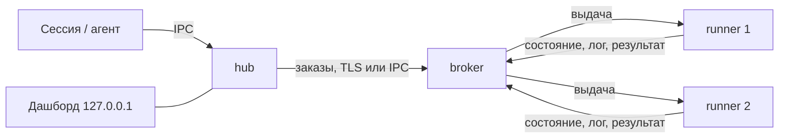

# Al.LocalRunner

[English](README.md) | **Русский**

Очередь задач с учётом ресурсов для разработчика и его AI-агентов. Тяжёлые задачи (тесты, сборки, lint, деплой, миграции) встают в одну очередь и идут по одной на подходящей машине в пределах её памяти и ядер, а агенты не спорят за процессор, память, эмулятор и кэши. Машина может быть одна или их может быть много, в одной сети или в разных. Работает на Windows, Linux и macOS. Один бинарник `localrunner` выполняет все роли.

Ядро не знает ни языка, ни инструментов проекта. Что запускать и что для этого нужно, описывает профиль в `.localrunner/profiles.toml` самого проекта. Полное описание, форматы и требования: [`docs/architecture.html`](docs/architecture.html) ([на английском](docs/architecture.en.html)).

## Содержание

- [Как это работает](#как-это-работает)
- [Быстрый старт с AI-агентом](#быстрый-старт-с-ai-агентом)
- [Быстрый старт вручную (одна машина)](#быстрый-старт-вручную-одна-машина)
- [Установка](#установка)
- [Hub](#hub)
- [Брокер](#брокер)
- [Раннер](#раннер)
- [Несколько машин](#несколько-машин)
- [Docker Compose](#docker-compose)
- [Профили проекта](#профили-проекта)
- [Журналы](#журналы)
- [Автозапуск, остановка, обновление, удаление](#автозапуск-остановка-обновление-удаление)
- [Диагностика](#диагностика)
- [Безопасность](#безопасность)
- [Подробности о плагине](#подробности-о-плагине)
- [Использование](#использование)
- [Выпуск версии](#выпуск-версии)
- [Лицензия](#лицензия)

## Как это работает

Сессия или агент ставит задачу через CLI. Задача становится заказом и уходит брокеру: он держит очередь и выдаёт заказы раннерам, которые подходят по памяти, ядрам, программам и тегам. Раннер выполняет её и возвращает результат и лог. Один бинарник играет три роли:

| Узел | Что делает | Где работает | Конфигурация |
|---|---|---|---|
| hub | принимает команды CLI, превращает профиль в заказ, отправляет его брокеру, хранит копию логов, показывает дашборд | на машине, откуда запускают; один на пользователя ОС | `hub-policy.toml`, `logging.toml` |
| broker | держит очередь, выбирает раннер, хранит историю и ключи участников | на одной машине пула | `policy.toml`, `logging.toml` |
| runner | исполняет джобы, по одной за раз | на машине, где нужны инструменты | `runner.toml`, `logging.toml` |



Для нескольких машин сначала ставят брокер, потом к нему присоединяют hub и раннеры (раздел [«Несколько машин»](#несколько-машин)).

## Быстрый старт с AI-агентом

Самый простой путь: подключить плагин и попросить агента. Плагин даёт агенту скилы для установки, запуска и работы с очередью.

Claude Code:

```
claude plugin marketplace add alexpantiukhin/Al.LocalRunner
claude plugin install localrunner@al-localrunner
```

Codex:

```
codex plugin marketplace add alexpantiukhin/Al.LocalRunner
codex plugin add localrunner@al-localrunner
```

Перезапустите сессию агента и просите простыми словами:

| Скажите | Скил | Что делает |
|---|---|---|
| «установи раннер» | `install-runner` | берёт бинарник из релиза, выполняет `init` и `doctor` |
| «обнови localrunner» | `upgrade-runner` | берёт новую версию из подписанного релиза и заменяет бинарник через `upgrade`, перезапуская роли |
| «подними раннеры» | `up-runner` | запускает hub, брокер и раннеры |
| «прогони тесты через раннер» | `run` | ставит задачу в очередь и читает результат |
| «покажи очередь» | `status-runner` | очередь, джобы, раннеры, история, дашборд |
| «останови раннеры», «включи автозапуск» | `down-runner`, `autostart-runner` | остановить роли, переключить автозапуск |

Скилы сами не повышают права и не печатают коды вступления и токены. Пока нет первого обычного релиза, используйте предварительный релиз или сборку из исходников (см. ниже). Области установки, удаление и ограничения Codex: [«Подробности о плагине»](#подробности-о-плагине).

## Быстрый старт вручную (одна машина)

1. Установите бинарник. Берите скрипт из релиза, а не из ветки (копия в репозитории содержит метку `@RELEASE_PUBKEY@` и отказывается что-либо ставить). Linux и macOS:

   ```
   curl -fsSL https://github.com/alexpantiukhin/Al.LocalRunner/releases/latest/download/install.sh | sh -s -- --role all
   ```

   Windows (PowerShell, от обычного пользователя; скрипт принимает параметры только как файл):

   ```
   Invoke-WebRequest https://github.com/alexpantiukhin/Al.LocalRunner/releases/latest/download/install.ps1 -OutFile install.ps1
   powershell -ExecutionPolicy Bypass -File .\install.ps1 --role all
   ```

   Или из исходников: `cargo build --release`, затем `target/release/localrunner install`. Установщик сам создаёт шаблоны конфигураций (`init`) и запускает `doctor`. Подробности и параметры: [«Установка»](#установка).

2. Запустите и проверьте:

   ```
   localrunner up        # брокер, hub и раннер фоновыми процессами
   localrunner status    # очередь и пул: память и ядра
   localrunner runners   # ваш раннер в состоянии `online`
   ```

3. Опишите задачу. Профиль лежит в `.localrunner/profiles.toml` проекта; в любой пустой папке создайте его:

   ```toml
   [profile.hello]
   command   = "echo hello from localrunner"   # на Windows: "cmd /c echo hello from localrunner"
   timeout_s = 60
   ```

4. Запустите, посмотрите результат и остановите всё:

   ```
   localrunner run hello --as me:test   # поставить, показать вывод, вернуть код выхода
   localrunner history                  # запись о запуске
   localrunner dashboard                # живая страница на 127.0.0.1, Ctrl+C останавливает
   localrunner down                     # раннер доделывает текущую джобу, затем всё останавливается
   ```

## Установка

### Скрипты релиза

Копии с вшитым открытым ключом выпуска лежат среди файлов каждого релиза (https://github.com/alexpantiukhin/Al.LocalRunner/releases); берите скрипт оттуда, а не из ветки. Роль задаёт `--role hub|broker|runner|all` (по умолчанию `all`). Остальные параметры: `--version X.Y.Z`, `--dir DIR`, `--offline ARCHIVE`, `--allow-elevated`, `--upgrade` (обновить установленную копию, см. «Обновление»); список даёт `--help`. Для предварительного релиза `latest` в ссылке не подходит: подставьте тег и версию, например `.../releases/download/v0.1.0-rc1/install.sh` и `--version 0.1.0-rc1`. Скрипт проверяет подпись `SHA256SUMS` и SHA-256 архива и при любом несовпадении ничего не ставит. Пока нет ни одного обычного релиза, используйте сборку из исходников или ссылку на предварительный.

### Из исходников

Нужен Rust (версия в `rust-toolchain.toml`). `cargo build --release` даёт `target/release/localrunner` (`localrunner.exe` на Windows). Положите его в каталог пользователя и подготовьте узел:

```
target/release/localrunner install --dry-run   # показать действия
target/release/localrunner install             # скопировать бинарник, дополнить PATH, выполнить init
```

Проверить узел можно командой `localrunner doctor`. `install` не запускает роли и не включает автозапуск. От root или администратора он отказывается без `--allow-elevated`. Установку нужно повторять на каждой машине.

### Файлы узла

| Что | Windows | Linux, macOS |
|---|---|---|
| бинарник | `%LOCALAPPDATA%\Programs\Al.LocalRunner` | `~/.local/bin` |
| состояние и конфигурации hub и раннера | `%LOCALAPPDATA%\Al.LocalRunner` | `~/.local/share/al-localrunner` |
| состояние брокера-службы | `%ProgramData%\Al.LocalRunner` | `/var/lib/al-localrunner` (Linux), `/Library/Application Support/Al.LocalRunner` (macOS) |

Каталоги можно заменить: `--state-dir` и `--config-dir`, либо переменные `LOCALRUNNER_STATE_DIR` и `LOCALRUNNER_CONFIG_DIR`. `localrunner init [--role hub|broker|runner|all]` создаёт каталог состояния и шаблоны конфигураций. Существующие файлы он не перезаписывает.

## Hub

Нужен на каждой машине, откуда ставят запуски. Один hub на пользователя ОС.

Установка и запуск:

```
localrunner install --role hub   # бинарник и шаблоны hub (init)
localrunner up hub               # или: localrunner hub run (на переднем плане)
```

Если брокер на другой машине, hub вступает в пул (код выдаёт брокер, см. [«Брокер»](#брокер)):

```
localrunner hub join <адрес:порт> --code-file code.txt --name office
localrunner brokers         # проверить: брокер в списке, зона, доступность
```

Код можно передать так: `--code-file файл`, `--code-file -` (стандартный ввод), переменная `LOCALRUNNER_JOIN_CODE`, аргумент командной строки. Последний способ показывает код другим пользователям машины.

Настройка: `hub-policy.toml` в каталоге конфигурации. Определяет, какому брокеру отправить заказ:

```toml
[brokers]
order             = ["win-host", "linux-box"]   # имена из hub join, по порядку
strategy          = "first"                     # first | least_loaded
broker_zone_order = ["local", "lan", "remote"]
query_timeout_s   = 3
query_attempts    = 3
zone_query        = "sequential"                # sequential | all
query_retry_s     = 5

[outbox]
ttl_hours = 24                                  # сколько заказ ждёт брокера
on_expire = "fail"                              # fail | keep
```

Без файла действуют значения по умолчанию. Заказы «та же машина» (рабочее дерево) уходят только на брокер с этой же машины. На машине брокера hub по коду не вступает: брокер разрешает локальным пользователям доступ по списку `[[local_user]]` в `policy.toml` (`install` вносит туда вас). Команды для работы с джобами: см. [«Использование»](#использование).

## Брокер

Один на пул. Держит очередь, ключи участников и историю. Сам ничего не исполняет.

Запуск на машине пользователя:

```
localrunner install --role broker
localrunner up broker       # или: localrunner broker run
```

Запуск службой ОС (выделенная машина, несколько пользователей). Нужны права администратора. Служба работает под отдельной учётной записью, не под root и не под SYSTEM:

```
localrunner broker install-service --dry-run
localrunner broker install-service
```

Служба снимается командой `localrunner autostart off broker` или `uninstall`. Команда `down` службу не останавливает: останавливайте менеджером служб ОС. `up` службу не запускает.

Настройка: `policy.toml` в каталоге состояния брокера. Без файла действуют значения по умолчанию. Основные таблицы:

| Таблица | Назначение |
|---|---|
| `[listen]` | адрес, на котором брокер слушает сеть. Без него сеть не слушается. Подстановочные адреса (`0.0.0.0`, `::`) отвергаются. В контейнере: `address = "container"` |
| `[networks]` | именованные сети; от них зависит зона hub (`lan` или `remote`) |
| `[[local_user]]` | кому разрешён локальный IPC: `name`, `label` |
| `[queue]` | `strategy` = `priority-fifo`, `fair-share`, `weighted`; `age_after_min` |
| `[[rule]]` | приоритет, резерв, квота, вес по условию `when` (первое подошедшее правило по каждому полю) |
| `[pool]` | `mem_mb`, `cpu`, `exclusive_tags`; по умолчанию вся память и все ядра машины брокера |
| `[limits]` | `max_job_timeout_s`, `timeout_above_max` (`reject` или `trim`), `job_log_max_mb`, `max_active_per_client`, `api_requests_per_min` (1200) |
| `[resources]` | лимиты джобы по заявленным `mem_mb` и `disk_mb`: `mode` = `off`, `warn` (по умолчанию), `kill`; `mem_headroom`, `disk_headroom` (запас, по умолчанию 1.25). См. [Лимиты ресурсов](#лимиты-ресурсов-очистка-и-чужая-нагрузка) |
| `[admission]` | `foreign_load` = `off` (по умолчанию) или `wait`: ждать, пока чужие процессы нагружают машину раннера; `mem_headroom_mb` (256) |
| `[commands]` | `default = "any"` или `"named"`; `[[commands.client]]` для отдельных ключей или ярлыков |
| `[visibility]` | `others_orders` = `none`, `summary`, `full`: что видят чужие клиенты |
| `[cancel]` | `others = "none"` или `"owner"`: кто отменяет чужие заказы |
| `[join]` | `code_ttl_min` — срок жизни кода вступления (60) |
| `[orphans]`, `[grace]`, `[results]` | что делать с заказами пропавшего hub, льготный срок потери раннера (`lost_min`), хранение результатов |
| `[history]`, `[saturation]`, `[cache]`, `[services]` | хранение истории, пороги насыщения, общий кэш, сервисы раннеров |
| `[[secrets.allow]]` | какой ярлык какие секреты может просить |

Пример:

```toml
[listen]
address = "192.168.1.10:7443"

[[local_user]]
name  = "alex"
label = ""

[[rule]]
name     = "ci-first"
when     = { client_label = "ci" }
priority = 100
```

Правила с условием по заявленным атрибутам (`source`, `project`, `tag`, `submitter_label`, `min_mem_mb`) допускаются только вместе с условием `client_label`. Неизвестные таблицы и ключи отвергаются с номером строки.

Команды:

```
localrunner policy check [файл]   # проверить, не применяя
localrunner policy reload         # применить; только на машине брокера. [listen] и [networks] требуют перезапуска
localrunner logging reload        # перечитать logging.toml во всех работающих ролях
```

Присоединение участников:

```
localrunner broker add --name office --label dev              # для hub: печатает адрес, код и отпечаток сертификата
localrunner broker add --runners 2 --address 192.168.1.10:7443  # для раннеров: код на 2 вступления
localrunner broker add --runners 1 --code-file code.txt         # записать код в новый файл, а не печатать
localrunner runner list
localrunner runner remove <имя> [--yes]   # удалить раннер и отозвать его ключ
localrunner client list
localrunner client remove <имя> [--yes]   # отозвать ключ hub
```

`broker add` работает через административный канал брокера: для брокера, установленного службой Windows, нужен администратор, в Unix нужен пользователь ОС брокера. `runner join` и `hub join` отказываются работать от администратора, поэтому код приходится передавать между двумя пользователями: выполнить `broker add --code-file <файл>` от администратора (файла ещё не должно быть), затем `runner join <адрес> --code-file <файл>` от обычного пользователя и удалить файл. Код не появляется на экране; адрес, отпечаток и срок печатаются как обычно.

Код действует 1 час и на указанное число вступлений. Адрес с портом должен быть доступен участнику. Отпечаток сертификата входит в код, поэтому вручную его сверять не нужно. `runner remove` и `client remove` спрашивают подтверждение; без терминала (скрипты, агенты) нужен `--yes`.

## Раннер

Исполняет джобы. Одну за раз, с теми ресурсами, которые объявлены в `runner.toml`.

Установка и запуск на машине брокера:

```
localrunner install --role runner
# отредактировать runner.toml (раздел ниже)
localrunner up runner
```

Раннер на другой машине:

```
localrunner install --role runner
# отредактировать runner.toml
localrunner runner join <адрес:порт> --code-file code.txt --name box --count 2
localrunner up runner
```

`--count N` (от 1 до 64) создаёт раннеры `box-1` … `box-N` с одним шаблоном `runner.toml`; у каждого свой каталог, ключ и запись на брокере. `--name` побеждает `name` из файла; без обоих берётся имя машины.

`runner join` копирует шаблон в `runner/<имя>/runner.toml`, и эта копия главнее: правки шаблона присоединённого раннера больше не достигают, а раннер, который не присоединялся, читает шаблон. `localrunner runner config <имя>` показывает файл, который читает раннер, и его путь; `--diff` — строки, которыми собственная копия отличается от шаблона.

Настройка: `runner.toml`. Обязателен `[env] path`: это `PATH` джобы и место поиска программ. Раннер без него не запускается, `PATH` процесса раннера джобам не передаётся. Автозапуск и службы дают бедное окружение, поэтому пути задают явно.

Джоба получает только такие переменные: `PATH` (из `[env] path`), `HOME` (из процесса раннера), `TEMP`, `TMP` и `TMPDIR` (личный каталог джобы), `LOCALRUNNER_JOB_ID`, `LOCALRUNNER_CACHE_<ИМЯ>`, секреты, которые она запросила, и всё из `[job_env]`; в Windows ещё `SystemRoot`, `windir`, `ComSpec`, `PATHEXT`. Остальное окружение раннера не наследуется. Любые другие нужные джобам переменные (`JAVA_HOME`, `CARGO_HOME`, `ANDROID_NDK_HOME`) записываются в `[job_env]` как `ИМЯ = "значение"`; `HOME`, записанный там, заменяет определённый. Нативной сборке в Windows может понадобиться больше, чем в списке выше: Rust с набором MSVC находит компоновщик через `vswhere`, а тот читает `ProgramFiles(x86)`; если джоба падает с `linker link.exe not found`, хотя инструменты установлены, запишите в `[job_env]` `"ProgramFiles(x86)"`, `ProgramFiles` и `ProgramData`. `init` и `runner join` записывают в `[job_env]` `HOME` оболочки, из которой запущены, поэтому он виден в файле; у раннера, в файле которого нет `HOME`, берётся домашний каталог пользователя ОС, от которого он запущен, поэтому у джоб на разных раннерах в нём могут оказаться разные настройки (`.npmrc`, `.gitconfig`); чтобы они совпадали, задайте `HOME` в `[job_env]` своим каталогом. `PATH` (для него есть `[env] path`), `TEMP`, `TMP`, `TMPDIR` и имена на `LOCALRUNNER_` отклоняются. Ключ, который не является настройкой `runner.toml` (например, переменная, записанная под `[env]`), даёт предупреждение при запуске и в `doctor`. Проверки `[programs]` идут в точно таком же окружении, и каждая может занять `check_timeout_s` секунд (по умолчанию 10): программе с медленным стартом, например `pnpm` через `corepack` с пустым кэшем, нужно значение побольше или `HOME` с её кэшем.

```toml
name      = "linux-heavy"
platforms = ["linux", "android"]
tags      = ["gradle", "emulator"]
mem_mb    = 16384              # необязательно: вся память хоста
cpu       = 8                  # необязательно: все ядра хоста
allow_elevated = false         # запуск от root или администратора
allow_same_user_as_broker = false

[env]
path = "/usr/local/bin:/usr/bin:/bin"

[programs]                     # что искать на раннере и чем проверять
git    = {}
gradle = { check = "gradle --version" }

[accept]
min_mem_mb = 8192              # резерв под тяжёлые заказы

[limits]
max_job_timeout_s = 3600       # потолок таймаута джобы на этом раннере
enforce       = "kill"        # необязательно: off | warn | kill; заменяет режим брокера
mem_headroom  = 1.25          # необязательно: запас к заявленному mem_mb (от 1.0 до 100.0)
disk_headroom = 1.5           # необязательно: запас к заявленному disk_mb (от 1.0 до 100.0)

[cache]
max_size_gb    = 40
retention_days = 14
evict          = "lru"

[workspace]
max_size_gb    = 20
retention_days = 7

[commands]                     # названия для клиентов с mode = "named"
build = "make all"

[job_env]                     # дополнительные переменные каждой джобы, службы и хука очистки
JAVA_HOME = "/opt/jdk"
GRADLE_OPTS = "-Dorg.gradle.daemon=false"

[[cleanup]]                    # команда после каждой джобы
name      = "labelled-containers"
command   = "sh -c 'docker rm -f $(docker ps -aq --filter label=$LOCALRUNNER_JOB_LABEL)'"
timeout_s = 60                 # от 1 до 3600, по умолчанию 60
on        = ["passed", "failed", "killed", "cancelled", "timeout"]   # по умолчанию все
```

Сервисы раннера (демон сборки, эмулятор) описываются в `[service.<имя>]`: `start`, `ready_check`, `stop`, `ready_timeout_s`, `memory_mb`, `lifetime` (`per_job`, `idle`, `keep`), `idle_timeout_s`, `max_lifetime_s` (обязателен), `reuse`. Формат — в разделе 3.11 архитектуры.

### Лимиты ресурсов, очистка и чужая нагрузка

Заявленные в профиле `cpu`, `mem_mb` и `disk_mb` ограничивают саму джобу по умолчанию в режиме `warn`: раннер записывает пики каждой джобы, пишет предупреждение в лог джобы при превышении потолка `mem_mb` или `disk_mb`, ограничивает долю CPU заявленным `cpu` и число процессов; ничего не убивается, пока не выбран `kill`. Выключается через `[resources] mode = "off"` или `[limits] enforce = "off"`. Это умолчание меняет поведение существующих установок. Пики пишутся в любом режиме (`peak_mem_mb`, `peak_disk_mb`): их видно в столбцах `PEAK_MEM_MB` и `PEAK_DISK_MB` команды `history`, а также в `history show`, `jobs`, `explain`, `status --json` и на дашборде. Прочерк в столбце пика значит «не измерялось» (у джобы без заявленного `disk_mb` и без каталогов для измерения пика диска нет), а `0` — измерено, пусто. Джоба, которая запускает контейнер (`docker run ...`), измеряется только по своему дереву процессов: память внутри виртуальной машины Docker или контейнера в пик не входит, поэтому пик такой джобы мал и заявленный `mem_mb` с ним не сравнить.

Приказ, который брокер отклоняет на входе (больше, чем пул способен дать, имя вне списков раннеров, секрет, не разрешённый ярлыку), записывается: `history` показывает его в состоянии `rejected`, а `history show` — причину; `history --result rejected` перечисляет только такие. Дашборд показывает то же состояние.

- **Режимы.** `[resources] mode` в `policy.toml` брокера или `[limits] enforce` раннера (значение владельца раннера сильнее): `off` (явно) ничего не ограничивает и только записывает пики, `warn` (по умолчанию) пишет строку-предупреждение в лог джобы, `kill` завершает всё дерево процессов, и джоба падает с причиной `resource_exceeded` и текстом `превышен заявленный mem_mb: заявлено X МБ, пик Y МБ`. `kill` стоит включать, когда накопилась история пиков.
- **Потолки** (только если режим не `off`): память — заявленный `mem_mb` на `mem_headroom`, диск — `disk_mb` на `disk_headroom` (запас от 1.0 до 100.0, по умолчанию 1.25). CPU — заявленные `cpu` ядер процессорного времени: доля, а не привязка к ядрам, жёсткий предел, но не повод убивать джобу. Число процессов ограничено значением `max(512, cpu * 256)`. Джоба, завершившаяся с кодом 0 при пике выше потолка, остаётся успешной.
- **Механизмы.** Windows: Job Object (память, предел доли CPU, предел числа процессов). Linux: scope cgroup v2 через `systemd-run` (`MemoryMax`, `CPUQuota`, `TasksMax`), если контроллеры делегированы пользователю. Иначе, и всегда на macOS, — наблюдатель в пользовательском пространстве: примерно раз в 250 мс он замеряет дерево процессов и убивает его выше потолка; CPU снижается приоритетом процесса (`nice`), предел числа процессов не действует. В Unix наблюдатель измеряет RSS, поэтому цифры там приблизительные (в Windows — commit). Раннер сообщает `enforcement = os` или `watcher` (видно в `runners` и на дашборде).
- **Диск.** Наблюдатель примерно раз в 2 секунды суммирует файлы в рабочем каталоге джобы и в её личном временном каталоге `<каталог состояния раннера>/tmp/lr-<job-id>` (символические ссылки не разворачиваются; общий системный temp не измеряется). `TEMP`, `TMP` и `TMPDIR` каждой джобы указывают на этот каталог: он используется всегда, создаётся до первого шага и удаляется после джобы (в том числе после kill или отмены; до 8 попыток с паузой 250 мс, так как в Windows файлы только что убитого процесса недолго заняты); после сбоя раннера при его запуске удаляется всё под `<каталог состояния>/tmp`. Это меняет место, куда джобы пишут временные файлы. Перед стартом раннер сверяет свободное место тома рабочего каталога с `disk_mb` на запас.
- **Очистка.** Команды `[[cleanup]]` запускаются после любого исхода джобы (`on` по умолчанию — все: `passed`, `failed`, `killed`, `cancelled`, `timeout`) с окружением `LOCALRUNNER_JOB_ID` и `LOCALRUNNER_JOB_LABEL` (`lr-<id джобы>`). Сбой хука не меняет результат джобы: предупреждение идёт в лог джобы и в диагностику. Джоба, прерванная падением или перезапуском раннера, получает свои хуки один раз при следующем запуске как `killed` (до отправки результата `runner_restarted`), поэтому хук должен быть идемпотентным. Хуки не запускаются для заказов, отклонённых при приёме. Что и как чистить (контейнеры с меткой, демоны сборки) — дело команды владельца; ядро инструментов не знает.
- **`[job_env]`** добавляет переменные каждой джобе и хуку; `PATH`, `TEMP`, `TMP`, `TMPDIR` и `LOCALRUNNER_*` запрещены; `HOME` разрешён. `LOCALRUNNER_JOB_LABEL` попадает в окружение джобы, только если есть хотя бы один `[[cleanup]]`.
- **Чужая нагрузка.** Раннеры присылают свободную память и загрузку CPU своей машины вместе с heartbeat. С `[admission] foreign_load = "wait"` заказ ждёт, пока чужие процессы оставляют слишком мало (`занято чужими процессами: CPU 95%, нужно 4 ядер`, видно в `status` и `explain`); выполняющиеся джобы не приостанавливаются. CPU собственных джоб брокера на той же машине чужим не считается. На macOS нагрузка читается через `vm_stat` и `ps`. Раннеры, не присылающие нагрузку (старые), допускаются как раньше.
- **В этой версии нет:** лимитов дискового ввода-вывода, привязки к ядрам, приостановки выполняющихся джоб, прокси Docker-сокета, дисковых квот ОС.

База `broker.db` при первом запуске переходит на схему 2 (остаётся копия `broker.db.bak-1`). Два новых столбца `history` стоят перед `BROKER`: в скриптах сдвиньте номера столбцов. Подробности — в разделе 3.14 архитектуры.

`localrunner doctor` предупреждает, когда раннер, зарегистрированный у брокера, работает на другой версии, чем этот бинарник (`runners` отмечает то же расхождение); обновите такую машину через `localrunner upgrade`.

Права:

- Раннер выполняет команды из заказов и работает под пользователем, который его запустил. Для чужих клиентов заведите отдельного ограниченного пользователя ОС.
- От root, администратора и SYSTEM раннер отказывается запускаться без `allow_elevated = true`.
- Если брокер запущен не службой, принимает других клиентов (`[listen]` или чужой `[[local_user]]`) и разрешает им любые команды, раннер под тем же пользователем ОС не запустится. Варианты: раннер под другим пользователем, брокер службой ОС, `[commands] default = "named"` в `policy.toml` или `allow_same_user_as_broker = true` в `runner.toml` (вы принимаете риск).

## Несколько машин

Порядок: брокер, затем остальные.

1. Брокер-машина. `install --role broker`, в `policy.toml` задать `[listen]` и `[networks]`, запустить (`broker install-service` для постоянной работы).
2. Для каждой клиентской машины: на брокере `broker add --name <имя> --label <ярлык>`; на клиенте `install --role hub`, `hub join <адрес:порт> --code-file code.txt --name <имя брокера>`, `up hub`.
3. Для каждой машины с раннерами: на брокере `broker add --runners N --address <адрес:порт>`; на машине `install --role runner`, правка `runner.toml`, `runner join ...`, `up runner`.
4. Проверка: `localrunner doctor`, `localrunner runners`, `localrunner brokers`.

Входящий порт нужен только брокеру. Автоматического поиска брокера в сети нет, адрес вводят вручную.

## Docker Compose

Файлы: `install/Dockerfile`, `install/compose.yaml`, `install/policy.toml`, `install/runner.toml`. В образе только бинарник, он работает не от root. Каждый релиз публикует образ `ghcr.io/alexpantiukhin/al-localrunner:<версия>` и прикладывает `compose.yaml`, который его использует. Инструменты проекта добавляйте в свой образ `FROM al-localrunner:<версия>`. Тег образа всегда указывается явно.

Обновление Linux-раннеров в Docker: возьмите образ нового релиза основой своего образа (`FROM ghcr.io/alexpantiukhin/al-localrunner:<новая версия>` и ваши инструменты), смените тег в своём `compose.yaml`, затем `docker compose build` и `docker compose up -d`. Том состояния хранит ключ раннера и запись о присоединении, поэтому заново присоединять не нужно. Проверка: `localrunner runners` показывает у каждого раннера версию, с которой он зарегистрировался (`version 0.2.0`, при расхождении рядом версия этого бинарника; она же в `--json` и на дашборде); раннер, не регистрировавшийся после обновления, показан как `version unknown`.

Собственный образ должен создать эти каталоги и отдать их пользователю, от имени которого работает процесс (в официальном образе это `65532:65532`): `/var/lib/al-localrunner` (состояние, `LOCALRUNNER_STATE_DIR`), `/etc/al-localrunner` (конфигурация, `LOCALRUNNER_CONFIG_DIR`), `/run/al-localrunner` (сокеты Unix). Без них процесс останавливается с `cannot create /run/al-localrunner: Permission denied`.

```
docker compose -f install/compose.yaml up -d broker
docker compose -f install/compose.yaml exec broker localrunner broker add --runners 1 --address broker:7443
docker compose -f install/compose.yaml run --rm runner localrunner runner join broker:7443 <код>
docker compose -f install/compose.yaml up -d runner
```

Политика: правьте `install/policy.toml`, затем `docker compose exec broker localrunner policy reload`. Порт брокера опубликован на `127.0.0.1:7443`; для других машин замените адрес на интерфейс хоста. Раннер в контейнере не видит файлы хоста и берёт только заказы с коммитом.

## Профили проекта

`.localrunner/profiles.toml` в репозитории проекта:

```toml
[profile.rust-unit]
command   = "cargo test --workspace"
timeout_s = 900                     # обязателен
mem_mb    = 4096
cpu       = 4
tags      = ["cargo"]

[profile.rust-gate]
timeout_s = 1800
steps = [
  { name = "fmt",  command = "cargo fmt --all --check", timeout_s = 120 },
  { name = "test", command = "cargo test --workspace",  timeout_s = 900, mem_mb = 8192 },
]
```

В профиле либо `command`, либо `steps`. Упавший шаг останавливает джобу; `continue_on_failure = true` разрешает продолжить. `exclusive` — теги, которые одновременно держит одна джоба. `cache` — именованные кэши раннера. Остальные поля описаны в разделах 4 и 5 архитектуры.

**Рабочее дерево или коммит.** Заказ без `--platform` выполняется в живом рабочем каталоге клиента, а не по снимку: любая правка файлов во время прогона попадает в джобу (скрипт `bash`, изменённый под работающей джобой, падает с `syntax error`, которой в файле нет). От таких правок изолирует только заказ на коммит (`--platform`). Не трогайте файлы долгого прогона, пока он идёт; откуда берётся код, видно в карточке дашборда (`Directory` — рабочее дерево, `Commit` — коммит).

## Журналы

`logging.toml` в каталоге состояния каждой роли. Без файла пишется JSON-файл с ротацией. Применение без перезапуска: `localrunner logging reload`.

```toml
[logging]
level = "info"

[[sink]]
kind       = "file"
path       = "logs/daemon.log"
rotate_mb  = 50
keep_days  = 14
keep_files = 10

[[sink]]
kind = "console"       # только на переднем плане
```

Получатель `otlp` (`endpoint`, `ca_file`, `enabled`) по умолчанию выключен: это единственное, что может отправлять данные с машины. Значения секретов, коды вступления и токены маскируются в логах и выводе.

## Автозапуск, остановка, обновление, удаление

```
localrunner autostart on [hub|broker|runner|all] [--dry-run]
localrunner autostart on runner <имя>
localrunner autostart off [...]
localrunner down [имена] [--drain | --cancel [--yes]]
localrunner uninstall [--purge] [--yes] [--dry-run]
```

- Автозапуск по умолчанию выключен. Он работает под пользователем, который его включил: задача планировщика на Windows, пользовательский юнит systemd на Linux, LaunchAgent на macOS. `autostart on broker` то же, что `broker install-service`, и требует прав администратора (sudo). `autostart on` для нескольких ролей (`all` или без имени) выполняет пользовательскую часть без этих прав и печатает, что осталось администратору; `--dry-run` помечает шаги, которым эти права нужны.
- `down` по умолчанию (`--drain`) дожидается текущих джоб; `--cancel` отменяет их и ждёт раннеры не дольше 30 секунд. Брокер останавливается после раннеров. `--cancel` (как и `cancel --mine`) спрашивает подтверждение; без терминала (скрипты, агенты) нужен `--yes`.
- Обновление: `install.sh --upgrade` (или `install.ps1 --upgrade`; для не последней версии добавьте `--version X.Y.Z`). Скрипт проверяет подпись, как при установке, и запускает `localrunner upgrade` скачанного бинарника: он печатает установленную и новую версии, идущие джобы и ожидающие заказы, спрашивает (при идущих джобах: дождаться их, отменить или отказаться), сначала останавливает раннеры (они дорабатывают джобы или с `--cancel` отменяют их и выходят за 30 с), затем хаб и брокер, запущенный вручную, копирует себя поверх установленного бинарника и снова запускает те же роли уже из него. `upgrade --dry-run` показывает план (`install.sh|ps1 --upgrade` передаёт `--yes`, `--cancel` и `--dry-run` дальше, так что агент или CI заканчивают обновление без терминала); `--yes` снимает вопрос и при идущих джобах ждёт их (`--yes --cancel` отменяет); Ctrl+C во время ожидания ничего не заменяет и оставляет хаб и брокер работать; более старый бинарник отклоняется. Вручную то же: `down`, заменить бинарник, `up`. Схемы баз обновляются при старте с резервной копией; откат на более старую версию не поддерживается. При смене старшей версии протокола обновите брокер, хабы и раннеры других машин в одном окне; каждая машина обновляется так же, по очереди. Брокер как служба ОС держит свою копию бинарника (Windows: `%ProgramFiles%\Al.LocalRunner\localrunner.exe`; Linux и macOS: `/usr/local/libexec/al-localrunner/localrunner`), `upgrade` её не трогает. С правами администратора выполните `localrunner broker update-service` из нового бинарника (`--dry-run` покажет план): команда остановит службу, скопирует бинарник поверх этого файла и запустит службу; регистрация, состояние и ключи остаются. Вручную то же: остановите службу (`AlLocalRunnerBroker` в Windows, `al-localrunner-broker` в Linux), скопируйте новый бинарник поверх этого файла, запустите службу.
- `uninstall` останавливает роли, снимает автозапуск, службу, бинарник и запись в PATH. Ключи и история остаются; `--purge` удаляет и состояние после подтверждения.

## Диагностика

| Проблема | Что сделать |
|---|---|
| не ясно, что с узлом | `localrunner doctor` (`--json`; код 1, если есть `fail`) |
| заказ не стартует | `localrunner explain <job>`: причина и сработавшее правило |
| нет подходящего раннера | в ответе указана разница между заказом и раннерами; `localrunner runners` |
| настройка в `runner.toml` не действует | опечатка в ключе или секции не ошибка: она печатается предупреждением при старте и в `localrunner doctor` |
| раннер не запускается | сообщение называет причину: нет `[env] path`, запуск от root, раннер под пользователем брокера |
| hub не видит брокера | `localrunner brokers`; проверить `[listen]`, `[networks]` и порт |
| `broker add`: «admin channel is not reachable ... отказано в доступе» | выполнить от администратора (служба Windows) или от пользователя ОС брокера; код передать через `--code-file` |
| код вступления не подходит | срок 1 час и число вступлений ограничены; выдать новый `broker add` |

## Безопасность

- Дашборд слушает только `127.0.0.1` и `::1`.
- Участник вступает по одноразовому коду; сертификат брокера закреплён отпечатком из кода. Дальше работает отзываемый ключ участника: `client remove`, `runner remove`.
- Брокер никогда не работает под привилегированной учётной записью.
- Политику правит только тот, кто сидит за машиной брокера; `policy reload` принимается только по локальному каналу.
- `status --html` не включает логи без `--with-logs`.

## Подробности о плагине

Плагин в `plugin/` оборачивает команды в скилы. Один и тот же плагин `al-localrunner` описан для обоих агентов: `.claude-plugin/marketplace.json` для Claude Code, `.agents/plugins/marketplace.json` для Codex. Плагин только вызывает бинарник `localrunner`.

### Claude Code

Область установки задаёт `--scope`:

| Область | Где записывается | Кому доступен |
|---|---|---|
| `project` | `.claude/settings.json` репозитория | всем, кто работает с этим репозиторием (файл коммитится) |
| `local` | локальные настройки репозитория, не коммитятся | только вам и только в этом репозитории |
| `user` (по умолчанию) | настройки пользователя | вам во всех проектах |

Из локальной копии репозитория вместо `alexpantiukhin/Al.LocalRunner` укажите путь к каталогу, в котором лежит `.claude-plugin/`. Удаление:

```
claude plugin uninstall localrunner@al-localrunner --scope <область>
claude plugin marketplace remove al-localrunner --scope <область>
```

### Codex

У Codex нет областей установки: плагины и маркетплейсы записываются в `~/.codex/config.toml` пользователя и действуют во всех проектах. Установка на уровень проекта невозможна. Маркетплейс берёт плагин из ветки `main`. Проверка: `codex plugin list`. Удаление:

```
codex plugin remove localrunner@al-localrunner
codex plugin marketplace remove al-localrunner
```

## Использование

Порядок обычной сессии:

1. Поставьте задачу в очередь: `localrunner run [профиль] --as метка` (ждёт и возвращает код выхода) или `submit` (сразу печатает id джобы). Профили берутся из [`.localrunner/profiles.toml`](#профили-проекта).
2. Следите за ней: `wait <job>` или `log <job> -f`.
3. Если она ждёт: `explain <job>` скажет почему; `status` покажет всю очередь.
4. Если результат уже не нужен: `cancel <job> --as метка` или `cancel --mine --as метка [--yes]`.
5. Потом: `history`, `stats`, `dashboard`.

Все команды:

| Команда | Действие |
|---|---|
| `submit [профиль] --as метка` | поставить заказ, напечатать id, вернуться сразу |
| `run [профиль] --as метка` | то же, но показывать вывод и вернуть код выхода |
| `wait <job>` | следить за джобой; прерывание ничего не отменяет |
| `log <job> [--step имя] [--tail N] [-f]` | лог джобы |
| `cancel <job> --as метка`, `cancel --mine --as метка [--yes]` | отменить |
| `jobs --mine [--active] [--as метка]` | свои джобы |
| `status`, `explain <job>` | очередь; почему заказ ждёт |
| `profile check [профиль] [--label L]` | перед запуском: для каждого секрета профилей — в какую переменную джобы он превратится, разрешает ли политика его метке (метке записи `[[local_user]]`, а не `--as`), есть ли у раннера этой машины источник; код 1, если что-то остановит запуск |
| `history [--all]`, `history show <job>` | история |
| `stats`, `runners`, `brokers` | статистика, раннеры, брокеры |
| `dashboard` | страница на 127.0.0.1 |

Флаги `submit` и `run`: `--note`, `--platform`, `--timeout <с>` (только уменьшает таймаут профиля), `--mem 6144|512m|6g`, `--cpu <ядра>` (заменяют значения профиля на один запуск), `--arg имя=значение` (заполняет параметр, который объявляет профиль; можно повторять), `--detach` (без него заказ снимается, когда процесс-отправитель завершается; сессия агента всегда передаёт его и затем ждёт через `wait` или использует `run`). `--as` обязателен; внутри GitHub Actions по умолчанию `github:<workflow>/<job>`. У команд чтения есть `--json`.

## Выпуск версии

1. Везде одна версия `X.Y.Z`: `version` каждого `crates/*/Cargo.toml`, `image: al-localrunner:X.Y.Z` в `install/compose.yaml`, `version` в `plugin/.claude-plugin/plugin.json` и `plugin/.codex-plugin/plugin.json`. Выполните `cargo build`, чтобы `Cargo.lock` обновился (CI и сборка релиза идут с `--locked`). У пре-релиза суффикс во всех местах, например `0.2.0-rc1`.
2. Откройте pull request и дождитесь `ci-ok`: проверка обязательна для `main`, до её прохождения слить нельзя.
3. Поставьте на коммит слияния тег `vX.Y.Z` и отправьте тег. Workflow `release` собирает архивы для пяти платформ и падает, если `localrunner --version` не равна тегу, затем (окружение `release`, оно может ждать подтверждения) подписывает `SHA256SUMS` ключом релиза и публикует архивы с `install.sh` и `install.ps1`. `latest` не указывает на пре-релиз.
4. Проверьте релиз на одной машине: `install.sh --upgrade --version X.Y.Z` (или `install.ps1`), затем `localrunner doctor`. Служба брокера в ОС держит свою копию бинарника и обновляется вручную (см. «Автозапуск, остановка, обновление, удаление»); остальные машины по очереди, брокер первым, если не меняется старшая версия протокола.
5. Обновление плагина доходит до пользователей только с новой `version` плагина: файлы плагина меняйте только вместе с повышением версии.

## Лицензия

GPL-3.0-or-later: см. [LICENSE](LICENSE). Дополнительные условия (сохранять указание автора в копиях и документации): [NOTICE](NOTICE).
