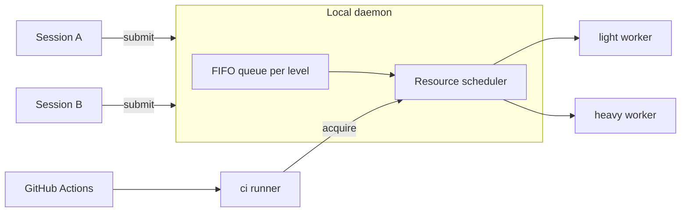

# Al.LocalRunner — design

## Goals
- Parallel agent sessions queue their runs instead of overloading the machine.
- Every run has a mandatory timeout; the whole process tree is killed on expiry or cancel.
- The core is generic; consumers supply profiles.

## Architecture



- `light` and `heavy` are workers of the local daemon. A run executes in the submitter working directory, so uncommitted changes are tested.
- `ci` is a real GitHub Actions self-hosted runner (label `al-ci`). Before executing a job it acquires its resource tags from the same scheduler through the daemon, so it never overlaps a conflicting local run.
- One worker per level by default. More workers per level are allowed; the scheduler enforces the limits.

## Profiles (consumer-supplied)
`.localrunner/profiles.toml` in the consumer repository:

```toml
[profile.rust-unit]
level = "light"
command = "cargo test --workspace"
timeout_s = 900
mem_mb = 4096
cpu = 4
tags = ["cargo"]

[profile.android-tier]
level = "heavy"
command = "pwsh scripts/android-tier.ps1"
timeout_s = 3600
mem_mb = 12288
cpu = 6
tags = ["gradle", "emulator"]
exclusive = ["gradle", "emulator"]
```

- `timeout_s` is required; there is no default and no unbounded run. The daemon enforces an upper cap from its own config.
- `tags` are resources held for the duration of the run; `exclusive` lists tags that no other running job may hold.
- The core never interprets `command`; it only spawns it. A profile with several commands uses `steps`.

### Steps
A profile has either `command` (one step) or `steps` (an ordered sequence); never both.

```toml
[profile.rust-gate]
level = "light"
timeout_s = 1800
tags = ["cargo"]
steps = [
  { name = "fmt",    command = "cargo fmt --all --check", timeout_s = 120 },
  { name = "clippy", command = "cargo clippy --workspace --all-targets -- -D warnings", timeout_s = 600 },
  { name = "test",   command = "cargo test --workspace", timeout_s = 900, mem_mb = 8192 },
]
```

- One job, one place in the queue: steps run back to back and no other job of the level is started between them.
- Resources are acquired once, as the maximum over the steps (memory, CPU) and the union of tags and `exclusive`; a step may override `mem_mb`, `cpu`, `tags`. There is no per-step acquisition, so there is no partial hold and no deadlock.
- Each step has its own `timeout_s` (required) and runs under the remaining job `timeout_s`; the job timeout is required too. A step is killed at the earlier of the two.
- A failed step stops the job; later steps are `skipped`. `continue_on_failure = true` on a step lets the job go on, and the job result is still `failed`.
- Branches, conditions and dependencies between steps are not part of the core; use a script inside `command`.
- Several independent jobs from one session are several submits: each is queued separately and other sessions may run between them.

## Queue and scheduling
- FIFO per level; a job starts when a worker of its level is free and the scheduler grants memory, CPU and tags.
- A job that can never fit the machine limits is rejected on submit with the reason.
- States: `queued` → `running` → `passed | failed | timeout | cancelled`; a step is `passed | failed | timeout | skipped`.
- Each job writes stdout and stderr to `temp/runner/<job-id>.log` in the submitter directory, with a header per step; the submit call returns the job id, and waiting streams progress and returns the exit code.
- Cancel and timeout kill the process tree (Windows Job Object; process group elsewhere).
- Crash safety: a dead submitter queued jobs are dropped, a dead job is reaped, leases are tied to the daemon child processes.

## Submitter identity
Every job says who submitted it, so the queue, the page and the log answer "whose is this".

- `--as <name>` is required on `submit`; a submit without it is rejected. It is a free-form label chosen by the caller, for example `claude:session-3`, `codex:review`, `alex`. The core does not enumerate or interpret agents.
- Optional `--note <text>` (what the run is for, up to 200 characters), for example `check fix for #609`.
- Collected by the CLI automatically and not overridable: OS user, host, submitter process id and start time, working directory, and, when the directory is a git worktree, the branch and the worktree root. Collection is generic git/OS data, with no agent knowledge.
- Shown in `status`, the HTML snapshot, the dashboard and the log header: label, note, branch, directory, age of the job.
- The identity is advisory, not authentication: any local process of the same OS user can submit under any label. The IPC endpoint is restricted to the OS user, which is the actual boundary.
- A label may be reused by a session across jobs; the submitter process id is what links a job to a live caller. A queued job whose submitter is dead is dropped; a running one is finished or killed by the same crash-safety rule as before.
- Cancel: by default only a job with the same `--as` and the same OS user; cancelling another label needs `--force`, which is recorded in the log of the cancelled job together with the label of whoever cancelled it.

## Viewing the queue
Read-only views of the queue, running jobs and their steps, in three forms of the same data:

- `al-localrunner status` — text; `--json` for agents and scripts.
- `al-localrunner status --html [path]` — writes one self-contained HTML file (no external scripts or fonts), default `temp/runner/queue.html`. A snapshot: it needs no listener, can be opened from disk and attached to a report.
- `al-localrunner dashboard` — live view in a browser. The daemon serves one page and a JSON/SSE feed on `127.0.0.1` only, on a random free port; the URL carries a per-start random token, and requests without it or from another origin are refused. Started on demand and stopped with `Ctrl+C` or `down`; it is the only network listener, absent unless asked for.

What the page shows:
- Per level: workers up or down, free memory and CPU, held tags.
- Running jobs: id, profile, submitter directory, level, elapsed against the job timeout, and the step list with state (`queued`, `running`, `passed`, `failed`, `timeout`, `skipped`), per-step elapsed against its timeout, and the last lines of the running step.
- Queue: position, profile, submitter directory, waiting time, the reason it waits (worker busy, memory, CPU, a held `exclusive` tag and whose).
- Recent finished jobs with the result per step and a link to the log file.

The view never changes anything: cancel and control stay in the CLI. Log text is escaped on output. The same data model backs all three forms, so a form added later adds no new source of truth.

## Transport and state
- Local IPC only: named pipe on Windows, Unix socket elsewhere. No network listener, except the optional loopback-only `dashboard` described above.
- State and runner directories under `%LOCALAPPDATA%\Al.LocalRunner` (`~/.local/share/al-localrunner` elsewhere).
- The `ci` runner lives in its own directory and registers per repository with a token supplied by the user at install time; the token is never stored by the plugin.

## Operating systems
Windows, Linux and macOS are first-class. The core is OS-neutral; everything that differs lives in one file per OS under `plugin/shared/os/` (`windows.md`, `linux.md`, `macos.md`) and is read by the install, up and down skills:

| Concern | Windows | Linux | macOS |
|---|---|---|---|
| IPC | named pipe | Unix socket in `$XDG_RUNTIME_DIR` | Unix socket in the state directory |
| Tree kill | Job Object | process group or cgroup | process group |
| `ci` supervision | user-session process | systemd user unit | LaunchAgent (GUI domain) |
| Emulator acceleration | WHPX or Hyper-V | KVM | HVF, arm64 images on Apple Silicon |
| Sleep prevention | `SetThreadExecutionState` | none by default | `caffeinate -i` |

The `ci` runner is never a system service on any OS: it must run in the user session to see the user toolchains, caches and devices. Daemon code selects the OS-specific parts behind one internal interface; consumer profiles stay OS-neutral where they can and use per-OS `command` variants where they cannot.

## Skills contract
| Skill | Inputs | Result |
|---|---|---|
| `install-runner` | repository for `ci` (optional), registration token (asked, not stored) | daemon installed; `ci` runner configured if absent; idempotent |
| `up-runner` | levels (default `light,heavy,ci`), workers per level (default 1) | runners running; prints status |
| `down-runner` | levels, `--drain` or `--cancel` | runners stopped; queue handled as asked |
| `status-runner` | optional `--html` or `dashboard` | queue, running jobs with steps, waiting time and reason, free resources; text, JSON, HTML snapshot or live page |
| `run` | submitter label (`--as`), optional note, profile, level override, timeout override (lowered only) | job id, log path, exit code, result per step |

## Out of scope
- Phones and physical devices over USB/ADB.
- Controlling jobs from the web page (the view is read-only).
- Any consumer-specific command or toolchain knowledge inside the core.
