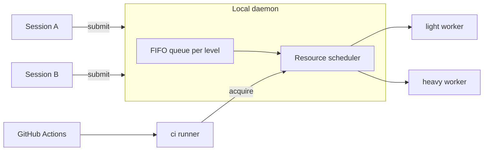
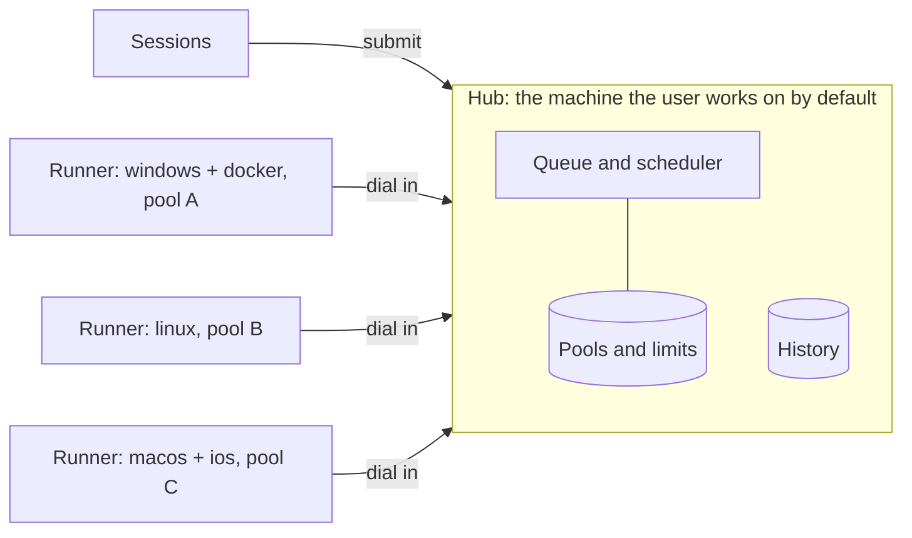

# Al.LocalRunner — design

## Goals
- Parallel agent sessions queue their runs instead of overloading the machine.
- Every run has a mandatory timeout; the whole process tree is killed on expiry or cancel.
- The core is generic; consumers supply profiles.

## Architecture



- `light` and `heavy` are classes of runner: the level says which jobs a runner accepts. On the machine of the submitter a runner executes in the submitter working directory, so uncommitted changes are tested. A runner on another machine tests a pushed commit (see "Multiple machines").
- `ci` is a real GitHub Actions self-hosted runner (label `al-ci`). Before executing a job it acquires its resource tags from the same scheduler through the daemon, so it never overlaps a conflicting local run. Other projects and workflows are free to use other runners; only jobs that land on `al-ci` go through this queue.
- One worker per level by default. More workers per level are allowed; the scheduler enforces the limits.
- A single machine with its own daemon is the default and needs no extra configuration; everything in "Multiple machines" is opt-in.

## Profiles (consumer-supplied)
`.localrunner/profiles.toml` in the consumer repository:

```toml
[profile.rust-unit]
level = "light"
command = "cargo test --workspace"
timeout_s = 900
mem_mb = 4096
cpu = 4
tags = ["cargo"]

[profile.android-tier]
level = "heavy"
command = "pwsh scripts/android-tier.ps1"
timeout_s = 3600
mem_mb = 12288
cpu = 6
tags = ["gradle", "emulator"]
exclusive = ["gradle", "emulator"]
```

- `timeout_s` is required; there is no default and no unbounded run. The daemon enforces an upper cap from its own config.
- `tags` are resources held for the duration of the run; `exclusive` lists tags that no other running job may hold.
- The core never interprets `command`; it only spawns it. A profile with several commands uses `steps`.

### Steps
A profile has either `command` (one step) or `steps` (an ordered sequence); never both.

```toml
[profile.rust-gate]
level = "light"
timeout_s = 1800
tags = ["cargo"]
steps = [
  { name = "fmt",    command = "cargo fmt --all --check", timeout_s = 120 },
  { name = "clippy", command = "cargo clippy --workspace --all-targets -- -D warnings", timeout_s = 600 },
  { name = "test",   command = "cargo test --workspace", timeout_s = 900, mem_mb = 8192 },
]
```

- One job, one place in the queue: steps run back to back and no other job of the level is started between them.
- Resources are acquired once, as the maximum over the steps (memory, CPU) and the union of tags and `exclusive`; a step may override `mem_mb`, `cpu`, `tags`. There is no per-step acquisition, so there is no partial hold and no deadlock.
- Each step has its own `timeout_s` (required) and runs under the remaining job `timeout_s`; the job timeout is required too. A step is killed at the earlier of the two.
- A failed step stops the job; later steps are `skipped`. `continue_on_failure = true` on a step lets the job go on, and the job result is still `failed`.
- Branches, conditions and dependencies between steps are not part of the core; use a script inside `command`.
- Several independent jobs from one session are several submits: each is queued separately and other sessions may run between them.

## Queue and scheduling
- FIFO per level, with `ci` jobs ahead of all others (see "Priority"); a job starts when a runner of its level and platform is free and the scheduler grants memory, CPU and tags.
- A job that can never fit the machine limits is rejected on submit with the reason.
- States: `queued` → `running` → `passed | failed | timeout | cancelled`; a step is `passed | failed | timeout | skipped`.
- Each job writes stdout and stderr to `temp/runner/<job-id>.log` in the submitter directory, with a header per step; the submit call returns the job id, and waiting streams progress and returns the exit code.
- Cancel and timeout kill the process tree (Windows Job Object; process group elsewhere).
- Crash safety: the dead-submitter rule is in "Own jobs and early cancel"; a dead job is reaped; leases are tied to the daemon child processes.

## Submitter identity
Every job says who submitted it, so the queue, the page and the log answer "whose is this".

- `--as <name>` is required on `submit` from a session or terminal; a submit without it is rejected (inside GitHub Actions it defaults, see below). It is a free-form label chosen by the caller, for example `claude:session-3`, `codex:review`, `alex`. The core does not enumerate or interpret agents.
- Optional `--note <text>` (what the run is for, up to 200 characters), for example `check fix for #609`.
- Collected by the CLI automatically and not overridable: OS user, host, submitter process id and start time, working directory, and, when the directory is a git worktree, the branch and the worktree root. Collection is generic git/OS data, with no agent knowledge.
- Shown in `status`, the HTML snapshot, the dashboard and the log header: project, source, label, note, branch, directory, age of the job.
- The identity is advisory, not authentication: any local process of the same OS user can submit under any label. The IPC endpoint is restricted to the OS user, which is the actual boundary.
- A label may be reused by a session across jobs; the submitter process id is what links a job to a live caller (see "Own jobs and early cancel" for what happens when it is gone).
- Cancel: by default only a job with the same `--as` and the same OS user; cancelling another label needs `--force`, which is recorded in the log of the cancelled job together with the label of whoever cancelled it.

### Project and source
Besides the label, every job records which project it is for and where it came from. Both are collected by the CLI and cannot be overridden.

- `project`: the normalized `origin` remote (`owner/repo`) of the submitter directory; without a remote, the repository root directory name; outside git, the directory name. Also recorded: the repository root and the worktree root, so two worktrees of one project are told apart.
- `source`, one of:
  - `session` — a submit from a terminal or an agent session; carries the `--as` label, the submitter process id and the directory.
  - `github` — a submit from a GitHub Actions job (detected by `GITHUB_ACTIONS=true`); carries repository, workflow, job, run id and attempt, ref, actor and the run URL. Here `--as` is optional and defaults to `github:<workflow>/<job>`.
- Reading the CI environment lives in a source adapter of the `ci` level; the core queue and scheduler see only the normalized fields. A further source (another CI system) is another adapter, not a change of the core.
- A `github` job has no local submitter process to watch; its liveness comes from the runner process of that job, and a cancelled workflow run cancels the job.
- Every view shows `project`, `source` and the label together, for example `Al.Browser · session · claude:fix-12` or `AiGateway · github · ci.yml/rust-test #4821`, and a `github` job links to its run URL.
- Filtering: `status --project <name>`, `--source <session|github>` and `--as <label>`; the same filters exist as fields in `--json`.

### Own jobs and early cancel
An agent must be able to tell which jobs are its own and stop them before they finish.

- `submit` prints the job id and writes a handle `temp/runner/<job-id>.json` in the submitter directory (label, id, profile, time). After a context loss or a restart the agent finds its jobs from these handles and from the daemon.
- `al-localrunner jobs --mine` lists the jobs of the caller: same OS user and same `--as` label (the label is given or read from the latest handle in the directory). Output is the same as `status` restricted to those jobs, with `--json`. `jobs --mine --active` leaves only `queued` and `running`.
- `al-localrunner cancel <job-id>` cancels one job; `cancel --mine` cancels all active jobs of the caller. Both check ownership as defined in "Submitter identity"; another label needs `--force`.
- Effect of cancel:
  - `queued`: removed from the queue at once, nothing was started.
  - `running`: a graceful stop signal to the process tree (Ctrl+Break on Windows, SIGTERM elsewhere), then, after a grace period (default 10 s, daemon config), the whole tree is killed. The running step ends `cancelled`, the remaining steps are `skipped`, the job is `cancelled`, and held resources are released only after the tree is gone.
  - Already finished: a no-op that reports the final state.
- The cancel reason is written to the job log header: who cancelled (label), when, and `--reason <text>` if given.
- `wait` is only an observer: interrupting `wait` (Ctrl+C, an agent tool timeout) does not cancel the job. The job is cancelled by `cancel`, by its timeout, or by the dead-submitter rule below.
- Dead submitter: when the submitter process is gone, its queued jobs are dropped and its running jobs are killed to free the machine. `submit --detach` opts out for a running job that must outlive the caller; a detached job is still visible and cancellable by its label.
- A `github` job is cancelled by cancelling the workflow run or with `cancel <job-id>` by an operator using `--force`.

## History
Finished jobs are kept and can be looked at later, from any session and for any project.

- Storage: a SQLite database `history.db` in the daemon state directory (public-domain library, compatible with the license rule). One row per job with everything known about it: id, project, source, label, note, branch, directories, profile, level, queued/started/finished times, result, exit code, who cancelled and why, and one row per step with state, times, exit code and timeout. A job is written when it is queued and updated on every state change, so a daemon crash loses at most the last update.
- Logs: the full log stays in `temp/runner/<job-id>.log` of the submitter directory, and the daemon keeps its own copy under `logs/` in the state directory, so the history survives a cleaned worktree. For `github` jobs the run URL is stored as well.
- Retention: by age and by total size, whichever hits first, default 30 days and 2 GB for logs, 365 days for rows (daemon config). Pruning removes the oldest first and never touches active jobs.
- CLI:
  - `al-localrunner history [--project P] [--source session|github] [--as L] [--profile N] [--result R] [--since D] [--limit N]`, newest first, `--json`.
  - `al-localrunner history show <job-id>` — the full record with steps.
  - `al-localrunner log <job-id> [--step NAME] [--tail N]` — reads the stored log; for an unfinished job it follows it.
- Views: `status --html --history` adds a history table to the snapshot; the dashboard has a History tab with the same filters; each row links to its log.
- Statistics from the same data, `al-localrunner stats [--project P] [--profile N]`: runs, pass rate, wait time and duration (median and 95th percentile) per profile and step, share of timeouts and cancellations. Its purpose is to set honest `timeout_s` values and see where the queue waits.
- The history is local to the machine and read-only for views; nothing in it is sent anywhere.

## Viewing the queue
Read-only views of the queue, running jobs and their steps, in three forms of the same data:

- `al-localrunner status` — text; `--json` for agents and scripts.
- `al-localrunner status --html [path]` — writes the dashboard page as one self-contained HTML file with the data embedded, default `temp/runner/queue.html`. A snapshot: it needs no listener, and can be opened from disk.
- `al-localrunner dashboard` — live view in a browser. The daemon serves one page and a JSON/SSE feed on `127.0.0.1` only, on a random free port; the URL carries a per-start random token, and requests without it or from another origin are refused. Started on demand and stopped with `Ctrl+C` or `down`; it is the only network listener, absent unless asked for.

What the page shows:
- Per level: workers up or down, free memory and CPU, held tags.
- Running jobs: id, project, source (session or github, with the run link), submitter label, profile, directory, level, elapsed against the job timeout, and the step list with state (`queued`, `running`, `passed`, `failed`, `timeout`, `skipped`), per-step elapsed against its timeout, and the last lines of the running step.
- Queue: position, project, source, submitter label, profile, directory, waiting time, the reason it waits (worker busy, memory, CPU, a held `exclusive` tag and whose).
- Recent finished jobs with the result per step and a link to the log file; the full list with filters is the History tab (see "History").

The page is specified in "Dashboard". The same data model backs all three forms, so a form added later adds no new source of truth. Only cancel is available from the page; everything else stays in the CLI.

## Dashboard
One interactive page that serves both the live `dashboard` and the static `status --html` snapshot: the snapshot embeds the data as JSON and runs the same code with live updates and actions switched off.

Delivery: a single self-contained page embedded in the daemon, with no external scripts, fonts or network requests (works offline). Light and dark theme follow the system; layout works at phone width; keyboard operable with visible focus.

Tabs:
- **Queue** — running and waiting jobs. A row expands into the job card: project, source, label, note, branch, directory, profile, level, why it waits, and the **steps timeline** (a bar per step against its timeout, current step animated, `skipped` greyed). Beside it a **live log** of the selected step: follow mode, pause, text search, copy, download. The card shows the cancel button (see Actions).
- **History** — finished jobs, newest first, a click opens the same card with the stored log.
- **Stats** — per profile and step: pass rate, wait time and duration (median, 95th percentile) as inline SVG charts, a per-level lane diagram of the day (who held the worker when, gaps, waiting), and **saturation**: how many jobs and how much waiting time fall on each cause (worker, memory, CPU, exclusive tag, no runner), so the owner sees which limit to raise.
- **Runners** — per machine and pool, then per level: runners online or offline with last seen, platform, workers up or down, queue length, memory and CPU gauges, held and exclusive tags with the holder of each.

Interaction common to all tabs:
- Filters: project, source, label, level, profile, result, time range, free text; sortable columns; the state lives in the URL hash, so a view is a shareable link, and the last filters are restored from `localStorage`.
- `?as=<label>` highlights and pins the jobs of that label, so an agent or a person can open "my jobs" directly.
- Live updates over one SSE stream with automatic reconnect and a visible connection state; a Pause button freezes the view while reading; new events during a pause show as a counter.
- Export of the current filtered table as CSV or JSON, and `Save snapshot` that writes the same page as a file.
- Shortcuts: `/` search, `j`/`k` move, `Enter` open, `Esc` close, `g q|h|s|r` switch tabs, `?` list shortcuts.

Actions (live mode only):
- **Cancel** a queued or running job, after a confirmation that names the job. A cancel from the page counts as `--force`: it is recorded in the job log and history as cancelled by `dashboard:<os user>` with the reason typed in the dialog. Cancelling all jobs of a project or label is a separate explicit action with the list of jobs in the dialog.
- No submit, no edit of profiles or config, no up or down of runners from the page.

Security:
- Random port, per-start token; the token is exchanged for a session cookie (`HttpOnly`, `SameSite=Strict`) on the first request and removed from the address bar.
- Localhost only, with no way to change it (the runner channel in "Multiple machines" is a separate listener and never serves the dashboard): the socket is bound to `127.0.0.1` (and `::1`), never to `0.0.0.0`, `::` or a LAN address, and there is no option, config key or environment variable that widens it. The dashboard is never published, tunnelled or shared by the plugin.
- DNS-rebinding protection: a request whose `Host` is not `localhost`, `127.0.0.1` or `[::1]` with the dashboard port is refused, and so is a request carrying a foreign `Origin`.
- On start the daemon checks the actual bound address and exits with an error if it is not loopback.
- Nothing leaves the machine: the daemon, the CLI and the page make no outbound network requests, send no telemetry, and never upload logs, history or snapshots anywhere. The only outbound connections in the whole system are the GitHub Actions runner of the `ci` level talking to GitHub (that runner own protocol, carrying no daemon data) and, when "Multiple machines" is enabled, a runner connecting to the hub it joined and `git fetch` on a runner from the repository of the job.
- Every state-changing request is `POST`, carries a per-session anti-forgery header and passes an `Origin`/`Host` check; reads and the stream require the session cookie.
- Log and field text is rendered as text, never as markup; strict Content-Security-Policy without inline script evaluation; logs are not indexed or cached.
- A snapshot file contains logs only when `--with-logs` is given, because logs may hold secrets from the profile commands.

## Transport and state
- Local IPC for sessions: named pipe on Windows, Unix socket elsewhere. The only network listeners are the optional loopback-only `dashboard` described above and, in hub mode only, the runner channel described in "Multiple machines".
- State and runner directories under `%LOCALAPPDATA%\Al.LocalRunner` (`~/.local/share/al-localrunner` elsewhere).
- The `ci` runner lives in its own directory and registers per repository with a token supplied by the user at install time; the token is never stored by the plugin.

## Multiple machines
Runners can live on other machines, with other operating systems, so that OS-specific checks run where they must (the motivating case: one test suite on android, ios, macos, windows and linux). Stage 1 is one local network; runners outside it (a VPS, a machine behind a foreign router) are a later stage, and nothing below blocks it.



### Roles
- One program, two roles. A **hub** owns the queue, the scheduler, history and the dashboard. A **runner** only executes jobs it is given and returns results and logs.
- Default: each machine is its own hub with its own local runners, exactly as before. The machine the user works on is the hub unless another machine is configured as hub; any machine can be the hub, and a submitter or runner is pointed at a hub by config.
- A third role, **client**: a machine that only submits and watches. The user may work on several machines at once; each can submit jobs to the same hub. A client joins like a runner (`al-localrunner client add` on the hub, `client join <host:port> <code>` on the machine), gets its own key and machine id, and its jobs carry that machine id next to `--as`. Cancel ownership, the dead-submitter rule and zones all work per submitting machine. Whether several machines share one queue or each keeps its own is configuration: pointing a client at one hub gives a shared queue and one place that counts resources and applies `ci` priority; leaving machines on their own hubs keeps separate queues that do not know each other load. *(Author's call.)*
- Hub down: the queue stops. A runner finishes its running jobs, keeps the results and delivers them on reconnect; a running job whose hub stays unreachable for a grace period (default 10 min, runner config) is killed, the same rule as a dead submitter. *(Builder's call.)*

### Runner attributes
- `levels`: which of `light`, `heavy`, `ci` the runner accepts.
- `platforms`: a list of opaque labels declared by the machine owner, for example `["macos", "ios"]` or `["linux", "android"]`. The core only compares labels for equality; it does not know what they mean. The CLI additionally records detected facts (OS, architecture, hostname) for display only.
- `tags`: opaque capability labels, as today (`emulator`, `gradle`, ...).
- `pool`: the resource pool the runner belongs to (next section).
- `workers`: how many jobs this runner runs at once, per level. Default 1.

### Pools: shared resources
- A pool is one physical or virtual machine and carries its limits: memory, CPU and the set of exclusive tags. Limits belong to the owner of the machine, in the runner config, never in a project profile. Profiles only say what a job needs.
- Runners with the same `pool` share one set of limits and one set of held tags. A Windows host and a runner inside Docker on that host are declared with the same pool name, so the scheduler sees their load together. Sharing cannot be detected reliably, so it is declared by the user.
- A runner without `pool` gets a pool of its own, so a missing declaration means too much parallelism rather than silent miscounting.
- Effective parallelism is bounded twice: by `workers` of each runner and by the pool limits; the stricter wins. This is the parallelism setting.
- The `ci` runner is a member of the pool of the machine it runs on, so its `acquire` is accounted with every other runner of that machine.

### Routing
- A profile may list `platforms`; a job needs a runner that has the level, one of the requested platforms, all required tags, and a pool that can grant the resources. Without `platforms` the job runs on a runner of the submitter machine, as before.
- Per-platform commands:

```toml
[profile.gateway-test]
level = "heavy"
timeout_s = 2400
platforms = ["android", "ios", "macos", "windows", "linux"]
tags = ["gradle"]

[profile.gateway-test.platform.ios]
command = "..."

[profile.gateway-test.platform.linux]
command = "..."
```

- `run --platform a,b,c` (or a profile with several `platforms`) creates one job per platform in one **group** with one group id. Jobs of a group are independent in the queue and run in parallel where pools allow; the group result is `passed` only if every job passed, and `status`, history and the dashboard show it as one row that expands.
- **Where to run among eligible runners.** When several runners match by level, platform, tags and free resources, the order of preference is: the runner on the submitter machine, then runners in the local network, then remote runners (outside the network). Inside one group of equal distance the runner with the most free capacity is chosen. Eligibility always comes first: a nearer runner that does not match is never chosen over a farther one that does.
- Distance is a `zone` of the runner **relative to the submitter**, so the same runner is `local`, `lan` or `remote` depending on which machine the job is submitted from: `local` when its machine id equals the submitter one, `lan` when both are in the same network, `remote` otherwise. Every machine has a `network` label; by default the hub derives it from the peer address (the private subnet the machine connects from; a public address gets a label of its own), and the owner can set it in config (for example `network = "home"`, also to put a VPN peer into the same network). Two machines are in the same network when their labels are equal. *(Author's call.)*
- Preference is not a reservation: if the nearest matching runner is busy and a farther matching one is free, the job goes to the farther one at once instead of waiting. A job that must stay near sets `zone = "local"` or `zone = "lan"` as the farthest allowed zone in the profile or on `submit`. *(Author's call.)*
- Priority of jobs (`ci` first) and preference between runners are independent: the first orders the queue, the second picks the runner for the job at the head.
- A job that no registered runner can ever match is rejected on submit with the reason; a job whose matching runners are all offline waits and shows that reason.

### Source delivery
- A job on a runner of another machine tests a **pushed commit**, not the working tree. The submit records the repository (normalized `origin`), the commit hash and the branch.
- `submit` refuses a remote job when `HEAD` is not reachable from a remote branch, and says: commit and push the branch (no merge request is needed). Uncommitted changes are ignored and a warning names them.
- The runner keeps one checkout per project in its state directory, fetches the commit, checks it out detached and clean, and runs the job there. The runner machine needs read access to the repository with its own git credentials; the core stores none.
- A runner on the submitter own machine keeps running in the submitter directory and sees uncommitted changes.

### Priority
- `ci` jobs are taken before `light` and `heavy` whenever a runner or resources become free; inside one priority the order is FIFO.
- No preemption: a `ci` job never stops or evicts a running job. It goes first in the queue and waits for resources.
- Anti-starvation: a non-`ci` job that has waited longer than a limit (default 30 min, hub config) is ordered as `ci` from then on. *(Builder's call.)*

### Joining a runner
Modelled on GitHub self-hosted runners: the runner dials the hub, so it needs no inbound port.

- On the hub: `al-localrunner runner add` prints the hub address and a **one-time code** (single use, valid 1 hour) that also carries the fingerprint of the hub certificate.
- On the new machine: `al-localrunner runner join <host:port> <code> --levels ... --platforms ... --tags ... --pool ... --workers ...`. The runner generates its own key pair, the hub stores the public key, and the code is spent. Afterwards the runner authenticates with that key; no code or shared password is needed again.
- The channel is TLS with the hub certificate pinned by the fingerprint from the code (self-signed, generated on first hub start); a man in the middle on the network cannot join or impersonate the hub. *(Builder's call on the exact mechanism, for example mutual TLS.)*
- `al-localrunner runner list` and `runner remove <name>` on the hub; removal revokes the key at once and the runner stops receiving jobs.
- The hub listens for runners only when hub mode is on and at least one runner is registered, on an address given explicitly in the hub config. There is no default of `0.0.0.0` and no wildcard. The dashboard stays on loopback regardless.
- Trust: a runner accepts jobs only from the hub it joined and runs the resolved profile command of the job. The hub is trusted by the runner owner; do not point a runner at a hub that accepts jobs from people you do not trust.

### Details settled in review
All of these are the author's calls, not agreed with the user; the user can change them.

- **Storage per machine.** Every machine keeps its own store of the jobs that ran on it: the `history.db` rows and the logs described in "History". A remote job is therefore recorded on the runner machine, not on the hub; the hub holds only live queue state. `history`, `log` and `stats` read the store of the machine they run on.
- **Live log.** A remote runner streams log chunks to the hub live and the hub relays them; the dashboard live log and `wait` read that stream. The submit CLI also writes `temp/runner/<job-id>.log` in the submitter directory from the stream, so agents keep one place to read. During a hub outage the runner buffers output and flushes it on reconnect, in order and without duplicates (chunks carry a sequence number).
- **Dashboard sources (extension point, not built in stage 1).** The dashboard reads through one internal `DataSource` interface (queue and live state, history, log, stats). Stage 1 ships two sources: the hub for live state and the local store for history. Later a dashboard can be configured with more sources, the stores of other machines and runners, and merge them; several dashboards on different machines can run at once because they only read. That later work adds sources and a configuration, not a change of the job model.
- **Protocol.** Runner to hub is a persistent connection with heartbeats every 15 s; a runner missing 3 heartbeats is `offline`. Messages: assign, cancel, log chunk, step and job result, heartbeat. Every message about a job is idempotent by job id and sequence number, so a resend after reconnect changes nothing. The wire format is the builder's choice under the license rule, with a protocol version in the handshake; the hub refuses a runner of an incompatible major version and says so, so hub and runners need not be updated in lockstep within a major version.
- **Profile source.** For a remote job the CLI reads `.localrunner/profiles.toml` from the pushed commit (`git show <commit>:...`), not from the working tree, so the command always matches the code that is checked out. The resolved job (command, steps, timeouts, resources) travels to the hub and on to the runner as data.
- **Machine-wide cap.** A pool is the machine-wide cap; pools do not nest. Two pools on one physical machine are two independent budgets, so the owner who wants one cap declares one pool (the Windows host and its Docker runner already share it). *(Author's call.)*
- **Pool limits.** Limits are static numbers declared by the machine owner; the hub does bookkeeping only and does not observe real load, so other work on the machine that is outside the queue is not counted. Runners of one pool must declare identical limits: the first to join sets them and a mismatching join is rejected with the difference.
- **Submitter machine.** Every machine has a machine id created at install. A job without `platforms` goes only to runners with the machine id of the submitter, which is how a local runner is told from a remote one when the hub is on another machine. Such a runner also dials the hub, runs in the submitter directory and sees uncommitted changes.
- **Groups.** Jobs of a group are independent: a failed job does not cancel its siblings. `cancel <group-id>` cancels every active job of the group under the same ownership rule as a single job. The group is `running` until every job is final, and `queued` jobs of offline runners keep it open. There is no group timeout, only per-job timeouts.
- **Dead submitter across machines.** When the hub is not the submitter machine, the rule watches the lifetime of the CLI connection to the hub instead of a process id; `submit --detach` and the handle files keep their meaning.
- **Projects.** A runner accepts jobs of any project the hub sends; what it can fetch is limited by its own git credentials. There is no per-project allowlist.
- **`ci` on a remote machine.** An `al-ci` runner on another machine does its `acquire` and release through the same authenticated runner channel to the hub, and counts in the pool of its machine.

### Effects on other parts
- History and every view add `runner`, `pool`, `platform`, `commit` and `group` to the job record; filters `--platform`, `--runner`, `--group` exist next to the current ones.
- Cancel, timeout and tree kill are executed by the runner that owns the job; the hub only sends the order and records the result.
- The core still never names a platform, language or toolchain: platform labels, tags and commands all come from machine owners and consumer profiles.

## Operating systems
Windows, Linux and macOS are first-class. The core is OS-neutral; everything that differs lives in one file per OS under `plugin/shared/os/` (`windows.md`, `linux.md`, `macos.md`) and is read by the install, up and down skills:

| Concern | Windows | Linux | macOS |
|---|---|---|---|
| IPC | named pipe | Unix socket in `$XDG_RUNTIME_DIR` | Unix socket in the state directory |
| Tree kill | Job Object | process group or cgroup | process group |
| `ci` supervision | user-session process | systemd user unit | LaunchAgent (GUI domain) |
| Emulator acceleration | WHPX or Hyper-V | KVM | HVF, arm64 images on Apple Silicon |
| Sleep prevention | `SetThreadExecutionState` | none by default | `caffeinate -i` |

The `ci` runner is never a system service on any OS: it must run in the user session to see the user toolchains, caches and devices. Daemon code selects the OS-specific parts behind one internal interface; consumer profiles stay OS-neutral where they can and use per-OS `command` variants where they cannot.

## Skills contract
| Skill | Inputs | Result |
|---|---|---|
| `install-runner` | repository for `ci` (optional), registration token (asked, not stored) | daemon installed; `ci` runner configured if absent; idempotent |
| `up-runner` | levels (default `light,heavy,ci`), workers per level (default 1) | runners running; prints status |
| `down-runner` | levels, `--drain` or `--cancel` | runners stopped; queue handled as asked |
| `status-runner` | optional `--html`, `dashboard`, `history`, `stats` | queue, running jobs with steps, waiting time and reason, free resources; text, JSON, HTML snapshot or live page |
| `run` | submitter label (`--as`), optional note, profile, level override, timeout override (lowered only) | job id, log path, exit code, result per step |

## Out of scope
- Phones and physical devices over USB/ADB. Android and iOS jobs run on an emulator or simulator that the runner machine provides.
- Stage 1 only: runners outside the local network, NAT traversal and tunnels.
- Submitting jobs, editing profiles or config, and starting or stopping runners from the web page (only cancel is there).
- Any consumer-specific command or toolchain knowledge inside the core.
