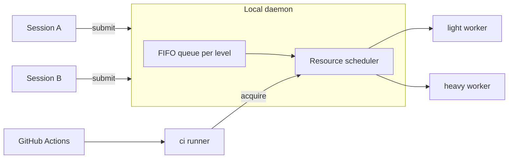

# Al.LocalRunner — design

## Goals
- Parallel agent sessions queue their runs instead of overloading the machine.
- Every run has a mandatory timeout; the whole process tree is killed on expiry or cancel.
- The core is generic; consumers supply profiles.

## Architecture



- `light` and `heavy` are workers of the local daemon. A run executes in the submitter working directory, so uncommitted changes are tested.
- `ci` is a real GitHub Actions self-hosted runner (label `al-ci`). Before executing a job it acquires its resource tags from the same scheduler through the daemon, so it never overlaps a conflicting local run.
- One worker per level by default. More workers per level are allowed; the scheduler enforces the limits.

## Profiles (consumer-supplied)
`.localrunner/profiles.toml` in the consumer repository:

```toml
[profile.rust-unit]
level = "light"
command = "cargo test --workspace"
timeout_s = 900
mem_mb = 4096
cpu = 4
tags = ["cargo"]

[profile.android-tier]
level = "heavy"
command = "pwsh scripts/android-tier.ps1"
timeout_s = 3600
mem_mb = 12288
cpu = 6
tags = ["gradle", "emulator"]
exclusive = ["gradle", "emulator"]
```

- `timeout_s` is required; there is no default and no unbounded run. The daemon enforces an upper cap from its own config.
- `tags` are resources held for the duration of the run; `exclusive` lists tags that no other running job may hold.
- The core never interprets `command`; it only spawns it. A profile with several commands uses `steps`.

### Steps
A profile has either `command` (one step) or `steps` (an ordered sequence); never both.

```toml
[profile.rust-gate]
level = "light"
timeout_s = 1800
tags = ["cargo"]
steps = [
  { name = "fmt",    command = "cargo fmt --all --check", timeout_s = 120 },
  { name = "clippy", command = "cargo clippy --workspace --all-targets -- -D warnings", timeout_s = 600 },
  { name = "test",   command = "cargo test --workspace", timeout_s = 900, mem_mb = 8192 },
]
```

- One job, one place in the queue: steps run back to back and no other job of the level is started between them.
- Resources are acquired once, as the maximum over the steps (memory, CPU) and the union of tags and `exclusive`; a step may override `mem_mb`, `cpu`, `tags`. There is no per-step acquisition, so there is no partial hold and no deadlock.
- Each step has its own `timeout_s` (required) and runs under the remaining job `timeout_s`; the job timeout is required too. A step is killed at the earlier of the two.
- A failed step stops the job; later steps are `skipped`. `continue_on_failure = true` on a step lets the job go on, and the job result is still `failed`.
- Branches, conditions and dependencies between steps are not part of the core; use a script inside `command`.
- Several independent jobs from one session are several submits: each is queued separately and other sessions may run between them.

## Queue and scheduling
- FIFO per level; a job starts when a worker of its level is free and the scheduler grants memory, CPU and tags.
- A job that can never fit the machine limits is rejected on submit with the reason.
- States: `queued` → `running` → `passed | failed | timeout | cancelled`; a step is `passed | failed | timeout | skipped`.
- Each job writes stdout and stderr to `temp/runner/<job-id>.log` in the submitter directory, with a header per step; the submit call returns the job id, and waiting streams progress and returns the exit code.
- Cancel and timeout kill the process tree (Windows Job Object; process group elsewhere).
- Crash safety: the dead-submitter rule is in "Own jobs and early cancel"; a dead job is reaped; leases are tied to the daemon child processes.

## Submitter identity
Every job says who submitted it, so the queue, the page and the log answer "whose is this".

- `--as <name>` is required on `submit` from a session or terminal; a submit without it is rejected (inside GitHub Actions it defaults, see below). It is a free-form label chosen by the caller, for example `claude:session-3`, `codex:review`, `alex`. The core does not enumerate or interpret agents.
- Optional `--note <text>` (what the run is for, up to 200 characters), for example `check fix for #609`.
- Collected by the CLI automatically and not overridable: OS user, host, submitter process id and start time, working directory, and, when the directory is a git worktree, the branch and the worktree root. Collection is generic git/OS data, with no agent knowledge.
- Shown in `status`, the HTML snapshot, the dashboard and the log header: project, source, label, note, branch, directory, age of the job.
- The identity is advisory, not authentication: any local process of the same OS user can submit under any label. The IPC endpoint is restricted to the OS user, which is the actual boundary.
- A label may be reused by a session across jobs; the submitter process id is what links a job to a live caller (see "Own jobs and early cancel" for what happens when it is gone).
- Cancel: by default only a job with the same `--as` and the same OS user; cancelling another label needs `--force`, which is recorded in the log of the cancelled job together with the label of whoever cancelled it.

### Project and source
Besides the label, every job records which project it is for and where it came from. Both are collected by the CLI and cannot be overridden.

- `project`: the normalized `origin` remote (`owner/repo`) of the submitter directory; without a remote, the repository root directory name; outside git, the directory name. Also recorded: the repository root and the worktree root, so two worktrees of one project are told apart.
- `source`, one of:
  - `session` — a submit from a terminal or an agent session; carries the `--as` label, the submitter process id and the directory.
  - `github` — a submit from a GitHub Actions job (detected by `GITHUB_ACTIONS=true`); carries repository, workflow, job, run id and attempt, ref, actor and the run URL. Here `--as` is optional and defaults to `github:<workflow>/<job>`.
- Reading the CI environment lives in a source adapter of the `ci` level; the core queue and scheduler see only the normalized fields. A further source (another CI system) is another adapter, not a change of the core.
- A `github` job has no local submitter process to watch; its liveness comes from the runner process of that job, and a cancelled workflow run cancels the job.
- Every view shows `project`, `source` and the label together, for example `Al.Browser · session · claude:fix-12` or `AiGateway · github · ci.yml/rust-test #4821`, and a `github` job links to its run URL.
- Filtering: `status --project <name>`, `--source <session|github>` and `--as <label>`; the same filters exist as fields in `--json`.

### Own jobs and early cancel
An agent must be able to tell which jobs are its own and stop them before they finish.

- `submit` prints the job id and writes a handle `temp/runner/<job-id>.json` in the submitter directory (label, id, profile, time). After a context loss or a restart the agent finds its jobs from these handles and from the daemon.
- `al-localrunner jobs --mine` lists the jobs of the caller: same OS user and same `--as` label (the label is given or read from the latest handle in the directory). Output is the same as `status` restricted to those jobs, with `--json`. `jobs --mine --active` leaves only `queued` and `running`.
- `al-localrunner cancel <job-id>` cancels one job; `cancel --mine` cancels all active jobs of the caller. Both check ownership as defined in "Submitter identity"; another label needs `--force`.
- Effect of cancel:
  - `queued`: removed from the queue at once, nothing was started.
  - `running`: a graceful stop signal to the process tree (Ctrl+Break on Windows, SIGTERM elsewhere), then, after a grace period (default 10 s, daemon config), the whole tree is killed. The running step ends `cancelled`, the remaining steps are `skipped`, the job is `cancelled`, and held resources are released only after the tree is gone.
  - Already finished: a no-op that reports the final state.
- The cancel reason is written to the job log header: who cancelled (label), when, and `--reason <text>` if given.
- `wait` is only an observer: interrupting `wait` (Ctrl+C, an agent tool timeout) does not cancel the job. The job is cancelled by `cancel`, by its timeout, or by the dead-submitter rule below.
- Dead submitter: when the submitter process is gone, its queued jobs are dropped and its running jobs are killed to free the machine. `submit --detach` opts out for a running job that must outlive the caller; a detached job is still visible and cancellable by its label.
- A `github` job is cancelled by cancelling the workflow run or with `cancel <job-id>` by an operator using `--force`.

## History
Finished jobs are kept and can be looked at later, from any session and for any project.

- Storage: a SQLite database `history.db` in the daemon state directory (public-domain library, compatible with the license rule). One row per job with everything known about it: id, project, source, label, note, branch, directories, profile, level, queued/started/finished times, result, exit code, who cancelled and why, and one row per step with state, times, exit code and timeout. A job is written when it is queued and updated on every state change, so a daemon crash loses at most the last update.
- Logs: the full log stays in `temp/runner/<job-id>.log` of the submitter directory, and the daemon keeps its own copy under `logs/` in the state directory, so the history survives a cleaned worktree. For `github` jobs the run URL is stored as well.
- Retention: by age and by total size, whichever hits first, default 30 days and 2 GB for logs, 365 days for rows (daemon config). Pruning removes the oldest first and never touches active jobs.
- CLI:
  - `al-localrunner history [--project P] [--source session|github] [--as L] [--profile N] [--result R] [--since D] [--limit N]`, newest first, `--json`.
  - `al-localrunner history show <job-id>` — the full record with steps.
  - `al-localrunner log <job-id> [--step NAME] [--tail N]` — reads the stored log; for an unfinished job it follows it.
- Views: `status --html --history` adds a history table to the snapshot; the dashboard has a History tab with the same filters; each row links to its log.
- Statistics from the same data, `al-localrunner stats [--project P] [--profile N]`: runs, pass rate, wait time and duration (median and 95th percentile) per profile and step, share of timeouts and cancellations. Its purpose is to set honest `timeout_s` values and see where the queue waits.
- The history is local to the machine and read-only for views; nothing in it is sent anywhere.

## Viewing the queue
Read-only views of the queue, running jobs and their steps, in three forms of the same data:

- `al-localrunner status` — text; `--json` for agents and scripts.
- `al-localrunner status --html [path]` — writes the dashboard page as one self-contained HTML file with the data embedded, default `temp/runner/queue.html`. A snapshot: it needs no listener, can be opened from disk and attached to a report.
- `al-localrunner dashboard` — live view in a browser. The daemon serves one page and a JSON/SSE feed on `127.0.0.1` only, on a random free port; the URL carries a per-start random token, and requests without it or from another origin are refused. Started on demand and stopped with `Ctrl+C` or `down`; it is the only network listener, absent unless asked for.

What the page shows:
- Per level: workers up or down, free memory and CPU, held tags.
- Running jobs: id, project, source (session or github, with the run link), submitter label, profile, directory, level, elapsed against the job timeout, and the step list with state (`queued`, `running`, `passed`, `failed`, `timeout`, `skipped`), per-step elapsed against its timeout, and the last lines of the running step.
- Queue: position, project, source, submitter label, profile, directory, waiting time, the reason it waits (worker busy, memory, CPU, a held `exclusive` tag and whose).
- Recent finished jobs with the result per step and a link to the log file; the full list with filters is the History tab (see "History").

The page is specified in "Dashboard". The same data model backs all three forms, so a form added later adds no new source of truth. Only cancel is available from the page; everything else stays in the CLI.

## Dashboard
One interactive page that serves both the live `dashboard` and the static `status --html` snapshot: the snapshot embeds the data as JSON and runs the same code with live updates and actions switched off.

Delivery: a single self-contained page embedded in the daemon, with no external scripts, fonts or network requests (works offline). Light and dark theme follow the system; layout works at phone width; keyboard operable with visible focus.

Tabs:
- **Queue** — running and waiting jobs. A row expands into the job card: project, source, label, note, branch, directory, profile, level, why it waits, and the **steps timeline** (a bar per step against its timeout, current step animated, `skipped` greyed). Beside it a **live log** of the selected step: follow mode, pause, text search, copy, download. The card shows the cancel button (see Actions).
- **History** — finished jobs, newest first, a click opens the same card with the stored log.
- **Stats** — per profile and step: pass rate, wait time and duration (median, 95th percentile) as inline SVG charts, and a per-level lane diagram of the day (who held the worker when, gaps, waiting).
- **Runners** — per level: workers up or down, queue length, memory and CPU gauges, held and exclusive tags with the holder of each.

Interaction common to all tabs:
- Filters: project, source, label, level, profile, result, time range, free text; sortable columns; the state lives in the URL hash, so a view is a shareable link, and the last filters are restored from `localStorage`.
- `?as=<label>` highlights and pins the jobs of that label, so an agent or a person can open "my jobs" directly.
- Live updates over one SSE stream with automatic reconnect and a visible connection state; a Pause button freezes the view while reading; new events during a pause show as a counter.
- Export of the current filtered table as CSV or JSON, and `Save snapshot` that writes the same page as a file.
- Shortcuts: `/` search, `j`/`k` move, `Enter` open, `Esc` close, `g q|h|s|r` switch tabs, `?` list shortcuts.

Actions (live mode only):
- **Cancel** a queued or running job, after a confirmation that names the job. A cancel from the page counts as `--force`: it is recorded in the job log and history as cancelled by `dashboard:<os user>` with the reason typed in the dialog. Cancelling all jobs of a project or label is a separate explicit action with the list of jobs in the dialog.
- No submit, no edit of profiles or config, no up or down of runners from the page.

Security:
- Loopback only, random port, per-start token; the token is exchanged for a session cookie (`HttpOnly`, `SameSite=Strict`) on the first request and removed from the address bar.
- Every state-changing request is `POST`, carries a per-session anti-forgery header and passes an `Origin`/`Host` check; reads and the stream require the session cookie.
- Log and field text is rendered as text, never as markup; strict Content-Security-Policy without inline script evaluation; logs are not indexed or cached.
- A snapshot file contains logs only when `--with-logs` is given, because logs may hold secrets from the profile commands.

## Transport and state
- Local IPC only: named pipe on Windows, Unix socket elsewhere. No network listener, except the optional loopback-only `dashboard` described above.
- State and runner directories under `%LOCALAPPDATA%\Al.LocalRunner` (`~/.local/share/al-localrunner` elsewhere).
- The `ci` runner lives in its own directory and registers per repository with a token supplied by the user at install time; the token is never stored by the plugin.

## Operating systems
Windows, Linux and macOS are first-class. The core is OS-neutral; everything that differs lives in one file per OS under `plugin/shared/os/` (`windows.md`, `linux.md`, `macos.md`) and is read by the install, up and down skills:

| Concern | Windows | Linux | macOS |
|---|---|---|---|
| IPC | named pipe | Unix socket in `$XDG_RUNTIME_DIR` | Unix socket in the state directory |
| Tree kill | Job Object | process group or cgroup | process group |
| `ci` supervision | user-session process | systemd user unit | LaunchAgent (GUI domain) |
| Emulator acceleration | WHPX or Hyper-V | KVM | HVF, arm64 images on Apple Silicon |
| Sleep prevention | `SetThreadExecutionState` | none by default | `caffeinate -i` |

The `ci` runner is never a system service on any OS: it must run in the user session to see the user toolchains, caches and devices. Daemon code selects the OS-specific parts behind one internal interface; consumer profiles stay OS-neutral where they can and use per-OS `command` variants where they cannot.

## Skills contract
| Skill | Inputs | Result |
|---|---|---|
| `install-runner` | repository for `ci` (optional), registration token (asked, not stored) | daemon installed; `ci` runner configured if absent; idempotent |
| `up-runner` | levels (default `light,heavy,ci`), workers per level (default 1) | runners running; prints status |
| `down-runner` | levels, `--drain` or `--cancel` | runners stopped; queue handled as asked |
| `status-runner` | optional `--html`, `dashboard`, `history`, `stats` | queue, running jobs with steps, waiting time and reason, free resources; text, JSON, HTML snapshot or live page |
| `run` | submitter label (`--as`), optional note, profile, level override, timeout override (lowered only) | job id, log path, exit code, result per step |

## Out of scope
- Phones and physical devices over USB/ADB.
- Submitting jobs, editing profiles or config, and starting or stopping runners from the web page (only cancel is there).
- Any consumer-specific command or toolchain knowledge inside the core.
